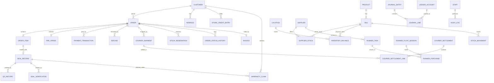

# System Architecture & Technical Specification — NCAMart

**Document Version:** 1.1 (Final for Phase 1 build)  
**Status:** Approved Architecture  
**Date:** 2026-10-15  
**Target Domain:** [ncamart.com](https://ncamart.com)  
**Source of Requirements:** [PRD.md](./PRD.md) v1.4 (supersedes conflicting values in [requirement-validation.md](./requirement-validation.md), see PRD §13)

### Change Log
| Version | Date | Changes |
| :--- | :--- | :--- |
| 1.0 | 2026-10-15 | Initial proposal (Next.js + NestJS options, Redis cart lock, open ORM choice). |
| 1.1 | 2026-10-15 | **Final decisions:** Next.js full-stack modular monolith + worker process; Drizzle ORM; PostgreSQL-backed inventory reservations; in-house double-entry ledger & COD/gateway reconciliation; progressive pre-order deposit; corrected Crockford Base32 seal generator; CGNAT-safe rate limiting & clone detection; DB-backed revocable sessions; transactional outbox; HA/backup plan with RPO/RTO; Cloudflare Pro instead of Enterprise. |

---

## 1. Architectural Summary & Principles

NCAMart is a **high-trust, operations-heavy commerce platform**: a bilingual storefront, a cryptographic seal verification portal, and internal tools for godown QC, dispatch, field runners, showroom POS, support, and finance.

**Principles**
1. **Zero client-side financial trust** — prices, discounts, deposits, delivery fees, and VAT are always computed on the server from database records.
2. **PostgreSQL is the source of truth** — orders, payments, inventory reservations, ledger, and the event outbox live in Postgres and change inside one ACID transaction. Redis is used only for things that may be lost and rebuilt (rate limits, OTPs, queues, cache).
3. **Every external call is asynchronous and retryable** — SSLCommerz, couriers, SMS/WhatsApp, and email go through BullMQ jobs fed by a transactional outbox.
4. **Explicit state machines** — orders, payments, seals, refunds, and settlements only move through defined transitions.
5. **Append-only records** — journal entries, stock movements, seal events, order status history, and audit logs can never be updated or deleted.
6. **Money is integer paisa** — no floating point in storage or calculations.

---

## 2. Architecture Pattern: Modular Monolith on Next.js

**One repository, one codebase, two processes:**

| Process | Runs | Why separate |
| :--- | :--- | :--- |
| **web** (Next.js server, `output: 'standalone'`) | Storefront SSR/ISR, `/verify`, admin, POS, runner PWA, REST API route handlers, webhooks, SSE | Request/response traffic |
| **worker** (Node.js, same code) | BullMQ consumers, scheduled jobs (crons), outbox relay | Long-running and scheduled work must not run inside HTTP request handlers |

Both processes import the same domain modules from `src/modules/*`, so business logic is written once.

```
┌──────────────────────────────────────────────────────────────────────────────┐
│                               Cloudflare (Pro)                               │
│                    DNS · WAF · DDoS · CDN · Turnstile CAPTCHA                │
└───────────────────────────────────────┬──────────────────────────────────────┘
                                        │
┌───────────────────────────────────────▼──────────────────────────────────────┐
│                     App VPS (Singapore) — Docker Compose                     │
│                                                                              │
│  ┌──────────┐   ┌────────────────────────┐   ┌────────────────────────────┐  │
│  │  Caddy   │──►│ web × 2 (Next.js)      │   │ worker × 1 (Node.js)       │  │
│  │ TLS/proxy│   │ Storefront · Admin ·   │   │ BullMQ jobs · Crons ·      │  │
│  └──────────┘   │ POS · Runner PWA · API │   │ Outbox relay               │  │
│                 └───────────┬────────────┘   └─────────────┬──────────────┘  │
│                             │                              │                 │
│                 ┌───────────▼──────────────────────────────▼──────────────┐  │
│                 │ src/modules/* (shared domain code)                      │  │
│                 │ identity · catalog · inventory · orders · preorder ·    │  │
│                 │ payments · ledger · logistics · sourcing · trust ·      │  │
│                 │ rma · promotions · notifications · search · analytics · │  │
│                 │ audit                                                   │  │
│                 └───────────┬──────────────────────────────┬──────────────┘  │
│                             │                              │                 │
│        ┌────────────────────▼───┐   ┌──────────────────────▼─────────────┐   │
│        │ Redis 7 (AOF)          │   │ Meilisearch                        │   │
│        │ queues · rate limits · │   │ Bangla/English/Banglish search     │   │
│        │ OTP · cache · pub/sub  │   │ (rebuildable from Postgres)        │   │
│        └────────────────────────┘   └────────────────────────────────────┘   │
└───────────────────────────────────────┬──────────────────────────────────────┘
                                        │
         ┌──────────────────────────────▼───────────┐   ┌──────────────────────┐
         │ Managed PostgreSQL 16 (Singapore)        │   │ Cloudflare R2        │
         │ primary + standby · PITR · daily backups │   │ media · invoices ·   │
         └──────────────────────────────────────────┘   │ backups · audit WORM │
                                                        └──────────────────────┘
```

**Module boundary rules**
- A module exposes only its `service.ts` functions and event types; other modules never import its tables or repositories (enforced with an ESLint `no-restricted-imports` / dependency-cruiser rule in CI).
- Cross-module side effects (send SMS, book courier, update search index) go through **outbox events**, never direct calls to external services inside a transaction.
- If a module ever needs to become its own service (Phase 2+), its boundary is already clean.

---

## 3. Final Technology Stack

| Layer | Choice | Reason |
| :--- | :--- | :--- |
| Framework | **Next.js 15 (App Router) + React 19** | SSR/ISR for SEO and fast mobile loads; one codebase for storefront, admin, POS, runner PWA and API. |
| Language | **TypeScript (strict)** | End-to-end types shared by UI, API, worker. |
| Database | **PostgreSQL 16 (managed)** | ACID, row-level locking, JSONB for QC checklists, PITR. |
| ORM | **Drizzle ORM + drizzle-kit migrations** | SQL-close, supports `SELECT … FOR UPDATE` / `SKIP LOCKED`, conditional updates and raw SQL needed for ledger, reservations and outbox; no heavy runtime engine. |
| Queue & scheduler | **BullMQ on Redis 7** | Retries with backoff, delayed jobs (quiet hours), repeatable jobs (crons). |
| Cache / rate limit / OTP | **Redis 7 (AOF enabled)** | Fast, TTL-based; all data here is rebuildable. |
| Search | **Meilisearch** (self-hosted) | Typo tolerance, synonyms for Bangla/Banglish, fast filters. |
| Validation | **Zod** | Shared request/response schemas; OpenAPI generated from Zod for REST routes. |
| UI | **Tailwind CSS + shadcn/ui (Radix)** | Accessible primitives, dense admin tables, consistent design system. |
| Client data | **TanStack Query + Zustand** | Server-state caching, optimistic updates; small client state (cart UI). |
| i18n | **next-intl** | `/bn` and `/en` routes, Bangla numerals in Bangla UI, `hreflang`. |
| Fonts | **next/font: Hind Siliguri + Inter** | Self-hosted, no layout shift. |
| Runner PWA | **Serwist (Workbox) + IndexedDB (Dexie)** | Offline task list and purchase queue, scoped to `/runner`. |
| Object storage | **Cloudflare R2** (S3 API) | No egress fees; presigned multipart uploads for RMA videos. |
| Staff 2FA | **otplib (TOTP)** + **argon2id** password hashing | Standard authenticator apps. |
| Label printing | **QZ Tray** (or small local print agent) sending TSPL/ZPL | Reliable raw printing to thermal printers from the browser. |
| Analytics | **PostHog** + **GA4** + **Meta Pixel / Conversions API** | KPI tracking incl. server-side events. |
| Monitoring | **Sentry**, **Better Stack** (uptime + cron heartbeats), bull-board (Super Admin only) | Errors, uptime, missed crons, queue health. |
| Testing | **Vitest**, **Testcontainers (Postgres)**, **Playwright** | Unit, integration, E2E with SSLCommerz sandbox. |
| Delivery | **Docker**, **GitHub Actions**, **GHCR** | Reproducible builds, staged deploys. |

**Why not Vercel/serverless:** the system needs long-running workers, scheduled jobs, SSE connections, a fixed Singapore region near the database, and predictable cost. Next.js is self-hosted in standalone mode.

---

## 4. Repository Structure

```
ncamart/
├─ src/
│  ├─ app/
│  │  ├─ [locale]/(store)/…        # storefront pages (bn / en)
│  │  ├─ [locale]/verify/…         # seal verification portal
│  │  ├─ [locale]/account/…        # customer portal
│  │  ├─ admin/…                   # staff portal: catalog, QC, dispatch, support, finance
│  │  ├─ pos/…                     # showroom POS mode
│  │  ├─ runner/…                  # runner PWA (service worker scope: /runner)
│  │  └─ api/v1/…                  # REST route handlers, webhooks, feeds, SSE
│  ├─ modules/
│  │  └─ <module>/                 # identity, catalog, inventory, orders, preorder, payments,
│  │     ├─ service.ts             # ledger, logistics, sourcing, trust, rma, promotions,
│  │     ├─ repo.ts                # notifications, search, analytics, audit
│  │     ├─ schema.ts              # Drizzle tables owned by this module
│  │     ├─ events.ts              # outbox event types
│  │     ├─ policies.ts            # RBAC permission checks
│  │     └─ *.test.ts
│  ├─ worker/
│  │  ├─ index.ts                  # starts BullMQ workers + schedulers + outbox relay
│  │  └─ jobs/*.ts
│  ├─ lib/                         # db, redis, money, rbac, i18n, errors, idempotency
│  └─ db/migrations/
├─ docker/                         # Dockerfile, compose files, Caddyfile
└─ .github/workflows/
```

---

## 5. API Design

1. **Two entry styles, one service layer**
   - **REST route handlers (`/api/v1/*`)** for anything called from outside the React tree: webhooks, runner PWA sync, `/verify`, checkout, uploads, feeds, and future native apps.
   - **Server Actions** only for internal form mutations in admin/storefront pages.
   - Both call the same `modules/*/service.ts` functions, so rules are never duplicated.
2. **Validation:** Every input is parsed with Zod (phone regex, Crockford seal regex, money as integer paisa, enums). OpenAPI spec is generated from the Zod schemas for REST routes.
3. **Error format:** `{"error": {"code": "ERR_MIXED_CART_DISALLOWED", "message": "...", "details": {...}}}` with a matching HTTP status (422 for business rule violations).
4. **Idempotency:** `Idempotency-Key` header required on checkout, payment initiation, refunds, POS sales and runner sync. Stored in an `idempotency_keys` table (key, scope, request hash, response, 24h TTL); a repeated key returns the stored response.
5. **Key endpoints**

| Area | Endpoint | Notes |
| :--- | :--- | :--- |
| Auth | `POST /api/v1/auth/otp/send` · `POST /api/v1/auth/otp/verify` · `POST /api/v1/auth/logout` | Rate limited (§7.4). |
| Verify | `GET /api/v1/verify?q={sealOrSerial}` | Turnstile when limits exceeded. |
| Cart/Checkout | `POST /api/v1/cart/validate` · `POST /api/v1/checkout` | Mixed-cart rule, server pricing, reservations. |
| Payments | `POST /api/v1/payments/sslcommerz/{ipn,success,fail,cancel}` | Hash + Validation API. |
| RMA | `POST /api/v1/rma/claims` · `POST /api/v1/media/uploads` · `POST /api/v1/media/uploads/{id}/complete` | Presigned multipart to R2. |
| Couriers | `POST /api/v1/webhooks/couriers/{courier}` | Per-courier authentication. |
| Runner | `GET /api/v1/runner/tasks` · `POST /api/v1/runner/sync` | Batch, idempotent per mutation. |
| QC | `POST /api/v1/qc/records` · `POST /api/v1/qc/seals/{sealId}/void` | Staff session + TOTP. |
| POS | `POST /api/v1/pos/pickups/verify` · `POST /api/v1/pos/sales` | PIN attempt limits. |
| Finance | `POST /api/v1/finance/courier-settlements` (CSV) · `GET /api/v1/finance/reports/*` | Finance role. |
| Realtime | `GET /api/v1/events/stream` (SSE) | Staff alerts via Redis pub/sub fan-out. |
| Feeds | `GET /feeds/google.xml` · `GET /feeds/meta.csv` | Regenerated hourly, cached at CDN. |

---

## 6. Identity, Sessions & RBAC

### 6.1 Customer login (phone OTP)
- Phone normalized to `+8801XXXXXXXXX` after regex `^(?:\+8801|01)[3-9]\d{8}$`.
- OTP: `crypto.randomInt(100000, 1000000)`, stored **hashed** in Redis key `otp:{phone}` with 180s TTL and attempt counter (max 3).
- Dormancy rule (PRD §3.5): if `last_active_at` is older than 12 months, the new session is created with `ownership_unconfirmed = true`; order history, addresses and warranties are hidden until confirmed.

### 6.2 Sessions (DB-backed, revocable)
- Opaque random 32-byte token in cookie `nca_sid`; only its SHA-256 hash is stored in the `sessions` table (cached in Redis for 60s).
- Cookie flags: `HttpOnly; Secure; SameSite=Lax; Path=/`. **Lax, not Strict**, because returning from SSLCommerz is a cross-site navigation; the success handler itself never relies on the cookie (§9.1).
- Customers: 30-day sliding expiry. Staff: 12-hour expiry, TOTP required at login, remote revoke by Super Admin.
- Next.js `middleware.ts` only checks cookie presence for coarse redirects; real session and permission checks happen in route handlers, Server Actions and server layouts (middleware cannot safely query Postgres).

### 6.3 RBAC
- Roles from PRD §3.9 map to permission strings, e.g. `qc.execute`, `seal.void.approve`, `refund.approve.lte_1000`, `finance.reconcile`.
- Every service function checks permissions through `policies.ts` (`assertCan(actor, 'refund.approve', { amount })`).
- **PII masking is done by role-specific serializers** — runner endpoints use a DTO that physically has no name/phone/address fields, so data cannot leak by mistake.
- Every read of full customer PII by staff writes an audit entry.

---

## 7. Trust & Verification Engine

### 7.1 Seal ID generation (corrected)
```typescript
import { randomInt } from 'node:crypto';

// Crockford Base32: 32 symbols, excludes I, L, O, U
const ALPHABET = '0123456789ABCDEFGHJKMNPQRSTVWXYZ';
export const SEAL_REGEX = /^NCA-[0-9A-HJKMNP-TV-Z]{4}-[0-9A-HJKMNP-TV-Z]{4}$/;

export function generateSealId(): string {
  let body = '';
  for (let i = 0; i < 8; i++) body += ALPHABET[randomInt(32)]; // unbiased CSPRNG
  return `NCA-${body.slice(0, 4)}-${body.slice(4)}`;
}

export function normalizeSealInput(raw: string): string | null {
  const cleaned = raw.toUpperCase().replace(/[\s-]/g, '').replace(/O/g, '0').replace(/[IL]/g, '1');
  const body = cleaned.startsWith('NCA') ? cleaned.slice(3) : cleaned;
  if (!/^[0-9A-HJKMNP-TV-Z]{8}$/.test(body)) return null;
  return `NCA-${body.slice(0, 4)}-${body.slice(4)}`;
}
```
- Space: 32⁸ ≈ 1.1 × 10¹². Inserted with a unique constraint; on the (very rare) collision the generator retries.

### 7.2 Seal state machine
`generated` → `printed` → `active` (only after a passing QC record exists) → `claimed` / `expired`.
`generated` or `printed` → `void_print_error` (requires reason + Godown/Sourcing Manager approval). Every change writes a row in append-only `seal_events`.

### 7.3 Cloned seal detection (CGNAT-safe)
- Each lookup stores `(seal_id, device_id, ip, geo_district, created_at)` in `seal_verifications` (monthly partitions, 12-month retention). `device_id` is a random first-party cookie `nca_did` — no fingerprinting.
- Job every 5 minutes:
```sql
SELECT seal_id
FROM seal_verifications
WHERE created_at > now() - interval '24 hours'
GROUP BY seal_id
HAVING COUNT(DISTINCT device_id) >= 5
   AND COUNT(DISTINCT geo_district) >= 2;
```
- Lookup of a `void_print_error` seal raises the alert immediately. Alerts are de-duplicated per seal per 24h and pushed as Class A internal notifications.

### 7.4 Rate limits (Redis sliding window)
| Endpoint | Limit | On exceed |
| :--- | :--- | :--- |
| `/verify` | 5/min per device, 60/min per IP | Turnstile challenge; repeated abuse → 15-min block |
| OTP send | 3 per 10 min per phone, 20/hour per IP | 1-hour cooldown |
| OTP verify | 3 attempts per OTP | OTP invalidated |
| Checkout | 10/hour per customer | Flag for review |
| Pickup PIN | 5 wrong attempts per order | Locked until Support reset |

### 7.5 Label printing
- QC station prints through **QZ Tray** (signed requests) or a small local agent; label content: Seal ID, QR (`https://ncamart.com/verify?q=NCA-XXXX-XXXX`), tier mark.
- "Void & Re-print" never reprints the same ID; it voids the old ID and issues a new one.

---

## 8. Inventory, Orders & State Machines

### 8.1 Inventory model
- **Virtual stock:** `supplier_stock` status per supplier/SKU; never reserved.
- **Physical stock:** `inventory_balances(sku_id, location_id, on_hand, reserved)` with `CHECK (reserved >= 0 AND on_hand >= reserved)`. Each change also writes an append-only `stock_movements` row in the same transaction; a nightly job checks `on_hand` = sum of movements.

### 8.2 Reservation (PostgreSQL, no Redis lock)
```sql
-- Reserve inside the checkout transaction (atomic, no explicit lock needed)
UPDATE inventory_balances
SET reserved = reserved + $qty
WHERE sku_id = $sku AND location_id = $loc AND on_hand - reserved >= $qty
RETURNING on_hand, reserved;        -- 0 rows = not enough stock

INSERT INTO stock_reservations (order_id, sku_id, location_id, qty, expires_at, status)
VALUES ($order, $sku, $loc, $qty, now() + interval '10 minutes', 'active');
```
- **Commit on payment/COD confirmation:** `UPDATE stock_reservations SET status='committed' WHERE id=$id AND status='active'`; if 1 row → decrement `on_hand` and `reserved`, write movement. If 0 rows (already expired) → try to reserve again → else switch the line to virtual sourcing → else auto-refund (PRD §3.6.3).
- **Expiry job (every minute):**
```sql
WITH expired AS (
  UPDATE stock_reservations SET status = 'released'
  WHERE status = 'active' AND expires_at < now()
  RETURNING sku_id, location_id, qty
)
UPDATE inventory_balances b
SET reserved = b.reserved - e.qty
FROM (SELECT sku_id, location_id, SUM(qty) AS qty FROM expired GROUP BY 1, 2) e
WHERE b.sku_id = e.sku_id AND b.location_id = e.location_id;
```
The `status='active'` condition on both commit and release means only one of them can win for a given reservation.

### 8.3 Order state machine
- Allowed transitions are declared as data (from PRD §3.12) and enforced by one function:
```typescript
export async function transitionOrder(tx: Tx, orderId: string, to: OrderStatus, actor: Actor, reason?: string) {
  const [order] = await tx.select().from(orders).where(eq(orders.id, orderId)).for('update');
  const allowed = TRANSITIONS[order.orderType][order.status] ?? [];
  if (!allowed.includes(to)) throw new BusinessError('ERR_ILLEGAL_TRANSITION', { from: order.status, to });
  await tx.update(orders).set({ status: to, updatedAt: new Date() }).where(eq(orders.id, orderId));
  await tx.insert(orderStatusHistory).values({ orderId, fromStatus: order.status, toStatus: to, actor: actor.id, reason });
  await tx.insert(outbox).values({ type: 'order.status_changed', payload: { orderId, from: order.status, to } });
}
```
- Courier statuses are normalized per adapter (e.g. Steadfast `delivered` / Pathao `Delivered` → `DELIVERED`; partial delivery → `PARTIALLY_DELIVERED`; return statuses → `RTO_IN_TRANSIT`).
- Mixed-cart rule is checked in `cart/validate` and again in `checkout` (`ERR_MIXED_CART_DISALLOWED`, HTTP 422).

### 8.4 Pre-order deposit (progressive, integer paisa)
```typescript
const BREAK = 5_000_000; // ৳50,000 in paisa

export function unitDepositPaisa(unitPricePaisa: number): number {
  // 20% of the first ৳50,000 + 10% of the rest, computed in integer hundredths
  const scaled = Math.min(unitPricePaisa, BREAK) * 20 + Math.max(unitPricePaisa - BREAK, 0) * 10;
  const deposit = Math.ceil(scaled / 100);               // paisa
  const roundedUp10Taka = Math.ceil(deposit / 1000) * 1000; // ৳10 = 1000 paisa
  return Math.min(roundedUp10Taka, unitPricePaisa);
}

export function orderDepositPaisa(lines: { unitPricePaisa: number; qty: number }[]): number {
  return lines.reduce((sum, l) => sum + unitDepositPaisa(l.unitPricePaisa) * l.qty, 0);
}
```
- `unitPricePaisa` is the unit price after allocated coupon discount.
- Balance COD allowed only if `balance <= PREORDER_COD_BALANCE_MAX` (config, default ৳30,000) and customer is not COD-blocked.
- Unit tests cover the PRD §3.3.2 table (৳30k → ৳6,000; ৳50k → ৳10,000; ৳80k → ৳13,000; ৳150k → ৳20,000; ৳300k → ৳35,000).

---

## 9. Payments (SSLCommerz)

### 9.1 Flow
1. `POST /api/v1/checkout` (one transaction): price lines on server, apply coupon/store credit, create order `PENDING_PAYMENT` / `DEPOSIT_PENDING`, reserve physical stock, create `payment_transactions` row (`tran_id`, purpose, amount, `PENDING`). After commit, call the SSLCommerz session API and return the gateway URL.
2. **IPN** (`/payments/sslcommerz/ipn`): verify `verify_sign` with the store password, then call the **Order Validation API** with `val_id`; check `tran_id`, amount and currency match. `risk_level = 1` → `HOLD_REVIEW` (Support queue). Otherwise, in one transaction: mark payment `PAID` (idempotent on `tran_id`), commit reservations, transition order, post ledger entry, write outbox events.
3. **Success URL** (cross-site POST): runs the same idempotent validation, then responds `303` to `GET /{locale}/account/orders/{orderNo}`, where the Lax session cookie is available.
4. **Reconciliation job (every 5 min):** `PENDING` transactions older than 10 minutes and newer than 24 hours are queried by `tran_id`; `VALID`/`VALIDATED` → same success path. Unpaid orders auto-cancel after 24 hours.

### 9.2 Refunds
- Gateway refunds via the SSLCommerz refund API (using `bank_tran_id`) where supported; refund status polled until final.
- Otherwise Finance pays manually (bKash/Nagad/bank) and records reference + proof upload.
- Approval limits enforced by RBAC policy (PRD §3.14). Every refund posts a ledger entry and sends a Class A notification.

### 9.3 COD eligibility
```
delivered_order_count >= 1 AND rto_count_12m == 0  → 100% COD
rto_count_12m >= 2 (or cod_blocked)                → COD hidden
otherwise                                          → advance base delivery fee online, rest COD
```
`rto_count_12m` is recomputed from shipment history (rolling window), not a lifetime counter.

---

## 10. Finance Ledger & Reconciliation

### 10.1 Tables & invariants
- `ledger_accounts`, `journal_entries(id, event_type, source_type, source_id, posted_at, posted_by, reversal_of)`, `journal_lines(entry_id, account_id, sub_ledger_ref, debit, credit)`.
- Unique `(event_type, source_type, source_id)` → the same business event can never post twice.
- `CHECK (debit >= 0 AND credit >= 0 AND (debit = 0) <> (credit = 0))` — each line is exactly one side.
- Balanced entries enforced by the database:
```sql
CREATE FUNCTION assert_entry_balanced() RETURNS trigger AS $$
BEGIN
  IF (SELECT COALESCE(SUM(debit), 0) - COALESCE(SUM(credit), 0)
      FROM journal_lines WHERE entry_id = NEW.entry_id) <> 0 THEN
    RAISE EXCEPTION 'Unbalanced journal entry %', NEW.entry_id;
  END IF;
  RETURN NULL;
END $$ LANGUAGE plpgsql;

CREATE CONSTRAINT TRIGGER journal_balanced
AFTER INSERT ON journal_lines
DEFERRABLE INITIALLY DEFERRED
FOR EACH ROW EXECUTE FUNCTION assert_entry_balanced();
```
- Postings happen inside the same transaction as the business change via `ledger.post(tx, event, refs)`.

### 10.2 Chart of accounts (Phase 1)
| Code | Account | Type |
| :--- | :--- | :--- |
| 1000 | Cash – Office | Asset |
| 1010 | Cash – Showroom Drawer | Asset |
| 1020 | Cash – Runner Float (per runner) | Asset |
| 1030 | Bank | Asset |
| 1040 | bKash/Nagad Merchant Wallet | Asset |
| 1100 | SSLCommerz Clearing | Asset |
| 1110 | Courier COD Receivable (per courier) | Asset |
| 1200 | Inventory | Asset |
| 2000 | Customer Advances (per order) | Liability |
| 2010 | Customer Deposits – Pre-Order (per order) | Liability |
| 2020 | Store Credit (per customer) | Liability |
| 2100 | VAT Payable | Liability |
| 2200 | Supplier Payable (per supplier) | Liability |
| 3000 | Owner's Equity | Equity |
| 4000 | Sales Revenue | Income |
| 4010 | Sales Discounts (contra) | Income |
| 4020 | Delivery Fee Revenue | Income |
| 4030 | Forfeited Deposit Income | Income |
| 4040 | Sales Returns (contra) | Income |
| 5000 | Cost of Goods Sold | Expense |
| 5100 | Courier Delivery Charges | Expense |
| 5110 | COD Charges | Expense |
| 5120 | Return / RTO Charges | Expense |
| 5200 | Gateway Fees | Expense |
| 5300 | Inventory Write-off & Damage | Expense |
| 5310 | Cash Variance | Expense |
| 5400 | Goodwill & Vouchers | Expense |

### 10.3 Posting rules
| Business event | Debit | Credit |
| :--- | :--- | :--- |
| Online payment validated (full/balance/advance fee) | 1100 | 2000 |
| Pre-order deposit validated | 1100 | 2010 |
| Store credit applied to order | 2020 | 2000 or 2010 |
| Delivered / counter handover — revenue | 2000 & 2010 (prepaid part) + 1110 (courier COD part) or 1010/1040/1030 (paid at counter) + 4010 (coupon discount) | 4000 (paid amount ex-VAT + discount) + 2100 (VAT) + 4020 (delivery fee) |
| Delivered — cost | 5000 | 1200 |
| Walk-in POS sale | 1010 / 1040 / 1030 | 4000 + 2100; plus 5000 / 1200 for cost |
| Runner cash purchase | 1200 | 1020 |
| Supplier credit purchase / supplier paid | 1200 / 2200 | 2200 / 1030 or 1000 |
| Float issued / returned | 1020 / 1000 | 1000 / 1020 |
| Float or drawer shortage | 5310 | 1020 or 1010 |
| Courier payout matched | 1030 (net) + 5100 + 5110 + 5120 | 1110 |
| Gateway settlement matched | 1030 (net) + 5200 | 1100 |
| Refund before delivery | 2000 or 2010 | 1100 (gateway) or 1040/1030 (manual) or 2020 (customer chose credit) |
| Refund after delivery (RMA) | 4040 + 2100 | 1100 / 1040 / 1030 / 2020; returned unit 1200 / 5000 at cost |
| Pre-order deposit forfeited | 2010 | 4030 |
| RTO received — advance fee retained | 2000 | 4020 |
| Goodwill store credit / voucher | 5400 | 2020 |
| Withdrawable store credit paid out | 2020 | 1040 / 1030 |
| Stock write-off (approved) | 5300 | 1200 |
| Supplier refunds rejected batch in cash | 1020 | 1200 |

A property-based unit test runs every posting rule with random amounts and asserts that debits equal credits.

### 10.4 Courier COD reconciliation
1. Booking stores `expected_cod` on `courier_shipments`.
2. `DELIVERED` → revenue posting debits 1110 for the COD amount (partial delivery → only delivered lines).
3. Payouts arrive via adapter `fetchSettlements()` (if the courier has an API) or Finance CSV upload → `courier_settlements` + lines.
4. Matching job per line by `consignment_no`: exact → `MATCHED` and post settlement entry; otherwise `SHORT_PAID` / `OVER_PAID` / `UNKNOWN_CONSIGNMENT`.
5. Daily 09:00 job: delivered shipments not found in any payout after 7 days → `MISSING` exception; aging report by courier.

### 10.5 Gateway settlement reconciliation
SSLCommerz settlement report (CSV/API) → `gateway_settlements` + lines matched by `tran_id`; fees posted to 5200; unmatched lines go to the Finance exception queue.

### 10.6 Runner float & cash drawer
- `runner_float_sessions` open/close with counted cash; `runner_purchases` link to the session. Variance requires Sourcing Manager + Finance approval before the session can close.
- `cash_drawer_sessions` for each POS shift; same variance flow.

### 10.7 Reports
Trial balance, P&L, courier receivable aging, customer deposits balance (2010), store credit liability (2020), runner float status, supplier payables, VAT sales register — all exportable to CSV/Excel.

---

## 11. Sourcing & Runner PWA

### 11.1 Spot price tolerance
```
allowed = quoted_unit_price <= base_cost × (1 + spot_buffer_pct)
          AND (list_price_ex_vat − quoted_unit_price) / list_price_ex_vat >= 0.15
```
If not allowed → task `AWAITING_APPROVAL`, SSE alert to Sourcing Managers; if not acknowledged in 5 minutes → WhatsApp/SMS alert job.

### 11.2 Offline sync
- Service worker (Serwist) caches the `/runner` shell; tasks are stored in IndexedDB on each online fetch.
- Each offline action is queued as `{ client_mutation_id (UUID), type, payload, recorded_at }` with the receipt photo as a Blob.
- Sync triggers: app comes to foreground, every 60s while open and online, manual "Sync now" (iOS has no Background Sync API).
- `POST /api/v1/runner/sync` processes each mutation in its own transaction; `runner_purchases.client_mutation_id` is unique, so retries are harmless. Per-item result: `ok` / `conflict` (task cancelled/reassigned → item received into godown physical stock, manager notified) / `quarantined` (session revoked).
- Receipt photos upload separately via presigned URL after the purchase row is accepted.
- Runner DTOs contain no customer PII, so the IndexedDB data is low-risk if a phone is lost.

---

## 12. Logistics

```typescript
export interface CourierAdapter {
  code: 'steadfast' | 'pathao' | 'redx';
  createShipment(input: ShipmentInput): Promise<{ consignmentNo: string; trackingUrl?: string }>;
  createReturnPickup?(input: ReturnPickupInput): Promise<{ consignmentNo: string }>; // only if the courier supports it
  getStatus(consignmentNo: string): Promise<NormalizedCourierEvent>;
  parseWebhook(req: Request): Promise<NormalizedCourierEvent[]>; // verifies courier auth first
  fetchSettlements?(since: Date): Promise<SettlementLineInput[]>;
}
```
- Booking jobs retry at 1m, 5m, 15m, 30m; then the shipment appears in the Dispatch Staff manual console with one-click switch to another courier.
- `courier_location_map` maps our Division/District/Thana/Area to each courier's location IDs.
- Polling fallback every 30 minutes for shipments with no event in 24 hours.
- If a courier lacks a reverse-pickup API, the RMA flow creates a manual booking task for Dispatch Staff.

---

## 13. Notifications

### 13.1 Pipeline
Business transaction → `outbox` row → relay → BullMQ `notifications` queue → channel provider. Every attempt is written to `notification_logs`.

### 13.2 Quiet hours by class (Asia/Dhaka is UTC+6, no DST)
```typescript
type NotificationClass = 'A' | 'B' | 'C';
const DHAKA_OFFSET_MS = 6 * 60 * 60 * 1000;

/** Returns when a message of this class may be sent (now, or next 08:00 Dhaka). */
export function nextAllowedSendTime(cls: NotificationClass, now = new Date()): Date {
  if (cls === 'A') return now;
  const dhaka = new Date(now.getTime() + DHAKA_OFFSET_MS); // read with getUTC* = Dhaka wall clock
  const hour = dhaka.getUTCHours();
  if (hour >= 8 && hour < 22) return now;
  const addDay = hour >= 22 ? 1 : 0;
  const next0800DhakaUtcMs =
    Date.UTC(dhaka.getUTCFullYear(), dhaka.getUTCMonth(), dhaka.getUTCDate() + addDay, 8, 0, 0) - DHAKA_OFFSET_MS;
  return new Date(next0800DhakaUtcMs);
}
```
Class C additionally requires `marketing_opt_in = true`.

### 13.3 Reliability
- Circuit breaker on the primary SMS provider: > 10% failures in 5 minutes → route to WhatsApp or secondary SMS for 10 minutes, then half-open retry.
- Class A messages that exhaust retries go to a dead-letter queue visible to Support.

---

## 14. Search, Analytics & Feeds
- **Meilisearch** index updated by outbox events on product publish/update; synonyms list (e.g., চার্জার ↔ charger, ক্যাবল ↔ cable); full reindex command available.
- **Analytics:** client events via PostHog/GA4; revenue-critical events (`order_placed`, `payment_succeeded`, `verify_lookup`, `rma_submitted`, `rto`) are sent server-side from the worker. Consent banner controls non-essential tracking.
- **Feeds:** hourly job writes Google Merchant XML and Meta CSV to R2; served via `/feeds/*` with CDN caching.

---

## 15. Data & Integrity

### 15.1 Entity relationships

Full field list: PRD §7.

### 15.2 Append-only enforcement
- Tables: `journal_entries`, `journal_lines`, `stock_movements`, `seal_events`, `order_status_history`, `audit_logs`.
- The application DB role has only `INSERT`/`SELECT` on them, and a trigger rejects `UPDATE`/`DELETE` even for other roles:
```sql
CREATE FUNCTION forbid_mutation() RETURNS trigger AS $$
BEGIN RAISE EXCEPTION 'append-only table: %', TG_TABLE_NAME; END $$ LANGUAGE plpgsql;
-- applied per table:
CREATE TRIGGER journal_lines_append_only BEFORE UPDATE OR DELETE ON journal_lines
FOR EACH ROW EXECUTE FUNCTION forbid_mutation();
```
- `audit_logs` rows are hash-chained (`hash = sha256(prev_hash || row)`); inserts take `pg_advisory_xact_lock` on the chain to keep order (staff action volume is low). A nightly job exports the day's audit rows + final hash to R2 with Object Lock.

### 15.3 Transactional outbox
`outbox(id, type, payload, created_at, published_at)` is written in the same transaction as the business change. The relay (worker) reads with `FOR UPDATE SKIP LOCKED`, enqueues BullMQ jobs with `jobId = outbox.id` (deduplicated), then sets `published_at`. If Redis is lost, unpublished events are simply re-sent.

### 15.4 Mushak 6.3 serials
Gapless per fiscal year via a `invoice_counters(fiscal_year, last_no)` row updated with `UPDATE … RETURNING` inside the invoice transaction (Postgres sequences can skip numbers, so they are not used here).

---

## 16. Background Jobs

| Job | Schedule (Asia/Dhaka) |
| :--- | :--- |
| Outbox relay | Continuous (1s poll) |
| Reservation expiry | Every 1 min |
| SSLCommerz reconciliation | Every 5 min |
| Cloned seal detection | Every 5 min |
| Courier booking / retries | On event, backoff 1m/5m/15m/30m |
| Courier status polling fallback | Every 30 min |
| Unpaid order auto-cancel (24h) | Every 15 min |
| Pre-order balance reminders | Daily 10:00 |
| Pre-order Day-8 forfeiture | Daily 00:05 |
| Pre-order batch threshold check | Daily 01:00 |
| Pickup expiry & reminders | Daily 09:30 |
| Warranty start fallback | Daily 02:00 |
| COD settlement aging / MISSING detection | Daily 09:00 |
| `rto_count_12m` recompute | Daily 03:00 |
| Inventory balance vs. movements check | Daily 03:30 |
| Audit log export to R2 | Daily 04:00 |
| Feeds generation | Hourly |
| Media retention cleanup | Daily 05:00 |

Each scheduled job pings a Better Stack heartbeat; a missed heartbeat alerts the Super Admin.

---

## 17. Infrastructure, Deployment & Operations

### 17.1 Topology (Phase 1)
- **Cloudflare Pro:** DNS, WAF, DDoS, CDN, Turnstile.
- **App VPS** (Singapore, ~4 vCPU / 8 GB): Docker Compose with `caddy`, `web` ×2, `worker`, `redis` (AOF), `meilisearch`.
- **Managed PostgreSQL 16** (Singapore) with standby node, PITR (7 days) and daily backups kept 30 days; weekly logical dump copied to R2.
- **Cloudflare R2:** media, invoices, feeds, backups, audit exports (Object Lock).

### 17.2 Multi-replica Next.js requirements
- Shared ISR/data cache through a Redis-backed `cacheHandler` in `next.config`.
- Same `NEXT_SERVER_ACTIONS_ENCRYPTION_KEY` and build/deployment ID on every replica.
- SSE fan-out through Redis pub/sub so any replica can deliver staff alerts.

### 17.3 Reliability targets
- **99.5% uptime**, **RPO ≤ 5 min** (managed PITR), **RTO ≤ 2 h** (rebuild app VPS from image + compose files; Redis/Meilisearch are rebuildable; Postgres is managed).
- Monthly restore drill into staging. The single app VPS is an accepted Phase 1 risk within the RTO; Phase 2 adds a second app node behind a load balancer.

### 17.4 Environments & CI/CD
- `local` (Docker Compose), `staging` (SSLCommerz + courier sandboxes, seeded data), `production`.
- GitHub Actions: lint → typecheck → unit tests → integration tests (Testcontainers Postgres) → build image → push to GHCR → auto-deploy staging → Playwright E2E → manual approval → production.
- Migrations run as a separate step before a rolling restart, using expand/contract (backward-compatible) changes.
- Secrets in the deployment environment (Docker secrets / Doppler), never in the repository.

### 17.5 Monitoring
Sentry (web + worker), Better Stack uptime and cron heartbeats, Postgres slow-query log, bull-board under `/admin/queues` (Super Admin only), daily Finance exception count on the admin dashboard.

---

## 18. Security Summary
- Cloudflare WAF + Turnstile; CGNAT-safe rate limits (§7.4).
- SSLCommerz hosted checkout; hash check + Validation API; idempotent on `tran_id`; risk holds.
- DB-backed revocable sessions; TOTP for all staff; argon2id passwords; 12-hour staff sessions.
- PII-free runner DTOs; PII access logging; role-based serializers.
- Append-only tables, hash-chained audit log, WORM export.
- Presigned, size-limited uploads (photos 10 MB, video 300 MB) with content-type checks; media served via signed URLs.
- CSP, HSTS, secure headers; dependency scanning in CI.

---

## 19. Testing Strategy
- **Unit (Vitest):** money helpers, deposit formula, coupon allocation, VAT split, COD eligibility, state-machine transitions, posting rules (property-based balance test), seal generator/normalizer, quiet-hours function.
- **Integration (Testcontainers Postgres):** reservation race (parallel checkouts for the last unit), commit-vs-expiry race, IPN replay idempotency, runner sync duplicates/conflicts, append-only triggers, unbalanced journal rejection.
- **E2E (Playwright):** regular COD checkout, first-time advance fee, pre-order deposit, `/verify`, RMA upload, POS pickup.

---

## 20. Phase 0 Verification Checklist (before coding the related modules)

| Item | Owner | Affects |
| :--- | :--- | :--- |
| Steadfast/Pathao/RedX: API access, webhook authentication, reverse-pickup API, COD cap, payout API/CSV format | Sourcing Manager + Tech Lead | §10.4, §12 |
| SSLCommerz: refund API availability per channel, settlement report format, sandbox credentials | Finance + Tech Lead | §9, §10.5 |
| SMS provider: masking/sender ID registration; WhatsApp Business template approval | Support Lead | §13 |
| Thermal printer model + VOID label stock: QR scan test at print size | Godown Manager | §7.5 |
| Legal: escrow, pre-order timelines, VAT rates & Mushak obligations, record retention | Owner + consultants | PRD §8.7 |
| Distributor warranty liaison agreements (Star Tech/Ryans/Excel) | Sourcing Manager | PRD Flow 10 |

---

## 21. Final Architectural Decisions (Signed Off)

1. **Pattern:** Modular monolith in a single **Next.js 15 (App Router)** codebase, run as two processes: `web` and `worker`.
2. **Data:** PostgreSQL 16 (managed) with **Drizzle ORM**; Redis 7 for BullMQ, rate limits, OTP and cache; Meilisearch for search; Cloudflare R2 for files.
3. **API:** REST route handlers (`/api/v1`) with Zod + generated OpenAPI for external callers; Server Actions only for internal forms; same service layer underneath; idempotency keys on money-moving endpoints.
4. **Auth:** Phone OTP for customers; email + password + TOTP for staff; DB-backed revocable sessions (`SameSite=Lax`); permission-based RBAC with PII-free runner DTOs.
5. **Inventory:** Physical vs. virtual stock; 10-minute reservations in PostgreSQL with conditional updates.
6. **Pre-order deposit:** Progressive 20% / 10% formula with ৳10 rounding; balance COD cap ৳30,000 (configurable).
7. **Payments:** SSLCommerz hosted checkout, hash + Validation API, 5-minute reconciliation, gateway refunds with manual fallback.
8. **Finance:** In-house double-entry ledger with DB-enforced balancing, courier COD + gateway settlement matching, runner float and cash drawer sessions.
9. **Verification:** Crockford Base32 Seal IDs, seal state machine, device + district based clone detection.
10. **Reliability:** Transactional outbox, append-only tables, 99.5% uptime target with RPO ≤ 5 min / RTO ≤ 2 h, monthly restore drills.
