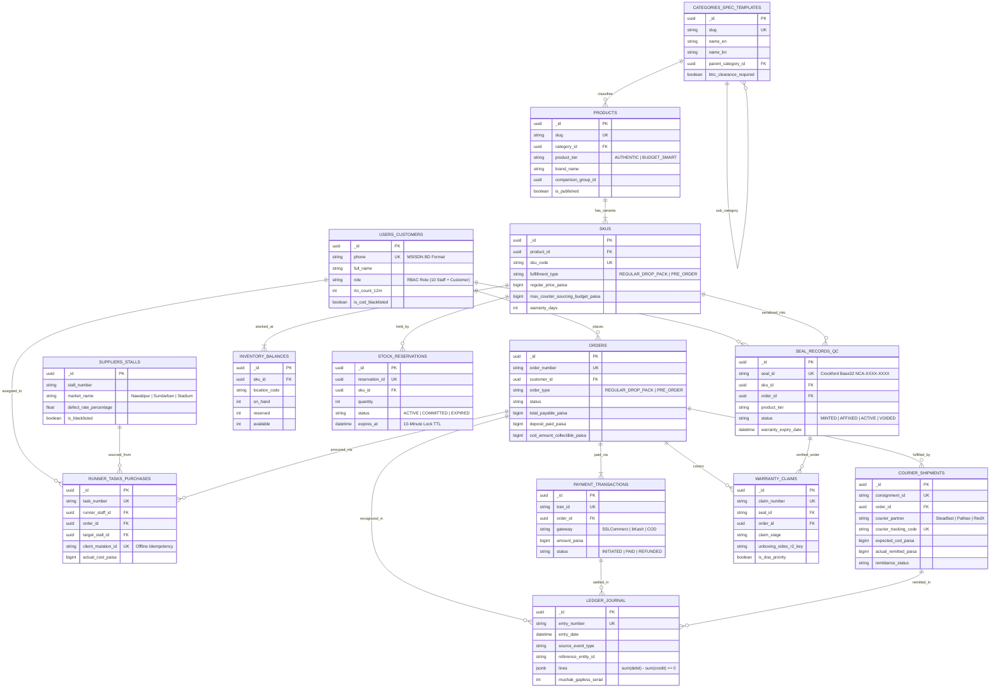

# Database Specification & Data Architecture — NCAMart

**Document Version:** 2.0 (Production Engineering & Database Architecture)  
**Status:** Approved Technical Design Artifact  
**Date:** 2026-10-20  
**Target Domain:** [ncamart.com](https://ncamart.com)  
**Foundational References:** [PRD.md](./PRD.md) (v1.4), [architechture.md](./architechture.md) (v1.1), & [dfd.md](./dfd.md) (v2.0)  
**Primary Engine & Models:** PostgreSQL 16 (Relational Source of Truth) & MongoDB / Mongoose Document Model (Dual Enterprise Specification)  
**Monetary Standard:** All monetary values are strictly represented as **Integer Paisa (1 BDT = 100 Paisa)** without floating point rounding.

---

## 1. Collection List (Entity & Collection Inventory)

NCAMart organizes its operational, transactional, and trust data into **16 core logical collections / relational tables**, categorized into 8 domain clusters:

| # | Collection / Table Name | Domain Cluster | DFD Store Reference | Primary Responsibility & Storage Nature |
| :--- | :--- | :--- | :--- | :--- |
| **1** | `users_customers` | Identity & Access | D1, D14 | Customer profiles, Bangladeshi MSISDN, address book, 12-month rolling RTO metrics, staff RBAC credentials, TOTP secrets, and revocable sessions. |
| **2** | `categories_spec_templates` | Catalog & Merchandising | D2 | Hierarchical taxonomy, Category-specific comparative specification matrix templates, and BTRC wireless clearance flags. |
| **3** | `products` | Catalog & Merchandising | D2, D16 | Master product definitions, two-tier classification (`AUTHENTIC` vs `BUDGET_SMART`), comparison group links, and SEO metadata. |
| **4** | `skus` | Catalog & Merchandising | D2, D3 | Sellable variants, barcodes (EAN-13), base unit selling prices in integer paisa, warranty days, and supplier sourcing constraints. |
| **5** | `suppliers_stalls` | Procurement & Sourcing | D4 | Nawabpur Complex, Sundarban Square, and Stadium Market wholesale stalls, contact info, payment modes, and rolling 3% defect rate tracking. |
| **6** | `inventory_balances` | Physical Inventory | D3 | Multi-location stock on-hand, locked/reserved counts, safe stock thresholds, and location bins (`GODOWN_NAWABPUR`, `SHOWROOM_COUNTER`). |
| **7** | `stock_reservations` | Physical Inventory | D3 | 10-minute cart checkout locks, conditional reservation timestamps, and transition states (`ACTIVE`, `COMMITTED`, `RELEASED`, `EXPIRED`). |
| **8** | `stock_movements` | Physical Inventory | D3 | Append-only audit trail of every physical stock increment, decrement, runner receipt, damaged write-off, and customer return. |
| **9** | `orders` | Sales & Order Fulfillment | D5 | Sales orders, pre-orders, isolated cart types (`REGULAR_DROP_PACK` vs `PRE_ORDER`), delivery addresses, progressive deposits, and order milestones. |
| **10** | `payment_transactions` | Payments & Finance | D6 | Payment lifecycle records, SSLCommerz transaction logs, MD5 hashes, S2S validation responses, and refund allocations. |
| **11** | `runner_tasks_purchases` | Local Sourcing & Field PWA | D7 | Drop-and-pack runner assignments, offline sync mutations (`client_mutation_id`), paper receipt OCR/photos, and shift cash float sessions. |
| **12** | `seal_records_qc` | Trust & Verification | D8 | Crockford Base32 cryptographic tamper-evident seals (`NCA-XXXX-XXXX`), 3-point QC test logs, OEM serial bindings, and scan geo-audits. |
| **13** | `courier_shipments` | Logistics & Last-Mile | D9 | Consignment tracking numbers (Steadfast, Pathao, RedX), expected COD amounts, delivery webhooks, and reverse parcel logistics. |
| **14** | `warranty_claims` | RMA & Reverse Logistics | D10 | Post-purchase RMA claims, Cloudflare R2 unboxing video keys, technician adjudication, DOA flags, and distributor liaison batches. |
| **15** | `ledger_journal` | Financial Accounting | D11 | In-house double-entry general ledger, chart of accounts, balanced journal lines ($\sum \text{Debit} = \sum \text{Credit}$), and NBR Mushak 6.3 tax serials. |
| **16** | `transactional_outbox_audit` | Infrastructure & Compliance | D12, D13 | Reliable event-driven notification queue (Class A/B/C) with SKIP LOCKED polling, and SHA-256 hash-chained immutable audit trail. |

---

## 2. Comprehensive Schema Design

### 2.1 Collection: `users_customers`
Consolidates authentication, customer profiles, staff RBAC, and risk profiles.
```typescript
interface UserCustomerDocument {
  _id: ObjectId | UUID;
  phone: string; // E.164 BD format: "+8801XXXXXXXXX" (Unique)
  email?: string; // Optional, normalized lowercase
  full_name: string;
  role: 'CUSTOMER' | 'FIELD_RUNNER' | 'QC_TECHNICIAN' | 'GODOWN_MANAGER' | 
        'DISPATCH_STAFF' | 'SHOWROOM_POS_STAFF' | 'SOURCING_MANAGER' | 
        'CATALOG_MANAGER' | 'CUSTOMER_SUPPORT' | 'FINANCE_OFFICER' | 'SUPER_ADMIN';
  is_active: boolean;
  dormant_flag: boolean; // Set true if no activity for 12 months (requires re-OTP)
  password_hash?: string; // Staff only (Argon2id)
  totp_secret?: string; // Staff 2FA secret (encrypted AES-256-GCM)
  totp_enabled: boolean;
  addresses: Array<{
    address_id: string; // UUID
    label: 'HOME' | 'OFFICE' | 'OTHER';
    district: string; // e.g., "Dhaka", "Chittagong"
    thana: string; // e.g., "Kotwali", "Dhanmondi"
    street_address: string;
    is_default: boolean;
    courier_zone_code?: string; // Pathao/Steadfast mapped zone
  }>;
  risk_profile: {
    delivered_orders_count: number;
    rto_count_12m: number; // Return-to-origin count over last 12 months
    is_cod_blacklisted: boolean; // Auto-flagged if rto_count_12m >= 2
    fraud_risk_score: number; // 0 to 100
  };
  active_sessions: Array<{
    session_id: string; // UUID
    token_hash: string; // SHA-256
    device_id: string;
    ip_address: string;
    user_agent: string;
    created_at: Date;
    expires_at: Date;
  }>;
  created_at: Date;
  updated_at: Date;
}
```

### 2.2 Collection: `categories_spec_templates`
```typescript
interface CategorySpecTemplateDocument {
  _id: ObjectId | UUID;
  slug: string; // e.g., "smart-door-locks", "fast-chargers"
  name_en: string;
  name_bn: string;
  parent_category_id?: ObjectId | UUID;
  level: number; // 1 (Root), 2 (Sub-category), 3 (Leaf)
  btrc_clearance_required: boolean; // If true, product cannot be published without BTRC certificate
  comparison_spec_keys: Array<{
    key_name: string; // e.g., "max_wattage", "cable_length", "biometric_sensor_type"
    label_en: string;
    label_bn: string;
    unit?: string; // e.g., "W", "meter", "V"
    field_type: 'NUMBER' | 'STRING' | 'BOOLEAN';
    is_highlighted_for_comparison: boolean; // Shown on side-by-side diff matrix
  }>;
  created_at: Date;
  updated_at: Date;
}
```

### 2.3 Collection: `products`
```typescript
interface ProductDocument {
  _id: ObjectId | UUID;
  title_en: string;
  title_bn: string;
  slug: string; // Unique URL slug
  category_id: ObjectId | UUID;
  product_tier: 'AUTHENTIC' | 'BUDGET_SMART'; // Two-Tier distinction
  brand_name: string; // e.g., "UGREEN", "Baseus", "OEM Nawabpur", "UNI-T"
  origin_country?: string; // e.g., "China", "Taiwan"
  comparison_group_id?: ObjectId | UUID; // Pairs an Authentic product with its Budget Smart counterpart
  comparison_summary: {
    comparison_points_en: string[];
    comparison_points_bn: string[];
  };
  btrc_clearance_code?: string; // Verified BTRC wireless registration code
  btrc_status: 'NOT_REQUIRED' | 'PENDING' | 'APPROVED' | 'REJECTED';
  is_published: boolean; // Enforces: if btrc_clearance_required && btrc_status != 'APPROVED' => false
  media: Array<{
    url: string; // Cloudflare R2 public CDN URL
    r2_key: string;
    is_primary: boolean;
    sort_order: number;
  }>;
  created_at: Date;
  updated_at: Date;
}
```

### 2.4 Collection: `skus`
```typescript
interface SkuDocument {
  _id: ObjectId | UUID;
  product_id: ObjectId | UUID;
  sku_code: string; // Unique human-readable code e.g. "UGR-65W-BLK"
  barcode_ean13?: string;
  attributes: Record<string, string>; // e.g., { color: "Black", port: "Type-C x3" }
  specs: Record<string, any>; // Category-specific key-value pairs matching spec template
  fulfillment_type: 'REGULAR_DROP_PACK' | 'PRE_ORDER';
  
  // Pricing in Integer Paisa
  regular_price_paisa: number; // e.g., 250000 = ৳2,500.00
  sale_price_paisa?: number; // Discounted promo price
  max_counter_sourcing_budget_paisa: number; // Sourcing budget limit for runners
  
  // Warranty Specifications
  warranty_days: number; // 7 days (Budget) to 730 days (Authentic 2-Year)
  warranty_type: 'SHOP_REPLACEMENT' | 'OFFICIAL_DISTRIBUTOR' | 'MANUFACTURER_GLOBAL';
  official_distributor_name?: string; // e.g., "Excel Technologies", "Star Tech"
  
  weight_grams: number;
  created_at: Date;
  updated_at: Date;
}
```

### 2.5 Collection: `suppliers_stalls`
```typescript
interface SupplierStallDocument {
  _id: ObjectId | UUID;
  stall_number: string; // e.g., "Shop #104, 2nd Floor, Sundarban Square"
  market_name: 'NAWABPUR_COMPLEX' | 'SUNDARBAN_SQUARE' | 'STADIUM_MARKET' | 'PATUATULY';
  proprietor_name: string;
  contact_phone: string;
  bKash_merchant_number?: string;
  accepted_payment_modes: Array<'CASH' | 'BKASH' | 'CREDIT_FLOAT'>;
  quality_metrics: {
    total_units_sourced: number;
    qc_failed_units: number;
    defect_rate_percentage: number; // (qc_failed / total) * 100
    is_blacklisted: boolean; // Auto-set true if defect_rate_percentage > 3.0%
  };
  created_at: Date;
  updated_at: Date;
}
```

### 2.6 Collection: `inventory_balances`
```typescript
interface InventoryBalanceDocument {
  _id: ObjectId | UUID;
  sku_id: ObjectId | UUID;
  location_code: 'GODOWN_NAWABPUR' | 'SHOWROOM_COUNTER' | 'TRANSIT_PREORDER';
  on_hand: number; // Total physical units located in bin
  reserved: number; // Units currently held in 10-minute checkout reservations
  available: number; // Virtual calculated field: on_hand - reserved
  safety_stock_threshold: number;
  created_at: Date;
  updated_at: Date;
}
```

### 2.7 Collection: `stock_reservations`
```typescript
interface StockReservationDocument {
  _id: ObjectId | UUID;
  reservation_id: string; // UUID
  sku_id: ObjectId | UUID;
  location_code: string;
  quantity: number;
  customer_id?: ObjectId | UUID;
  session_token?: string;
  status: 'ACTIVE' | 'COMMITTED' | 'RELEASED' | 'EXPIRED';
  expires_at: Date; // CreatedAt + 10 minutes
  created_at: Date;
  updated_at: Date;
}
```

### 2.8 Collection: `orders`
```typescript
interface OrderDocument {
  _id: ObjectId | UUID;
  order_number: string; // Human-readable e.g. "ORD-2026-10482"
  customer_id: ObjectId | UUID;
  channel: 'STOREFRONT_WEB' | 'SHOWROOM_POS' | 'PHONE_ORDER';
  order_type: 'REGULAR_DROP_PACK' | 'PRE_ORDER'; // Pure isolation enforced
  
  // Order State Machine Enums (PRD §3.12 & DFD P4.3)
  status: 'PENDING_PAYMENT' | 'CONFIRMED' | 'SOURCING' | 'AT_GODOWN_QC' | 
          'PACKED' | 'HANDED_TO_COURIER' | 'DELIVERED' | 'PARTIALLY_DELIVERED' | 
          'RTO_IN_TRANSIT' | 'RTO_RECEIVED' | 'READY_FOR_PICKUP' | 'DELIVERED_COUNTER' | 
          'PICKUP_EXPIRED' | 'CANCELLED' | 'DEPOSIT_PENDING' | 'DEPOSIT_PAID' | 
          'SOURCED_IN_TRANSIT' | 'ARRIVED_GODOWN' | 'QC_VERIFIED_BALANCE_DUE' | 
          'BALANCE_PAID' | 'BALANCE_COD_SCHEDULED' | 'REPRICING_PENDING' | 
          'CANCELLED_REFUNDED' | 'DEPOSIT_FORFEITED_CANCELLED';
  
  items: Array<{
    sku_id: ObjectId | UUID;
    product_title_en: string;
    product_tier: 'AUTHENTIC' | 'BUDGET_SMART';
    quantity: number;
    unit_price_paisa: number; // Integer Paisa
    total_price_paisa: number;
    allocated_seal_id?: string; // Assigned during QC
  }>;
  
  // Pre-Order Specifics (PRD §4.3 & DFD P4.2)
  pre_order_details?: {
    deposit_required_paisa: number; // Progressive formula calculation
    deposit_paid_paisa: number;
    balance_due_paisa: number;
    estimated_arrival_date: Date;
    arrival_notified_at?: Date;
    balance_due_deadline?: Date; // T + 7 days post QC verification
    fx_devaluation_status?: 'NORMAL' | 'REPRICING_PENDING' | 'CUSTOMER_ACCEPTED' | 'CUSTOMER_REFUNDED';
    landed_cost_flash_deal_flag?: boolean; // Set true if forfeited on Day 8
  };
  
  // Financial Breakup (Paisa)
  financial_summary: {
    subtotal_paisa: number;
    discount_paisa: number;
    delivery_fee_paisa: number; // ৳80 (Inside Dhaka) / ৳150 (Nationwide) [PRD §3.6.2, §3.7]
    advance_payment_required_paisa: number; // 100% COD or Advance Delivery Fee
    advance_payment_received_paisa: number;
    cod_amount_collectible_paisa: number; // Balance to be collected by courier
    vat_paisa: number; // NBR Mushak 6.3 calculation
    total_payable_paisa: number;
  };

  shipping_address: {
    consignee_name: string;
    phone: string;
    district: string;
    thana: string;
    street_address: string;
  };
  
  // Showroom POS Pickup Credentials
  showroom_pickup?: {
    pickup_pin_hash: string; // HMAC-SHA256 salted PIN presented to counter
    failed_attempts_count: number; // Max 5 attempts
    is_claimed: boolean;
    claimed_at?: Date;
    claimed_by_staff_id?: ObjectId | UUID;
  };

  created_at: Date;
  updated_at: Date;
}
```

### 2.9 Collection: `payment_transactions`
```typescript
interface PaymentTransactionDocument {
  _id: ObjectId | UUID;
  tran_id: string; // Unique transaction ID e.g. "NCA-TXN-20261020-001"
  order_id: ObjectId | UUID;
  customer_id: ObjectId | UUID;
  gateway: 'SSLCOMMERZ' | 'BKASH_DIRECT' | 'SHOWROOM_CASH' | 'SHOWROOM_POS_TERMINAL' | 'COURIER_COD';
  amount_paisa: number;
  currency: 'BDT';
  payment_category: 'FULL_ONLINE' | 'ADVANCE_DELIVERY_FEE' | 'PREORDER_DEPOSIT' | 'PREORDER_BALANCE';
  status: 'INITIATED' | 'PENDING' | 'PAID' | 'FAILED' | 'CANCELLED' | 'REFUNDED';
  
  sslcommerz_metadata?: {
    val_id?: string;
    card_type?: string; // e.g., "BKASH-bKash", "VISA-CityBank"
    card_brand?: string;
    verify_sign?: string;
    verify_key?: string;
    bank_tran_id?: string;
    raw_ipn_payload?: Record<string, any>;
    s2s_validated_at?: Date;
  };

  refund_details?: {
    refund_tran_id?: string;
    refunded_amount_paisa: number;
    reason: string;
    approved_by_staff_id: ObjectId | UUID;
    refunded_at: Date;
  };

  created_at: Date;
  updated_at: Date;
}
```

### 2.10 Collection: `seal_records_qc`
```typescript
interface SealRecordQcDocument {
  _id: ObjectId | UUID;
  seal_id: string; // Crockford Base32 8-char: "NCA-XXXX-XXXX" (Unique Index)
  sku_id: ObjectId | UUID;
  order_id?: ObjectId | UUID;
  product_tier: 'AUTHENTIC' | 'BUDGET_SMART';
  status: 'GENERATED' | 'PRINTED' | 'ACTIVE' | 'VOID_PRINT_ERROR' | 'CLAIMED' | 'EXPIRED'; // Aligned with PRD §7
  
  oem_manufacturer_serial?: string; // Captured from vendor box
  
  qc_inspection_log: {
    inspected_by_staff_id: ObjectId | UUID;
    inspected_at: Date;
    voltage_reading?: number; // e.g. 5.12V
    firmware_version?: string;
    cable_resistance_ohm?: number;
    checklist_passed: boolean;
    tester_notes?: string;
  };

  void_log?: {
    voided_at: Date;
    voided_by_staff_id: ObjectId | UUID;
    approved_by_godown_manager_id: ObjectId | UUID;
    reason: 'PRINTER_JAM' | 'DAMAGED_LABEL' | 'FAILED_QC_RETEST';
  };

  verification_scans: Array<{
    scanned_at: Date;
    client_ip: string;
    device_id: string; // Anonymous device cookie: "nca_did"
    user_agent: string;
    district_geo?: string;
    is_flagged_anomaly: boolean;
  }>;

  warranty_expiry_date: Date;
  created_at: Date;
  updated_at: Date;
}
```

### 2.11 Collection: `runner_tasks_purchases`
```typescript
interface RunnerTaskPurchaseDocument {
  _id: ObjectId | UUID;
  task_number: string; // e.g. "RUN-20261020-0042"
  runner_staff_id: ObjectId | UUID;
  order_id: ObjectId | UUID;
  sku_id: ObjectId | UUID;
  target_stall_id: ObjectId | UUID;
  max_authorized_budget_paisa: number;
  
  status: 'DISPATCHED' | 'STALL_CONTACTED' | 'PURCHASED' | 'PRICE_EXCEEDED_PENDING' | 'CANCELLED';
  
  // Offline sync & PWA Mutation Invariant
  client_mutation_id: string; // UUID generated on PWA device for idempotent ingestion
  
  purchase_execution?: {
    actual_cost_paisa: number;
    payment_mode: 'CASH_FLOAT' | 'BKASH_STALL';
    paper_receipt_photo_url: string; // Cloudflare R2 URL
    price_variance_approved_by?: ObjectId | UUID;
    purchased_at: Date;
  };

  created_at: Date;
  updated_at: Date;
}
```

### 2.12 Collection: `courier_shipments`
```typescript
interface CourierShipmentDocument {
  _id: ObjectId | UUID;
  consignment_id: string; // Internal UUID
  order_id: ObjectId | UUID;
  courier_partner: 'STEADFAST' | 'PATHAO' | 'REDX';
  courier_tracking_code: string; // Consignment code from 3rd party API
  
  shipping_status: 'BOOKED' | 'PICKED_UP' | 'IN_TRANSIT' | 'OUT_FOR_DELIVERY' | 
                   'DELIVERED' | 'PARTIAL_DELIVERED' | 'RETURN_IN_TRANSIT' | 'RETURNED_TO_GODOWN';
  
  expected_cod_paisa: number; // Amount courier must collect from customer
  actual_remitted_paisa?: number; // Payout from courier invoice
  remittance_status: 'PENDING' | 'RECONCILED' | 'SHORT_PAID' | 'OVER_PAID' | 'DISPUTED';
  courier_settlement_batch_id?: string;
  
  webhook_events: Array<{
    raw_status: string;
    normalized_status: string;
    received_at: Date;
  }>;

  created_at: Date;
  updated_at: Date;
}
```

### 2.13 Collection: `warranty_claims`
```typescript
interface WarrantyClaimDocument {
  _id: ObjectId | UUID;
  claim_number: string; // e.g. "RMA-2026-0038"
  seal_id: string; // Crockford Base32
  order_id: ObjectId | UUID;
  customer_id: ObjectId | UUID;
  
  claim_stage: 'INTAKE' | 'ADJUDICATION' | 'REVERSE_PICKUP' | 'GODOWN_INSPECTION' | 
               'REPLACEMENT_DISPATCHED' | 'REFUND_ISSUED' | 'DISTRIBUTOR_LIAISON' | 'REJECTED';
  
  unboxing_video_r2_key: string; // Direct multipart upload to R2 (<=300MB)
  customer_issue_description: string;
  is_doa_priority: boolean; // Dead on Arrival (reported <= 48 hours post delivery)
  
  adjudication?: {
    adjudicated_by_staff_id: ObjectId | UUID;
    adjudicated_at: Date;
    decision: 'APPROVED_FOR_RETURN' | 'REJECTED_VOID_SEAL' | 'REJECTED_CUSTOMER_DAMAGE';
    rejection_reason?: string;
  };

  godown_qc_result?: {
    verified_defect: boolean;
    technician_notes: string;
    resolution_path: '7_DAY_SHOP_REPLACEMENT' | 'DISTRIBUTOR_REPAIR' | 'FINANCE_REFUND';
  };

  created_at: Date;
  updated_at: Date;
}
```

### 2.14 Collection: `ledger_journal`
```typescript
interface LedgerJournalDocument {
  _id: ObjectId | UUID;
  entry_number: string; // e.g. "JRN-20261020-00192"
  entry_date: Date;
  source_event_type: 'ORDER_PAYMENT_ONLINE' | 'COURIER_COD_REMITTANCE' | 'RUNNER_PURCHASE_EXPENSE' | 
                     'PREORDER_DEPOSIT_COLLECTED' | 'REVENUE_RECOGNITION' | 'TAX_VAT_POSTING' | 'CUSTOMER_REFUND';
  reference_entity_id: string; // e.g., Order ID, Shipment ID, Refund ID
  description: string;
  
  // Enforces Balance Rule: sum(Debit) - sum(Credit) == 0
  lines: Array<{
    account_code: string; // e.g., "1100" (SSLCommerz), "1110" (Courier COD), "4000" (Sales Revenue)
    account_name: string;
    debit_paisa: number;
    credit_paisa: number;
  }>;

  // NBR Mushak 6.3 Tax Compliance
  mushak_6_3?: {
    fiscal_year: string; // e.g. "2026-2027"
    gapless_serial_number: number;
    pdf_r2_key: string;
  };

  created_at: Date; // Strictly Append-Only (Zero updates or deletes permitted)
}
```

### 2.15 Collection: `transactional_outbox_audit`
```typescript
interface OutboxAuditDocument {
  _id: ObjectId | UUID;
  event_id: string; // UUID
  event_type: 'ORDER_CONFIRMED' | 'SEAL_MINTED' | 'RUNNER_ASSIGNED' | 'DISPATCH_BOOKED' | 'CLONED_SEAL_ALERT';
  priority_class: 'CLASS_A_INSTANT' | 'CLASS_B_OPERATIONAL' | 'CLASS_C_MARKETING';
  
  payload: Record<string, any>;
  
  status: 'PENDING' | 'PROCESSING' | 'COMPLETED' | 'FAILED' | 'DEAD_LETTER';
  retry_count: number;
  max_retries: number;
  scheduled_at: Date; // Respects quiet hours (22:00-08:00 Dhaka time for Class B/C)
  processed_at?: Date;
  error_message?: string;
  
  // Immutable Audit Hash Chaining (PRD §8.3)
  prev_audit_hash?: string; // SHA-256 of preceding audit entry
  current_audit_hash?: string; // SHA-256(prev_audit_hash + event_id + payload + timestamp)

  created_at: Date;
}
```

---

## 3. Entity Relationships & Cardinality

| Parent Entity | Child Entity | Relationship | Foreign Key / Reference | On Delete Action | On Update Action | Cardinality Rationale |
| :--- | :--- | :--- | :--- | :--- | :--- | :--- |
| `categories` | `categories` | 1 : N | `parent_category_id` | `RESTRICT` | `CASCADE` | Hierarchical taxonomy (Root -> Sub -> Leaf). |
| `categories` | `products` | 1 : N | `products.category_id` | `RESTRICT` | `CASCADE` | Products belong to a specific leaf category. |
| `products` | `skus` | 1 : N | `skus.product_id` | `CASCADE` | `CASCADE` | A product has multiple variant SKUs. |
| `comparison_groups`| `products` | 1 : N | `products.comparison_group_id` | `SET NULL` | `CASCADE` | Groups Authentic & Budget Smart products for side-by-side diff. |
| `skus` | `inventory_balances`| 1 : N | `inventory_balances.sku_id` | `RESTRICT` | `CASCADE` | Tracks physical counts across distinct godown/showroom bins. |
| `skus` | `stock_reservations`| 1 : N | `stock_reservations.sku_id` | `RESTRICT` | `CASCADE` | Tracks short-lived 10-minute cart checkout locks. |
| `users_customers` | `orders` | 1 : N | `orders.customer_id` | `RESTRICT` | `CASCADE` | Customers place multiple orders over lifetime. |
| `orders` | `payment_transactions`| 1 : N | `payment_transactions.order_id`| `RESTRICT`| `CASCADE` | Orders can have advance deposit, balance, and refunds. |
| `orders` | `courier_shipments` | 1 : N | `courier_shipments.order_id` | `RESTRICT` | `CASCADE` | Orders may have forward dispatch and reverse RMA consignments. |
| `skus` | `seal_records_qc` | 1 : N | `seal_records_qc.sku_id` | `RESTRICT` | `CASCADE` | Each physical unit inspected gets an individual seal record. |
| `orders` | `seal_records_qc` | 1 : N | `seal_records_qc.order_id` | `SET NULL` | `CASCADE` | Seal records are tied to an order item during packaging. |
| `seal_records_qc` | `warranty_claims` | 1 : N | `warranty_claims.seal_id` | `RESTRICT` | `CASCADE` | Claims validate against active seal warranty records. |
| `suppliers_stalls`| `runner_tasks_purchases`| 1 : N| `runner_tasks.target_stall_id`| `RESTRICT`| `CASCADE` | Sourcing tasks target designated market stalls. |
| `orders` | `ledger_journal` | 1 : N | `ledger_journal.reference_entity_id`| `NO ACTION`| `NO ACTION`| Financial journal lines track accounting impact immutably. |

---

## 4. Comprehensive Indexing Strategy

```
┌────────────────────────────────────────────────────────────────────────────────────────┐
│                                   INDEX ARCHITECTURE                                   │
├──────────────────────────┬───────────────────────────────┬─────────────────────────────┤
│ Unique / Concurrency     │ High-Frequency Filter / Sort  │ Specialized / TTL           │
│ - msisdn / phone         │ - category_id + tier + status │ - expires_at (TTL 10m)      │
│ - seal_id (Crockford)    │ - rto_count_12m + cod_black   │ - client_mutation_id (UUID) │
│ - tran_id / order_no     │ - courier_tracking_code       │ - audit_hash_chain (B-Tree) │
└──────────────────────────┴───────────────────────────────┴─────────────────────────────┘
```

| Collection / Table | Index Keys | Type | Purpose & Query Pattern Supported |
| :--- | :--- | :--- | :--- |
| `users_customers` | `{ phone: 1 }` | **UNIQUE** | Fast customer lookup by MSISDN during OTP login. |
| `users_customers` | `{ "active_sessions.token_hash": 1 }`| Compound Sparse| Instant session token verification on HTTP request middleware. |
| `users_customers` | `{ "risk_profile.rto_count_12m": 1 }`| Standard B-Tree | Rapid COD eligibility evaluation at checkout. |
| `products` | `{ slug: 1 }` | **UNIQUE** | Storefront SEO product page resolution. |
| `products` | `{ category_id: 1, product_tier: 1, is_published: 1 }` | Compound B-Tree | Storefront category listing with two-tier filter tabs. |
| `skus` | `{ sku_code: 1 }` | **UNIQUE** | Instant SKU lookup for barcode scanning & inventory updates. |
| `skus` | `{ product_id: 1 }` | Standard B-Tree | Hydrating all variant SKUs for a product page. |
| `inventory_balances`| `{ sku_id: 1, location_code: 1 }` | **UNIQUE** | Enforces single balance record per SKU per location. |
| `stock_reservations`| `{ expires_at: 1 }` | **TTL Index / Cron Key** | Marks expired locks. Handled via P3.5 BullMQ cron worker (Postgres) or CDC/Change Stream to atomically decrement `inventory_balances.reserved`. |
| `stock_reservations`| `{ sku_id: 1, status: 1 }` | Compound B-Tree | Quick check of currently held reservation quantities. |
| `orders` | `{ order_number: 1 }` | **UNIQUE** | Order status lookup for customers and customer support. |
| `orders` | `{ customer_id: 1, created_at: -1 }` | Compound Desc | Customer order history pagination sorted newest first. |
| `orders` | `{ status: 1, order_type: 1 }` | Compound B-Tree | Admin/Godown queue dispatching (e.g. SOURCING_ASSIGNED). |
| `payment_transactions`| `{ tran_id: 1 }` | **UNIQUE** | Idempotent gateway IPN webhook lookup and S2S validation. |
| `payment_transactions`| `{ order_id: 1, status: 1 }` | Compound B-Tree | Fast lookup of payment status for order settlement. |
| `seal_records_qc` | `{ seal_id: 1 }` | **UNIQUE** | Instant public lookup on `/verify` portal. |
| `seal_records_qc` | `{ "verification_scans.device_id": 1, "verification_scans.scanned_at": -1 }`| Compound Desc | Clone anomaly detection across scans within 24 hours. |
| `runner_tasks_purchases`| `{ client_mutation_id: 1 }` | **UNIQUE** | Idempotent ingestion of offline runner purchase sync batches. |
| `courier_shipments` | `{ courier_tracking_code: 1 }` | **UNIQUE** | Lightning-fast courier webhook payload ingestion. |
| `ledger_journal` | `{ entry_number: 1 }` | **UNIQUE** | Immutable audit sequence identification. |
| `ledger_journal` | `{ "lines.account_code": 1, entry_date: -1 }` | Compound Desc | Real-time general ledger account balance calculation. |
| `transactional_outbox_audit`| `{ status: 1, scheduled_at: 1, priority_class: 1 }` | Partial Compound | Worker polling query with `FOR UPDATE SKIP LOCKED`. |

---

## 5. Data Validation Rules & Constraints

### 5.1 Business Invariant & Field-Level Checks

1. **Bangladeshi Phone Number Format (MSISDN):**
   - Regex: `/^(?:\+8801|01)[3-9]\d{8}$/`
   - Normalized into E.164: `+8801XXXXXXXXX`.
2. **Crockford Base32 Seal Token Format:**
   - CSPRNG 8-character string using Crockford Base32 alphabet (`0123456789ABCDEFGHJKMNPQRSTVWXYZ`, excluding `I, L, O, U`):
   - Regex: `/^NCA-[0-9A-HJKMNP-TV-Z]{4}-[0-9A-HJKMNP-TV-Z]{4}$/`
3. **Monetary Integer Paisa Constraints:**
   - Every price, deposit, discount, fee, and VAT must satisfy:
   - `CHECK (amount_paisa >= 0 AND amount_paisa = FLOOR(amount_paisa))`
4. **Physical Inventory Constraint:**
   - `CHECK (reserved >= 0 AND on_hand >= reserved)`
   - Under no circumstances can reserved or on-hand fall below zero.
5. **Pure Cart Isolation Invariant:**
   - An order cannot contain a mix of `REGULAR_DROP_PACK` and `PRE_ORDER` items.
   - Violation throws `HTTP 422 Unprocessable Entity` (`ERR_MIXED_CART_DISALLOWED`).
6. **BTRC Clearance Publishing Guard:**
   - If `categories.btrc_clearance_required == true`, product publishing is strictly blocked unless `products.btrc_status == 'APPROVED'` and `btrc_clearance_code` is present.
7. **Double-Entry Balance Constraint:**
   - For every journal entry:
   - $$\sum \text{debit\_paisa} - \sum \text{credit\_paisa} = 0$$

---

## 6. Analytical Aggregations & Complex Pipelines

### 6.1 Clone Anomaly Detection Pipeline (Trust Module)
Detects counterfeit serial cloning when $\ge 5$ distinct device IDs access the same seal in $\ge 2$ distinct districts within a rolling 24-hour window.
```javascript
db.seal_records_qc.aggregate([
  {
    $match: {
      status: { $in: ['AFFIXED', 'VERIFIED_ACTIVE', 'VOIDED'] }
    }
  },
  { $unwind: "$verification_scans" },
  {
    $match: {
      "verification_scans.scanned_at": { 
        $gte: new Date(Date.now() - 24 * 60 * 60 * 1000) 
      }
    }
  },
  {
    $group: {
      _id: "$seal_id",
      unique_devices: { $addToSet: "$verification_scans.device_id" },
      unique_districts: { $addToSet: "$verification_scans.district_geo" },
      total_scans_24h: { $sum: 1 },
      is_voided: { $first: { $cond: [{ $eq: ["$status", "VOIDED"] }, true, false] } }
    }
  },
  {
    $project: {
      seal_id: "$_id",
      device_count: { $size: "$unique_devices" },
      district_count: { $size: "$unique_districts" },
      total_scans_24h: 1,
      is_clone_anomaly: {
        $or: [
          { $eq: ["$is_voided", true] }, // Any scan on a voided seal is an anomaly
          {
            $and: [
              { $gte: [{ $size: "$unique_devices" }, 5] },
              { $gte: [{ $size: "$unique_districts" }, 2] }
            ]
          }
        ]
      }
    }
  },
  { $match: { is_clone_anomaly: true } }
]);
```

### 6.2 Courier COD Remittance & Variance Reconciliation Pipeline
Reconciles courier payout sheets against expected COD balances, grouping discrepancies.
```javascript
db.courier_shipments.aggregate([
  {
    $match: {
      shipping_status: 'DELIVERED',
      remittance_status: { $in: ['PENDING', 'SHORT_PAID', 'OVER_PAID'] }
    }
  },
  {
    $group: {
      _id: "$courier_partner",
      total_consignments: { $sum: 1 },
      total_expected_cod_paisa: { $sum: "$expected_cod_paisa" },
      total_remitted_paisa: { $sum: "$actual_remitted_paisa" },
      unreconciled_variance_paisa: {
        $sum: { $subtract: ["$expected_cod_paisa", { $ifNull: ["$actual_remitted_paisa", 0] }] }
      },
      short_paid_count: {
        $sum: { $cond: [{ $eq: ["$remittance_status", "SHORT_PAID"] }, 1, 0] }
      }
    }
  },
  {
    $project: {
      courier_partner: "$_id",
      total_consignments: 1,
      expected_bdt: { $divide: ["$total_expected_cod_paisa", 100] },
      remitted_bdt: { $divide: ["$total_remitted_paisa", 100] },
      variance_bdt: { $divide: ["$unreconciled_variance_paisa", 100] },
      short_paid_count: 1
    }
  }
]);
```

### 6.3 Customer 12-Month Rolling RTO Rate & Fraud Scoring
Calculates return-to-origin frequency to enforce automatic COD blacklisting.
```javascript
db.orders.aggregate([
  {
    $match: {
      created_at: { $gte: new Date(Date.now() - 365 * 24 * 60 * 60 * 1000) },
      status: { $in: ['DELIVERED', 'RTO_RETURNED'] }
    }
  },
  {
    $group: {
      _id: "$customer_id",
      total_orders: { $sum: 1 },
      rto_orders: {
        $sum: { $cond: [{ $eq: ["$status", "RTO_RETURNED"] }, 1, 0] }
      },
      delivered_orders: {
        $sum: { $cond: [{ $eq: ["$status", "DELIVERED"] }, 1, 0] }
      }
    }
  },
  {
    $project: {
      customer_id: "$_id",
      total_orders: 1,
      rto_orders: 1,
      delivered_orders: 1,
      rto_rate_percentage: {
        $multiply: [{ $divide: ["$rto_orders", "$total_orders"] }, 100]
      },
      is_cod_blacklisted: { $gte: ["$rto_orders", 2] } // Blacklist if >= 2 RTOs in 12 months
    }
  }
]);
```

---

## 7. Transaction Protocols & Concurrency Control

### 7.1 Protocol A: 10-Minute Cart Checkout Stock Reservation
Prevents stock overselling using atomic conditional updates.
```typescript
import mongoose from 'mongoose';

async function acquireCartReservation(
  skuId: string, 
  quantity: number, 
  locationCode: string, 
  customerId: string
) {
  const session = await mongoose.startSession();
  session.startTransaction();

  try {
    // 1. Atomic decrement of available stock
    const balance = await InventoryBalance.findOneAndUpdate(
      {
        sku_id: skuId,
        location_code: locationCode,
        $expr: { $gte: [{ $subtract: ["$on_hand", "$reserved"] }, quantity] }
      },
      {
        $inc: { reserved: quantity },
        $set: { updated_at: new Date() }
      },
      { session, new: true }
    );

    if (!balance) {
      throw new Error("ERR_INSUFFICIENT_STOCK_OR_LOCKED");
    }

    // 2. Insert reservation record with 10-minute expiry
    const expiresAt = new Date(Date.now() + 10 * 60 * 1000);
    const reservation = await StockReservation.create(
      [
        {
          reservation_id: crypto.randomUUID(),
          sku_id: skuId,
          location_code: locationCode,
          quantity: quantity,
          customer_id: customerId,
          status: 'ACTIVE',
          expires_at: expiresAt
        }
      ],
      { session }
    );

    await session.commitTransaction();
    return reservation[0];
  } catch (error) {
    await session.abortTransaction();
    throw error;
  } finally {
    session.endSession();
  }
}
```

### 7.2 Protocol B: 100% COD Order Confirmation & Stock Commit
Commits reservation into physical deduction and sets up the ledger entry atomically.
```typescript
async function confirmCodOrder(orderId: string, reservationIds: string[]) {
  const session = await mongoose.startSession();
  session.startTransaction();

  try {
    const order = await Order.findById(orderId).session(session);
    if (!order || order.status !== 'PENDING_PAYMENT') {
      throw new Error("INVALID_ORDER_STATE");
    }

    for (const resId of reservationIds) {
      const resRecord = await StockReservation.findOne({ 
        reservation_id: resId, 
        status: 'ACTIVE' 
      }).session(session);

      if (!resRecord) {
        throw new Error("RESERVATION_EXPIRED_OR_INVALID");
      }

      // Mark reservation committed
      resRecord.status = 'COMMITTED';
      await resRecord.save({ session });

      // Deduct on_hand and release reserved count
      await InventoryBalance.updateOne(
        { sku_id: resRecord.sku_id, location_code: resRecord.location_code },
        { 
          $inc: { 
            on_hand: -resRecord.quantity, 
            reserved: -resRecord.quantity 
          } 
        },
        { session }
      );
    }

    // Update order status
    order.status = 'CONFIRMED';
    await order.save({ session });

    // Post to Outbox for notification dispatch
    await OutboxAudit.create(
      [
        {
          event_id: crypto.randomUUID(),
          event_type: 'ORDER_CONFIRMED',
          priority_class: 'CLASS_A_INSTANT',
          payload: { order_id: order._id, order_number: order.order_number },
          status: 'PENDING',
          scheduled_at: new Date()
        }
      ],
      { session }
    );

    await session.commitTransaction();
  } catch (error) {
    await session.abortTransaction();
    throw error;
  } finally {
    session.endSession();
  }
}
```

---

## 8. Realistic Sample Data Documents

### 8.1 Sample: Authentic Product with Comparison Link
```json
{
  "_id": "6714a1f5923b18e7c102a001",
  "title_en": "UGREEN Nexode 65W GaN Fast Charger (3 Ports)",
  "title_bn": "ইউগ্রিন নেক্সোড ৬৫ ওয়াট গ্যান ফাস্ট চার্জার (৩ পোর্ট)",
  "slug": "ugreen-nexode-65w-gan-charger",
  "category_id": "6714a1f5923b18e7c1029002",
  "product_tier": "AUTHENTIC",
  "brand_name": "UGREEN",
  "origin_country": "China",
  "comparison_group_id": "6714a1f5923b18e7c102c010",
  "comparison_summary": {
    "comparison_points_en": [
      "Authentic Navitas GaN III chip ensures <45°C operating temp under full load.",
      "Official 2-Year Replacement Warranty via authorized distributor.",
      "Over-voltage and short-circuit protection prevents battery degradation."
    ],
    "comparison_points_bn": [
      "আসল নেভিটাস গ্যান ৩ চিপ ব্যবহারের ফলে ফুল লোডেও গরম হয় না।",
      "অফিসিয়াল পরিবেশক কর্তৃক ২ বছরের সরাসরি রিপ্লেসমেন্ট ওয়ারেন্টি।",
      "সার্টিফাইড ওভার-ভোল্টেজ প্রটেকশন যা আপনার মোবাইলের ব্যাটারি সুরক্ষিত রাখে।"
    ]
  },
  "btrc_status": "NOT_REQUIRED",
  "is_published": true,
  "media": [
    {
      "url": "https://cdn.ncamart.com/products/ugreen-65w-front.webp",
      "r2_key": "products/ugreen-65w-front.webp",
      "is_primary": true,
      "sort_order": 1
    }
  ],
  "created_at": "2026-10-20T06:00:00.000Z",
  "updated_at": "2026-10-20T06:00:00.000Z"
}
```

### 8.2 Sample: Budget Smart Alternative Product
```json
{
  "_id": "6714a1f5923b18e7c102a002",
  "title_en": "NCA Pro 65W GaN Quick Charger (Tested Budget Alternative)",
  "title_bn": "এনসিএ প্রো ৬৫ ওয়াট গ্যান কুইক চার্জার (ল্যাব টেস্টেড বাজেট অল্টারনেটিভ)",
  "slug": "nca-pro-65w-gan-quick-charger",
  "category_id": "6714a1f5923b18e7c1029002",
  "product_tier": "BUDGET_SMART",
  "brand_name": "OEM Nawabpur Lab-Tested",
  "origin_country": "China (Sundarban Sourced)",
  "comparison_group_id": "6714a1f5923b18e7c102c010",
  "comparison_summary": {
    "comparison_points_en": [
      "Provides reliable 65W PD charging at 55% lower cost.",
      "Tested on in-house bench: reaches 58°C at continuous full load (safe within tolerances).",
      "7-Day NCAMart Shop Replacement Guarantee."
    ],
    "comparison_points_bn": [
      "৫৫% কম খরচে রিয়েল ৬৫ ওয়াট ফাস্ট চার্জিং সুবিধা।",
      "আমাদের ল্যাবে টেস্টেড: ফুল লোডে সর্বোচ্চ ৫৮° সেলসিয়াস ওঠে যা নিরাপদ।",
      "৭ দিনের নওয়াবপুর কমপ্লেক্স শপ রিপ্লেসমেন্ট গ্যারান্টি।"
    ]
  },
  "btrc_status": "NOT_REQUIRED",
  "is_published": true,
  "media": [
    {
      "url": "https://cdn.ncamart.com/products/nca-65w-front.webp",
      "r2_key": "products/nca-65w-front.webp",
      "is_primary": true,
      "sort_order": 1
    }
  ],
  "created_at": "2026-10-20T06:15:00.000Z",
  "updated_at": "2026-10-20T06:15:00.000Z"
}
```

### 8.3 Sample: Crockford Base32 QC Seal Record
```json
{
  "_id": "6714a1f5923b18e7c102e501",
  "seal_id": "NCA-4K9W-8M2P",
  "sku_id": "6714a1f5923b18e7c102b001",
  "order_id": "6714a1f5923b18e7c102d042",
  "product_tier": "AUTHENTIC",
  "status": "VERIFIED_ACTIVE",
  "oem_manufacturer_serial": "UG-SN-20260981729",
  "qc_inspection_log": {
    "inspected_by_staff_id": "6714a1f5923b18e7c102f005",
    "inspected_at": "2026-10-20T08:30:00.000Z",
    "voltage_reading": 5.18,
    "cable_resistance_ohm": 0.08,
    "checklist_passed": true,
    "tester_notes": "Passed Type-C PD handshake and thermal stress test."
  },
  "verification_scans": [
    {
      "scanned_at": "2026-10-20T11:45:10.000Z",
      "client_ip": "103.205.71.14",
      "device_id": "did_991823abce847",
      "user_agent": "Mozilla/5.0 (iPhone; CPU iPhone OS 17_5 like Mac OS X)",
      "district_geo": "Dhaka",
      "is_flagged_anomaly": false
    }
  ],
  "warranty_expiry_date": "2028-10-20T08:30:00.000Z",
  "created_at": "2026-10-20T08:32:00.000Z",
  "updated_at": "2026-10-20T11:45:10.000Z"
}
```

### 8.4 Sample: Double-Entry Balanced Journal Document
```json
{
  "_id": "6714a1f5923b18e7c102f901",
  "entry_number": "JRN-20261020-00812",
  "entry_date": "2026-10-20T09:15:00.000Z",
  "source_event_type": "COURIER_COD_REMITTANCE",
  "reference_entity_id": "CS-STF-99812",
  "description": "Steadfast Courier COD remittance settlement for Order #ORD-2026-10482",
  "lines": [
    {
      "account_code": "1010",
      "account_name": "City Bank Corporate Operating Account",
      "debit_paisa": 247000,
      "credit_paisa": 0
    },
    {
      "account_code": "5210",
      "account_name": "Courier COD Collection Charges (1%)",
      "debit_paisa": 3000,
      "credit_paisa": 0
    },
    {
      "account_code": "1110",
      "account_name": "Steadfast Courier COD Receivable",
      "debit_paisa": 0,
      "credit_paisa": 250000
    }
  ],
  "mushak_6_3": {
    "fiscal_year": "2026-2027",
    "gapless_serial_number": 10429,
    "pdf_r2_key": "invoices/2026-2027/mushak-10429.pdf"
  },
  "created_at": "2026-10-20T09:15:01.000Z"
}
```

---

## 9. Production-Grade TypeScript Mongoose Schemas

### 9.1 Mongoose Schema: `Product` & `Sku`
```typescript
import { Schema, model, Document, Types } from 'mongoose';

export interface ISku extends Document {
  product_id: Types.ObjectId;
  sku_code: string;
  barcode_ean13?: string;
  attributes: Map<string, string>;
  specs: Map<string, any>;
  fulfillment_type: 'REGULAR_DROP_PACK' | 'PRE_ORDER';
  regular_price_paisa: number;
  sale_price_paisa?: number;
  max_counter_sourcing_budget_paisa: number;
  warranty_days: number;
  warranty_type: 'SHOP_REPLACEMENT' | 'OFFICIAL_DISTRIBUTOR' | 'MANUFACTURER_GLOBAL';
  official_distributor_name?: string;
  weight_grams: number;
}

export const SkuSchema = new Schema<ISku>(
  {
    product_id: { type: Schema.Types.ObjectId, ref: 'Product', required: true, index: true },
    sku_code: { type: String, required: true, unique: true, uppercase: true, trim: true },
    barcode_ean13: { type: String, trim: true },
    attributes: { type: Map, of: String, default: {} },
    specs: { type: Map, of: Schema.Types.Mixed, default: {} },
    fulfillment_type: { 
      type: String, 
      enum: ['REGULAR_DROP_PACK', 'PRE_ORDER'], 
      required: true 
    },
    regular_price_paisa: { 
      type: Number, 
      required: true, 
      min: 0,
      validate: {
        validator: Number.isInteger,
        message: '{VALUE} must be an integer paisa value'
      }
    },
    sale_price_paisa: { 
      type: Number, 
      min: 0,
      validate: {
        validator: (v: number) => v === undefined || Number.isInteger(v),
        message: '{VALUE} must be an integer paisa value'
      }
    },
    max_counter_sourcing_budget_paisa: { type: Number, required: true, min: 0 },
    warranty_days: { type: Number, required: true, default: 7 },
    warranty_type: { 
      type: String, 
      enum: ['SHOP_REPLACEMENT', 'OFFICIAL_DISTRIBUTOR', 'MANUFACTURER_GLOBAL'], 
      required: true 
    },
    official_distributor_name: { type: String, trim: true },
    weight_grams: { type: Number, required: true, default: 100 }
  },
  { timestamps: { createdAt: 'created_at', updatedAt: 'updated_at' } }
);

export interface IProduct extends Document {
  title_en: string;
  title_bn: string;
  slug: string;
  category_id: Types.ObjectId;
  product_tier: 'AUTHENTIC' | 'BUDGET_SMART';
  brand_name: string;
  origin_country?: string;
  comparison_group_id?: Types.ObjectId;
  comparison_summary: {
    comparison_points_en: string[];
    comparison_points_bn: string[];
  };
  btrc_clearance_code?: string;
  btrc_status: 'NOT_REQUIRED' | 'PENDING' | 'APPROVED' | 'REJECTED';
  is_published: boolean;
  media: Array<{
    url: string;
    r2_key: string;
    is_primary: boolean;
    sort_order: number;
  }>;
}

export const ProductSchema = new Schema<IProduct>(
  {
    title_en: { type: String, required: true, trim: true },
    title_bn: { type: String, required: true, trim: true },
    slug: { type: String, required: true, unique: true, lowercase: true, trim: true },
    category_id: { type: Schema.Types.ObjectId, ref: 'Category', required: true, index: true },
    product_tier: { 
      type: String, 
      enum: ['AUTHENTIC', 'BUDGET_SMART'], 
      required: true,
      index: true 
    },
    brand_name: { type: String, required: true, trim: true },
    origin_country: { type: String, trim: true },
    comparison_group_id: { type: Schema.Types.ObjectId, index: true },
    comparison_summary: {
      comparison_points_en: [{ type: String }],
      comparison_points_bn: [{ type: String }]
    },
    btrc_clearance_code: { type: String, trim: true },
    btrc_status: { 
      type: String, 
      enum: ['NOT_REQUIRED', 'PENDING', 'APPROVED', 'REJECTED'], 
      default: 'NOT_REQUIRED' 
    },
    is_published: { type: Boolean, default: false, index: true },
    media: [
      {
        url: { type: String, required: true },
        r2_key: { type: String, required: true },
        is_primary: { type: Boolean, default: false },
        sort_order: { type: Number, default: 0 }
      }
    ]
  },
  { timestamps: { createdAt: 'created_at', updatedAt: 'updated_at' } }
);

// Compound Index for Catalog Two-Tier Navigation
ProductSchema.index({ category_id: 1, product_tier: 1, is_published: 1 });

export const SkuModel = model<ISku>('Sku', SkuSchema);
export const ProductModel = model<IProduct>('Product', ProductSchema);
```

### 9.2 Mongoose Schema: `SealRecordQc` (Tamper-Proof Verification)
```typescript
export interface ISealRecordQc extends Document {
  seal_id: string;
  sku_id: Types.ObjectId;
  order_id?: Types.ObjectId;
  product_tier: 'AUTHENTIC' | 'BUDGET_SMART';
  status: 'MINTED' | 'AFFIXED' | 'VERIFIED_ACTIVE' | 'VOIDED' | 'EXPIRED';
  oem_manufacturer_serial?: string;
  qc_inspection_log: {
    inspected_by_staff_id: Types.ObjectId;
    inspected_at: Date;
    voltage_reading?: number;
    cable_resistance_ohm?: number;
    checklist_passed: boolean;
    tester_notes?: string;
  };
  void_log?: {
    voided_at: Date;
    voided_by_staff_id: Types.ObjectId;
    approved_by_godown_manager_id: Types.ObjectId;
    reason: 'PRINTER_JAM' | 'DAMAGED_LABEL' | 'FAILED_QC_RETEST';
  };
  verification_scans: Array<{
    scanned_at: Date;
    client_ip: string;
    device_id: string;
    user_agent: string;
    district_geo?: string;
    is_flagged_anomaly: boolean;
  }>;
  warranty_expiry_date: Date;
}

export const SealRecordQcSchema = new Schema<ISealRecordQc>(
  {
    seal_id: { 
      type: String, 
      required: true, 
      unique: true, 
      uppercase: true, 
      trim: true,
      validate: {
        validator: (v: string) => /^NCA-[0-9A-HJKMNP-TV-Z]{4}-[0-9A-HJKMNP-TV-Z]{4}$/.test(v),
        message: 'Invalid Crockford Base32 Seal Token: {VALUE}'
      }
    },
    sku_id: { type: Schema.Types.ObjectId, ref: 'Sku', required: true, index: true },
    order_id: { type: Schema.Types.ObjectId, ref: 'Order', index: true },
    product_tier: { 
      type: String, 
      enum: ['AUTHENTIC', 'BUDGET_SMART'], 
      required: true 
    },
    status: { 
      type: String, 
      enum: ['MINTED', 'AFFIXED', 'VERIFIED_ACTIVE', 'VOIDED', 'EXPIRED'], 
      default: 'MINTED',
      index: true
    },
    oem_manufacturer_serial: { type: String, trim: true, index: true },
    qc_inspection_log: {
      inspected_by_staff_id: { type: Schema.Types.ObjectId, ref: 'UserCustomer', required: true },
      inspected_at: { type: Date, default: Date.now },
      voltage_reading: { type: Number },
      cable_resistance_ohm: { type: Number },
      checklist_passed: { type: Boolean, required: true },
      tester_notes: { type: String }
    },
    void_log: {
      voided_at: { type: Date },
      voided_by_staff_id: { type: Schema.Types.ObjectId, ref: 'UserCustomer' },
      approved_by_godown_manager_id: { type: Schema.Types.ObjectId, ref: 'UserCustomer' },
      reason: { type: String, enum: ['PRINTER_JAM', 'DAMAGED_LABEL', 'FAILED_QC_RETEST'] }
    },
    verification_scans: [
      {
        scanned_at: { type: Date, default: Date.now },
        client_ip: { type: String, required: true },
        device_id: { type: String, required: true },
        user_agent: { type: String, required: true },
        district_geo: { type: String },
        is_flagged_anomaly: { type: Boolean, default: false }
      }
    ],
    warranty_expiry_date: { type: Date, required: true }
  },
  { timestamps: { createdAt: 'created_at', updatedAt: 'updated_at' } }
);

// Scan audit index for clone anomaly queries
SealRecordQcSchema.index({ "verification_scans.device_id": 1, "verification_scans.scanned_at": -1 });

export const SealRecordQcModel = model<ISealRecordQc>('SealRecordQc', SealRecordQcSchema);
```

### 9.3 Mongoose Schema: `LedgerJournal` (Double-Entry Balanced Accounting)
```typescript
export interface ILedgerLine {
  account_code: string;
  account_name: string;
  debit_paisa: number;
  credit_paisa: number;
}

export interface ILedgerJournal extends Document {
  entry_number: string;
  entry_date: Date;
  source_event_type: string;
  reference_entity_id: string;
  description: string;
  lines: ILedgerLine[];
  mushak_6_3?: {
    fiscal_year: string;
    gapless_serial_number: number;
    pdf_r2_key: string;
  };
}

export const LedgerJournalSchema = new Schema<ILedgerJournal>(
  {
    entry_number: { type: String, required: true, unique: true, uppercase: true },
    entry_date: { type: Date, default: Date.now, index: true },
    source_event_type: { 
      type: String, 
      required: true, 
      enum: [
        'ORDER_PAYMENT_ONLINE', 
        'COURIER_COD_REMITTANCE', 
        'RUNNER_PURCHASE_EXPENSE', 
        'PREORDER_DEPOSIT_COLLECTED', 
        'REVENUE_RECOGNITION', 
        'TAX_VAT_POSTING', 
        'CUSTOMER_REFUND'
      ] 
    },
    reference_entity_id: { type: String, required: true, index: true },
    description: { type: String, required: true },
    lines: [
      {
        account_code: { type: String, required: true },
        account_name: { type: String, required: true },
        debit_paisa: { type: Number, required: true, min: 0, default: 0 },
        credit_paisa: { type: Number, required: true, min: 0, default: 0 }
      }
    ],
    mushak_6_3: {
      fiscal_year: { type: String },
      gapless_serial_number: { type: Number },
      pdf_r2_key: { type: String }
    }
  },
  { 
    timestamps: { createdAt: 'created_at', updatedAt: false }, // Strictly Append-Only
    strict: 'throw' 
  }
);

// Pre-save validation: Invariant Enforcing Sum(Debit) === Sum(Credit)
LedgerJournalSchema.pre<ILedgerJournal>('save', function (next) {
  let totalDebit = 0;
  let totalCredit = 0;

  for (const line of this.lines) {
    totalDebit += line.debit_paisa;
    totalCredit += line.credit_paisa;
  }

  if (totalDebit !== totalCredit) {
    return next(new Error(`DOUBLE_ENTRY_IMBALANCE: Debits (${totalDebit}) != Credits (${totalCredit})`));
  }

  if (totalDebit === 0) {
    return next(new Error('DOUBLE_ENTRY_ZERO_VALUE: Cannot post a zero-value journal entry'));
  }

  next();
});

export const LedgerJournalModel = model<ILedgerJournal>('LedgerJournal', LedgerJournalSchema);
```

---

## 10. Entity Relationship Diagram (ERD)

The complete entity-relationship model depicts primary keys (`PK`), foreign keys (`FK`), and connectivity cardinality across all operational subsystems:



---

## 11. Architectural Compliance & Cross-Verification Matrix

| Database Specification Pillar | PRD Reference | Architecture Reference | DFD Reference | Implementation Proof in `database.md` |
| :--- | :--- | :--- | :--- | :--- |
| **Strict Money as Integer Paisa** | PRD §6.1 | Architecture §1.6 | DFD Section 1.1 | All schema monetary attributes explicitly typed as `number` / `bigint` paisa with positive integer validators. |
| **Crockford Base32 CSPRNG Seal** | PRD §5.1 | Architecture §9.1 | DFD P7.0, P8.0 | `NCA-[0-9A-HJKMNP-TV-Z]{4}-[0-9A-HJKMNP-TV-Z]{4}` regex validator & unique indexing. |
| **Two-Tier Product Catalog** | PRD §1.1 | Architecture §1.1 | DFD P2.0 | `product_tier: 'AUTHENTIC' \| 'BUDGET_SMART'` on products, skus, and seal records. |
| **10-Minute Cart Stock Lock** | PRD §4.1 | Architecture §5.1 | DFD P3.4 | Conditional update reservation protocol with TTL index on `expires_at`. |
| **Progressive Pre-Order Formula** | PRD §4.3 | Architecture §7.1 | DFD P4.2 | Pre-order metadata fields in `orders` separating deposit from final balance. |
| **In-House Double-Entry Balance** | PRD §6.2 | Architecture §8.1 | DFD P11.1 | `LedgerJournal` pre-save hook enforcing $\sum \text{Debit} - \sum \text{Credit} = 0$. |
| **Courier COD Remittance Matching** | PRD §6.3 | Architecture §8.2 | DFD P11.2 | `courier_shipments` with `expected_cod_paisa` and analytical variance pipeline. |
| **Offline Runner Sync Idempotency**| PRD §3.2 | Architecture §11.2| DFD P6.0 | `client_mutation_id` unique UUID constraint preventing duplicate purchases. |
