# Data Flow Diagram (DFD) Specification — NCAMart

**Document Version:** 2.0 (Production Engineering & Architecture Specification)  
**Status:** Approved Technical Design Artifact  
**Date:** 2026-10-20  
**Target Domain:** [ncamart.com](https://ncamart.com)  
**Foundational References:** [PRD.md](./PRD.md) (v1.4) & [architechture.md](./architechture.md) (v1.1)  
**Audit & Review Baseline:** [dfd_review.md](./dfd_review.md)  
**Notation Standard:** Gane & Sarson DFD Notation adapted for Event-Driven Modular Monoliths

---

## 1. Executive Summary & DFD Notation Standards

This specification details the formal Data Flow Architecture for **NCAMart** — a hybrid tech e-commerce, cryptographic serial verification, and hyper-local drop-and-pack procurement platform anchored in Nawabpur, Dhaka.

### 1.1 Notation Conventions & Core Rules
```
┌───────────────────────┐         ┌─────────────────────────┐         ╔═════════════════════════╗
│   [E#] External Entity│  ────►  │   [P#.#] Core Process   │  ────►  │   [D#] Data Store       │
│   (Source or Sink)    │  ◄────  │   (Data Transformation) │  ◄────  │   (Postgres/Redis/R2)   │
└───────────────────────┘         └─────────────────────────┘         ╚═════════════════════════╝
```

* **Strict Boundary Rules:**
  1. **Zero Entity-to-Entity Direct Flows:** External actors never communicate directly within the system boundary. Interactions (e.g., Runner purchasing at a stall, Customer presenting a PIN to POS staff) are mediated through digital system processes.
  2. **Zero Entity-to-Store Direct Flows:** No external user or third-party API reads or writes directly to a data store. All persistence is governed by authenticated, authorized service processes.
  3. **Zero Store-to-Store Direct Flows:** Data stores do not autonomously replicate or transfer data. Synchronization is executed by background workers or domain services.
  4. **Strict Conservation of Data:** Data cannot magically originate (No Miracles) nor disappear without egress (No Black Holes). Outputs must be mathematically or logically derivable from inputs (No Gray Holes).

---

## 2. External Entity Catalog

The platform interacts with 15 discrete external entities categorized into **Customer Actors**, **Internal Staff Roles (PRD §3.9)**, **Third-Party Services**, and **Hardware Terminals**:

| Entity ID | Entity Name | Type | Interaction Role & Boundary Scope |
| :--- | :--- | :--- | :--- |
| **E1** | **Customer** | User / Actor | Browses catalog, authenticates via OTP, checks out isolated carts, queries `/verify`, pays balances, submits RMA claims. |
| **E2** | **Field Runner** | Staff / Actor | Receives sourcing tickets on PWA, submits offline/online purchase records with receipt photos, returns unused cash float. |
| **E3** | **QC Technician** | Staff / Actor | Executes 3-point/non-invasive testing checklists, binds manufacturer serials, triggers thermal seal printing, voids ruined labels. |
| **E4** | **Godown Manager** | Staff / Actor | Executes 5% random sampling audits, approves damaged seal voids, oversees godown physical inventory and write-offs. |
| **E5** | **Dispatch Staff** | Staff / Actor | Accesses packaging station, views full shipping PII, prints courier shipping labels, handles manual courier dispatch fallbacks. |
| **E6** | **Showroom POS Staff**| Staff / Actor | Inputs customer pickup PINs for counter verification, executes walk-in cash/card sales, manages daily cash drawer sessions. |
| **E7** | **Sourcing Manager** | Staff / Actor | Assigns sourcing tasks, approves counter spot-price overrides exceeding SKU tolerance buffer, monitors stall defect scores. |
| **E8** | **Catalog Manager** | Staff / Actor | Drafts product tiers, configures category spec comparison templates, inputs BTRC clearance codes, drafts promotional coupons. |
| **E9** | **Customer Support** | Staff / Actor | Adjudicates RMA warranty claims, approves refunds $\le ৳1{,}000$, initiates reverse logistics, contacts delayed pre-order buyers. |
| **E10** | **Finance Officer** | Staff / Actor | Issues runner floats, reconciles drawer/float variances, matches courier COD remittances and gateway payouts, executes refunds. |
| **E11** | **Super Admin** | Staff / Actor | Full system authority, approves product publishing, activates coupons, manages staff RBAC/TOTP, investigates cloned seal alerts. |
| **E12** | **SSLCommerz Gateway**| External Service | Hosted payment checkout, asynchronous IPN webhooks, Order Validation API, refund API endpoints, daily settlement reports. |
| **E13** | **Courier Logistics** | External Service | Steadfast, Pathao, RedX. Consignment booking, webhook status tracking, reverse doorstep pickup, COD remittance payout CSVs. |
| **E14** | **Notification Hub** | External Service | Local SMS Aggregators (Greenweb/Reve SMS), Meta WhatsApp Business Cloud API, Transactional Email (Resend). |
| **E15** | **Thermal Seal Printer**| Hardware Device| Central godown TSC/Zebra thermal label printer receiving raw TSPL/ZPL commands via QZ Tray print agent. |

---

## 3. Context Diagram (Level 0 DFD)

### 3.1 Narrative & System Scope
At Level 0, the entire NCAMart platform is represented as a single central process: **P0: NCAMart Commerce, Trust & Operations Platform**.

All external entities communicate exclusively with **P0**. Physical interactions between actors (such as a customer presenting a pickup PIN to showroom staff) are captured as data flows between the actor and the system interface.

### 3.2 Level 0 Context Diagram (Mermaid)
```mermaid
flowchart TD
    %% External Entities
    E1["E1: Customer"]
    E2["E2: Field Runner"]
    E3["E3: QC Technician"]
    E4["E4: Godown Manager"]
    E5["E5: Dispatch Staff"]
    E6["E6: Showroom POS Staff"]
    E7["E7: Sourcing Manager"]
    E8["E8: Catalog Manager"]
    E9["E9: Customer Support Agent"]
    E10["E10: Finance Officer"]
    E11["E11: Super Admin"]
    E12["E12: SSLCommerz Gateway"]
    E13["E13: Courier Logistics"]
    E14["E14: Notification Hub"]
    E15["E15: Thermal Seal Printer"]

    %% Central System Process
    P0(("P0: NCAMart Commerce, Trust & Operations Platform"))

    %% Customer Flows
    E1 -->|"Phone_Auth_Intent (MSISDN)"| P0
    P0 -->|"Auth_Challenge / Session_Cookie"| E1
    E1 -->|"Cart_Checkout_Intent (SKU, Qty, Channel)"| P0
    P0 -->|"Order_Confirmation / Pickup_PIN_Notice"| E1
    E1 -->|"Seal_Lookup_Query (Seal_ID, Device_ID)"| P0
    P0 -->|"Verification_Badge & Active_Warranty"| E1
    E1 -->|"RMA_Claim_Submission (Seal_ID, Video)"| P0
    P0 -->|"RMA_Status_Update"| E1

    %% Payment Gateway Flows
    P0 -->|"Gateway_Session_Init (Paisa Amount)"| E12
    E12 -->|"Payment_IPN_Callback (MD5 Hash)"| P0
    P0 -->|"S2S_Validation_Query (Val_ID)"| E12
    E12 -->|"Validation_Response (VALID / FAILED)"| P0
    P0 -->|"Gateway_Refund_Command"| E12
    E12 -->|"Daily_Settlement_Feed (CSV / API)"| P0

    %% Courier Logistics Flows
    P0 -->|"Consignment_Booking (COD Paisa, Address)"| E13
    E13 -->|"Tracking_Webhook_Feed (Event, Consignment)"| P0
    P0 -->|"Reverse_Logistics_Request (RMA Pickup)"| E13
    E13 -->|"COD_Remittance_Payout_Sheet (CSV / API)"| P0

    %% Notification Hub Flows
    P0 -->|"SMS_Direct_Job (OTP Code, Class A)"| E14
    P0 -->|"Outbox_Notification (Class A/B/C Scheduled)"| E14
    E14 -->|"Delivery_Receipt_Callback"| P0

    %% Field Runner Flows
    P0 -->|"Runner_Task_Ticket (SKU, Stall, Max Budget)"| E2
    E2 -->|"Purchase_Record_Sync (Photo, Cost, Mode)"| P0
    E2 -->|"Shift_End_Cash_Return (Counted Paisa)"| P0

    %% QC & Thermal Printer Flows
    P0 -->|"Inspection_Work_Order (SKU, Checklist Guide)"| E3
    E3 -->|"QC_Checklist_Submission (Pass/Fail, Serials)"| P0
    E3 -->|"Void_Sticker_Request (Ruined Seal, Reason)"| P0
    P0 -->|"Raw_TSPL_ZPL_Print_Command"| E15

    %% Godown Manager & Dispatch Flows
    P0 -->|"Sampling_Audit_Task (5% Flagged Parcels)"| E4
    E4 -->|"Sampling_Audit_Decision (Pass / Return)"| P0
    E4 -->|"Approve_Seal_Void (Status Update)"| P0
    P0 -->|"Shipping_Packing_List (Full PII)"| E5
    E5 -->|"Parcel_Handover_Confirm (Consignment Scanned)"| P0

    %% Showroom POS Flows
    E6 -->|"Verify_Pickup_PIN_Query (Order No, PIN)"| P0
    P0 -->|"Pickup_Release_Authorization"| E6
    E6 -->|"Walk_In_POS_Sale (SKU, Paisa, Mode)"| P0
    E6 -->|"Cash_Drawer_Close_Submission (Counted Paisa)"| P0

    %% Management & Governance Flows
    P0 -->|"Spot_Price_Breach_Alert (SSE Push)"| E7
    E7 -->|"Price_Buffer_Override_Decision"| P0
    E8 -->|"Product_Draft_Submission (Tiers, Specs)"| P0
    P0 -->|"Catalog_Approval_Request"| E11
    E11 -->|"Catalog_Publish_Command"| P0
    E9 -->|"RMA_Adjudication_Decision (Replace/Refund)"| P0
    P0 -->|"Cloned_Seal_Security_Alert"| E11
    E10 -->|"Issue_Runner_Float (Paisa Allocation)"| P0
    E10 -->|"Reconcile_Settlement_Batch (Courier / Gate)"| P0
    E10 -->|"Execute_Manual_Refund_Disbursement"| P0
```

---

## 4. Level 1 Data Flow Diagram (Modular Monolith Overview)

### 4.1 Subsystem Decomposition
Level 1 decomposes **P0** into twelve discrete domain processes matching the Clean Modular Monolith architecture in [architechture.md](./architechture.md). Every external entity from Level 0 is mapped to its exact process boundary:

* **P1.0: Identity, Authentication & RBAC Engine**
* **P2.0: Catalog, Pricing & Spec Comparison Engine**
* **P3.0: Cart Isolation & Inventory Reservation Engine**
* **P4.0: Order Processing & Pre-Order Milestone Engine**
* **P5.0: Payment, COD Anti-Fraud & Gateway Reconciliation**
* **P6.0: Local Sourcing, Runner PWA & Float Management**
* **P7.0: Quality Control, Serial Binding & Seal Printing**
* **P8.0: Direct Verification & Anti-Counterfeiting Engine (`/verify`)**
* **P9.0: Logistics Orchestration, Multi-Courier & Showroom POS**
* **P10.0: Warranty Adjudication & Reverse Logistics (RMA)**
* **P11.0: In-House Double-Entry Ledger & Settlement Engine**
* **P12.0: Multi-Channel Notification Hub & Audit Logger**

### 4.2 Level 1 Diagram (Mermaid)
```mermaid
flowchart TD
    %% Entities
    E1["E1: Customer"]
    E2["E2: Field Runner"]
    E3["E3: QC Tech"]
    E4["E4: Godown Manager"]
    E5["E5: Dispatch Staff"]
    E6["E6: Showroom POS Staff"]
    E7["E7: Sourcing Manager"]
    E8["E8: Catalog Manager"]
    E9["E9: Support Agent"]
    E10["E10: Finance Officer"]
    E11["E11: Super Admin"]
    E12["E12: SSLCommerz"]
    E13["E13: Couriers"]
    E14["E14: Notifications"]
    E15["E15: Thermal Printer"]

    %% Processes
    P1["P1.0: Identity & RBAC"]
    P2["P2.0: Catalog & Specs"]
    P3["P3.0: Cart & Reservation"]
    P4["P4.0: Order & Pre-Order"]
    P5["P5.0: Payment & Reconcile"]
    P6["P6.0: Sourcing & Runner"]
    P7["P7.0: QC & Seal Printing"]
    P8["P8.0: Direct /verify"]
    P9["P9.0: Logistics & POS"]
    P10["P10.0: Warranty & RMA"]
    P11["P11.0: In-House Ledger"]
    P12["P12.0: Notify & Audit"]

    %% Data Stores
    D1[("D1: Customers & Addr")]
    D2[("D2: Catalog & SKUs")]
    D3[("D3: Inventory & Locks")]
    D4[("D4: Supplier Stocks")]
    D5[("D5: Orders & PreOrders")]
    D6[("D6: Payments & Refunds")]
    D7[("D7: Sourcing & Floats")]
    D8[("D8: Seals & QC Logs")]
    D9[("D9: Courier Shipments")]
    D10[("D10: RMA Claims & Media")]
    D11[("D11: Double-Entry Ledger")]
    D12[("D12: Outbox & Logs")]
    D13[("D13: Audit Trail")]
    D14[("D14: Sessions & Staff")]
    D15[("D15: Redis Ephemeral")]
    D16[("D16: Meilisearch Index")]
    D17[("D17: Cloudflare R2")]

    %% P1 Identity
    E1 -->|"Phone_Auth_Request"| P1
    P1 <-->|"Verify / Store Profile"| D1
    P1 <-->|"Cache OTP & Rate Limit"| D15
    P1 -->|"Session_Cookie (Lax)"| E1
    P1 <-->|"Session Hash & Staff TOTP"| D14
    P1 -->|"Fast-Path SMS OTP (BullMQ)"| E14

    %% P2 Catalog
    E8 -->|"Submit Product Draft"| P2
    E11 -->|"Approve & Publish Catalog"| P2
    P2 <-->|"Manage Catalog Records"| D2
    P2 -->|"Update Search Index"| D16
    E1 <-->|"Query Catalog & Compare"| P2

    %% P3 Cart & Reservation
    E1 -->|"Add to Cart / Checkout Intent"| P3
    P3 -->|"Fetch Authoritative Prices"| D2
    P3 <-->|"10-Min Atomic Reservation"| D3
    P3 -->|"Create Order Intent"| P4

    %% P4 Orders & Pre-Orders
    P4 <-->|"Persist Order / PreOrder"| D5
    P4 -->|"Transaction Event"| P5
    P4 -->|"Create Outbox Event"| D12
    P4 -->|"Sourcing Dispatch Ticket"| P6

    %% P5 Payments
    P5 <-->|"Hosted Redirect & S2S Valid"| E12
    P5 <-->|"Persist Payment Record"| D6
    P5 -->|"Commit Stock Reservation"| D3
    P5 -->|"Post Payment Journal"| P11
    P5 -->|"Transition Order to PAID"| P4

    %% P6 Sourcing
    E7 -->|"Assign Task / Override Spot"| P6
    E2 <-->|"Sync Purchases (Idempotent)"| P6
    P6 <-->|"Log Tasks, Purchases, Floats"| D7
    P6 -->|"Physical Item to Godown"| P7

    %% P7 QC & Sealing
    E3 -->|"Submit Test Checklist"| P7
    E4 -->|"Sampling Audit & Void Approval"| P7
    P7 <-->|"Mint Crockford Seal & QC Log"| D8
    P7 -->|"Send TSPL Raw Command"| E15
    P7 -->|"Cleared Parcel to Dispatch"| P9

    %% P8 Verify Portal
    E1 -->|"Lookup Seal / QR Scan"| P8
    P8 <-->|"Validate Crockford ID & Log Scan"| D8
    P8 <-->|"Sliding Window Device Limiter"| D15
    P8 -->|"Alert Cloned Seal Incident"| D12

    %% P9 Logistics & POS
    E5 -->|"Confirm Packing & Label"| P9
    P9 <-->|"Book Consignment & Webhooks"| E13
    P9 <-->|"Persist Shipment Data"| D9
    E6 <-->|"Validate Pickup PIN & POS Sales"| P9
    P9 -->|"Delivery Complete Event"| P11
    P9 -->|"Commit Physical POS Stock"| D3

    %% P10 RMA
    E1 -->|"Submit RMA & Upload Video"| P10
    P10 -->|"Direct Presigned Upload"| D17
    P10 <-->|"Persist RMA Claim"| D10
    E9 -->|"Adjudicate Claim"| P10
    P10 -->|"Trigger Reverse Pickup"| E13
    P10 -->|"Approved Refund Command"| P5

    %% P11 Ledger
    P11 <-->|"Balanced Journal Entries"| D11
    E10 <-->|"Reconcile COD, Gateways, Floats"| P11
    P11 -->|"Generate Mushak 6.3 PDF"| D17

    %% P12 Notify & Audit
    D12 -->|"Poll Events (SKIP LOCKED)"| P12
    P12 -->|"Dispatch SMS / WhatsApp"| E14
    P12 <-->|"Log Audit Hash Chain"| D13
```

---

## 5. Level 2 Data Flow Diagrams (Granular Decompositions)

### 5.1 Process 1.0: Identity, Authentication & RBAC Engine
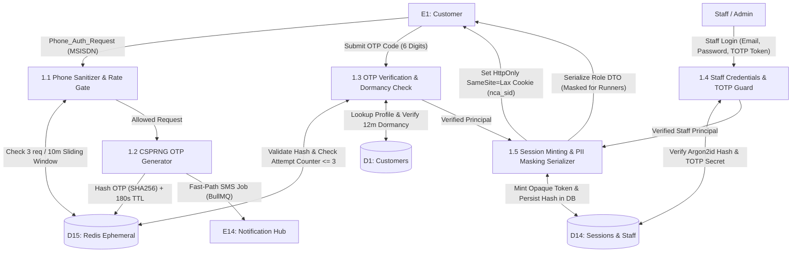

* **P1.1 Phone Sanitizer & Rate Gate:** Normalizes phone to `+8801XXXXXXXXX`. Checks Redis sliding window: max 3 requests per 10 minutes per phone, max 20 per hour per IP.
* **P1.2 CSPRNG OTP Generator:** Generates 6-digit numeric OTP via `crypto.randomInt(100000, 1000000)`. Stores salted SHA-256 hash in `D15: Redis` with 180s TTL. Enqueues an immediate, transient BullMQ job to `E14: Notification Hub` (never written to Postgres).
* **P1.3 OTP Verification & Dormancy Check:** Verifies code against Redis hash; increments failure counter (invalidated on 3 failures). Checks `D1: Customers.last_active_at`; if $> 12\text{ months}$, creates session with `ownership_unconfirmed = true`, hiding past orders until verified.
* **P1.4 Staff Credentials & TOTP Guard:** Verifies staff email/password using `argon2id` and validates 6-digit TOTP token against secret stored in `D14: Staff`.
* **P1.5 Session Minting & PII Masking Serializer:** Mints 32-byte cryptographically secure session token, stores SHA-256 hash in `D14: Sessions`. Emits role-specific Data Transfer Objects (DTOs) with customer shipping address masked for field runners.

---

### 5.2 Process 3.0: Cart Isolation & Inventory Reservation Engine
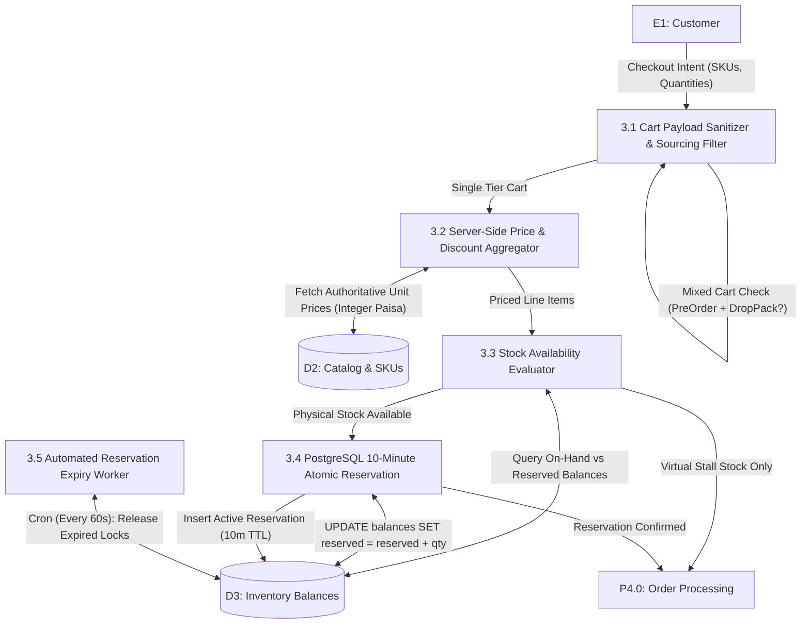

* **P3.1 Cart Payload Sanitizer & Sourcing Filter:** Ignores any client-supplied prices. Inspects line items; if the cart contains both `PRE_ORDER` and `DROP_PACK` items, terminates with `HTTP 422 Unprocessable Entity` (`ERR_MIXED_CART_DISALLOWED`).
* **P3.2 Server-Side Price & Discount Aggregator:** Reads base unit prices in integer paisa directly from `D2: Catalog`. Computes allocated coupon discounts on the server.
* **P3.3 Stock Availability Evaluator:** Checks `D3: Inventory Balances` across sellable locations (`godown`, `showroom`).
* **P3.4 PostgreSQL 10-Minute Atomic Reservation:** Runs conditional update:
  `UPDATE inventory_balances SET reserved = reserved + qty WHERE on_hand - reserved >= qty RETURNING on_hand, reserved;`
  Inserts row into `stock_reservations` with status `active` and expiry set to $T + 10\text{ minutes}$.
* **P3.5 Automated Reservation Expiry Worker:** Repeatable BullMQ worker running every 60 seconds; cancels expired reservations and decrements `inventory_balances.reserved` atomically.

---

### 5.3 Process 4.0: Order Processing & Pre-Order Lifecycle Engine
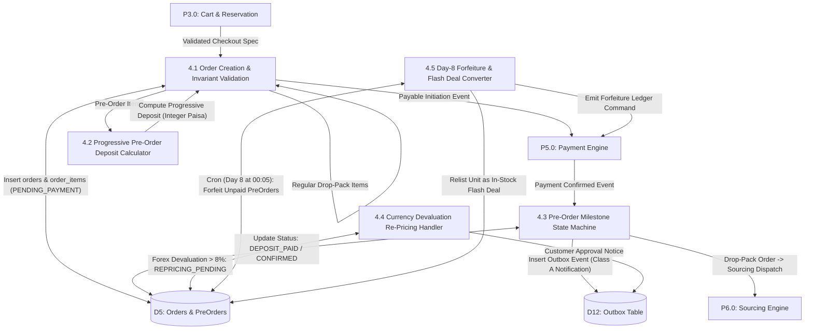

* **P4.1 Order Creation & Invariant Validation:** Generates human-readable order number (`ORD-YYYY-XXXXX`). Inserts records into `D5: Orders` with initial status `PENDING_PAYMENT` (or `DEPOSIT_PENDING`).
* **P4.2 Progressive Pre-Order Deposit Calculator:** Calculates advance deposit per unit in integer paisa without pricing cliffs:
  $$\text{Deposit}_{unit} = 20\% \times \min(P, ৳50{,}000) + 10\% \times \max(P - ৳50{,}000,\ 0)$$
  Rounds up to nearest ৳10 (1000 paisa).
* **P4.3 Pre-Order Milestone State Machine:** Controls state progression: `DEPOSIT_PAID` $\to$ `SOURCED_IN_TRANSIT` $\to$ `ARRIVED_GODOWN` $\to$ `QC_VERIFIED_BALANCE_DUE` $\to$ `BALANCE_PAID` / `BALANCE_COD_SCHEDULED` $\to$ `PACKED`.
* **P4.4 Currency Devaluation Re-Pricing Handler:** If USD/BDT currency devaluation exceeds 8%, pauses milestone to `REPRICING_PENDING`. Dispatches 48-hour approval ticket to customer; if rejected, issues 100% deposit refund.
* **P4.5 Day-8 Forfeiture & Flash Deal Converter:** Daily cron running at 00:05; marks orders where balance is unpaid 7 days post-QC as `DEPOSIT_FORFEITED_CANCELLED`. Moves unit to sellable physical stock as an "In-Stock Flash Deal" at landed cost.

---

### 5.4 Process 5.0: Payment Processing, COD Anti-Fraud & Reconciliation
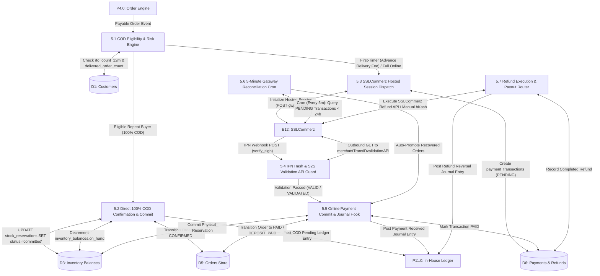

* **P5.1 COD Eligibility & Risk Engine:** Evaluates customer history:
  - `rto_count_12m >= 2` or `cod_blocked = true` $\implies$ COD disabled.
  - `rto_count_12m == 0` AND `delivered_order_count >= 1` $\implies$ 100% COD permitted.
  - Otherwise $\implies$ Advance delivery fee (৳80 Dhaka / ৳150 Nationwide) required online.
* **P5.2 Direct 100% COD Confirmation & Commit:** Sets order status to `CONFIRMED`. **Crucial Fix:** Commits physical reservation in `D3`, decrements `on_hand`, and posts expected COD receivable to ledger.
* **P5.3 SSLCommerz Hosted Session Dispatch:** Initializes session with SSLCommerz gateway; generates unique `tran_id`.
* **P5.4 IPN Hash & S2S Validation API Guard:** Validates MD5 signature with Store Password; immediately executes server-to-server call to Order Validation API before mutating database state.
* **P5.5 Online Payment Commit & Journal Hook:** Sets transaction to `PAID`, commits stock reservation, updates order status, and posts double-entry journal entry to `P11.0: Ledger`.
* **P5.6 5-Minute Gateway Reconciliation Cron:** Background worker querying transactions in `PENDING` state older than 10 minutes and newer than 24 hours. Automatically validates and settles dropped customer sessions.
* **P5.7 Refund Execution & Payout Router:** Routes refunds via SSLCommerz Refund API; for COD orders, routes to Finance manual bKash/Nagad disbursement.

---

### 5.5 Process 6.0: Local Sourcing, Runner PWA & Float Management
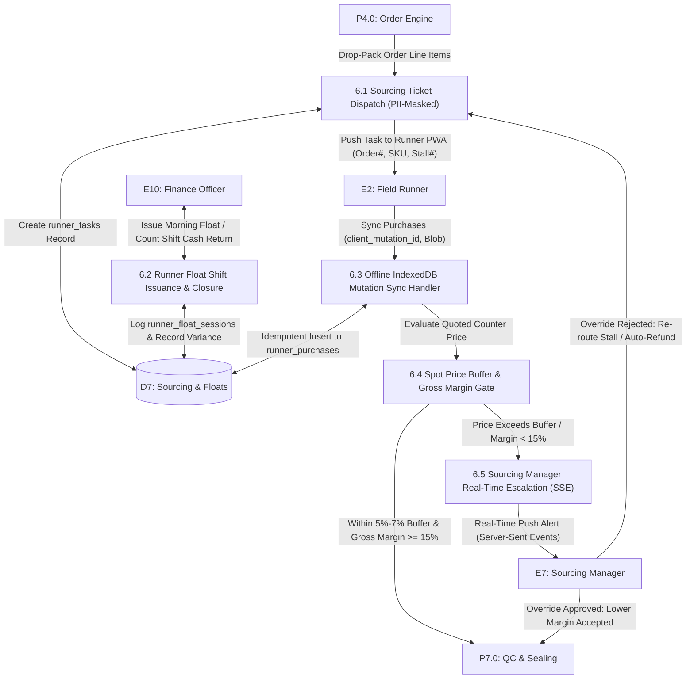

* **P6.1 Sourcing Ticket Dispatch (PII-Masked):** Generates digital pickup task for runner. Runner payload contains SKU, Wholesale Stall #, and Max Purchase Budget. Customer name, phone, and delivery address are completely masked.
* **P6.2 Runner Float Shift Issuance & Closure:** Finance issues cash float at shift start. At shift end, runner returns cash; system calculates variance: $\text{Variance} = \text{Issued} - \text{Purchases} - \text{Returned}$.
* **P6.3 Offline IndexedDB Mutation Sync Handler:** In basement stalls with zero 4G reception, runner stores purchases offline. When reconnected, PWA flushes batch to backend. Uses client-generated UUIDs (`client_mutation_id`) ensuring idempotent execution.
* **P6.4 Spot Price Buffer & Gross Margin Gate:** Evaluates price tolerance:
  $$\text{Quoted Price} \le \text{Base Cost} \times (1 + \text{spot\_buffer\_pct}) \quad \land \quad \frac{\text{Selling Price (ex VAT)} - \text{Quoted Price}}{\text{Selling Price (ex VAT)}} \ge 15\%$$
* **P6.5 Sourcing Manager Real-Time Escalation (SSE):** If spot price exceeds buffer, freezes task and emits real-time alert via Server-Sent Events (SSE). Re-alerts via WhatsApp/SMS after 5 minutes if unacknowledged.

---

### 5.6 Process 7.0 & 8.0: QC Testing, Base32 Seal Minting & Anti-Counterfeiting `/verify`
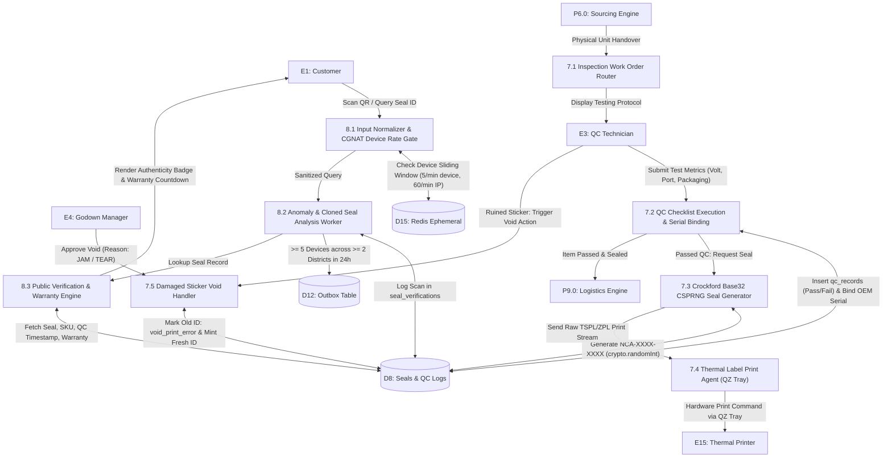

* **P7.1 Inspection Work Order Router:** Routes unit according to tier: non-invasive inspection for Authentic tier (factory seal preserved); full 3-point bench unboxing for Budget OEM; pre-dispatch testing for pre-orders.
* **P7.2 QC Checklist Execution & Serial Binding:** Captures technician checklist in `D8: QC Records`. Binds manufacturer serial number for Authentic items.
* **P7.3 Crockford Base32 CSPRNG Seal Generator:** Uses `crypto.randomInt(32)` to generate 8 unbiased characters from `0123456789ABCDEFGHJKMNPQRSTVWXYZ`. Formats as `NCA-XXXX-XXXX` ($1.1\times 10^{12}$ combinations).
* **P7.4 Thermal Label Print Agent (QZ Tray):** Sends raw TSPL/ZPL print streams to the thermal printer via signed QZ Tray certificate.
* **P7.5 Damaged Sticker Void Handler:** If a label tears or jams, logs void action with reason (`PRINTER_JAM`, `RIBBON_TEAR`). Godown Manager approves; status transitions to `void_print_error`; mintage of fresh ID logged in `seal_events`.
* **P8.1 Input Normalizer & CGNAT Device Rate Gate:** Cleans input (strips hyphens, maps `O→0`, `I/L→1`). Enforces rate limits using first-party anonymous device cookie `nca_did`: max 5 lookups/min per device, 60/min per IP.
* **P8.2 Anomaly & Cloned Seal Analysis Worker:** If a Seal ID is queried by $\ge 5$ distinct device IDs across $\ge 2$ distinct geographical districts within 24 hours, or if a `void_print_error` seal is scanned, enqueues immediate `CLONED_SEAL_SUSPECTED` alert.
* **P8.3 Public Verification & Warranty Engine:** Returns product name, tier badge, inspection timestamp, technician ID, and active warranty countdown.

---

### 5.7 Process 9.0: Logistics Orchestration, Multi-Courier & Showroom POS Counter
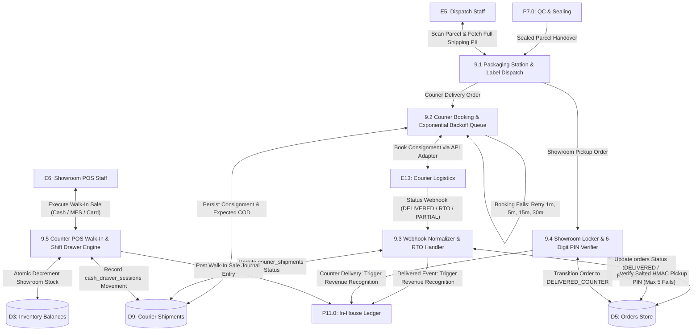

* **P9.1 Packaging Station & Label Dispatch:** Dispatch Staff at central godown accesses packaging interface to view unmasked shipping addresses and print shipping labels.
* **P9.2 Courier Booking & Exponential Backoff Queue:** Queues consignment creation in BullMQ for Steadfast, Pathao, or RedX. Retries on failure at 1m, 5m, 15m, 30m before escalating to manual dispatch console.
* **P9.3 Webhook Normalizer & RTO Handler:** Maps courier webhooks into unified internal order statuses (`DELIVERED`, `PARTIALLY_DELIVERED`, `RTO_IN_TRANSIT`, `RTO_RECEIVED`). On `DELIVERED`, calls `P11.0: Ledger` to recognize revenue.
* **P9.4 Showroom Locker & 6-Digit PIN Verifier:** Verifies counter pickup PIN using salted HMAC with pepper. Locks locker after 5 failed attempts. On handover, marks order `DELIVERED_COUNTER` and starts warranty.
* **P9.5 Counter POS Walk-In & Shift Drawer Engine:** Sells showroom physical stock directly. Decrements stock in `D3`, prints thermal receipt, records cash in `cash_drawer_sessions`, and posts walk-in sale journal entry.

---

### 5.8 Process 10.0: Warranty Adjudication, Distributor Liaison & Reverse RMA
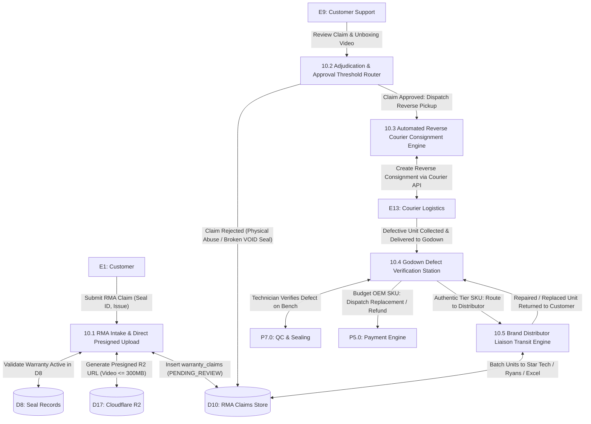

* **P10.1 RMA Intake & Direct Presigned Upload:** Customer submits claim with unboxing video ($\le 300\text{MB}$) via direct presigned multipart upload to Cloudflare R2 (`D17`). Validates that Seal ID has an active warranty countdown in `D8`.
* **P10.2 Adjudication & Approval Threshold Router:** Support agent reviews claim:
  - Exclusions: broken VOID seal, physical drop, liquid damage $\implies$ claim rejected.
  - DOA reported $\le 48\text{ hours}$ $\implies$ priority replacement fast-track.
* **P10.3 Automated Reverse Courier Consignment Engine:** Triggers reverse pickup via Steadfast/Pathao API; courier collects parcel from customer doorstep.
* **P10.4 Godown Defect Verification Station:** QC technician inspects parcel upon arrival; if defect confirmed, triggers automated replacement dispatch or full refund command to `P5.0: Payments`.
* **P10.5 Brand Distributor Liaison Transit Engine:** For Authentic products $> 30\text{ days}$ old, weekly liaison batches units to official distributor service centers (Star Tech, Ryans, Excel Technologies).

---

### 5.9 Process 11.0: In-House Double-Entry Ledger, Remittance & VAT 6.3
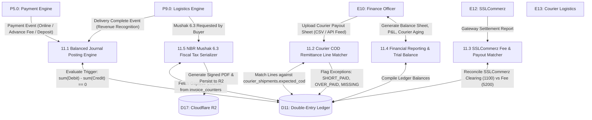

* **P11.1 Balanced Journal Posting Engine:** Enforces double-entry accounting. Database constraint trigger evaluates $\sum \text{Debit} - \sum \text{Credit} = 0$ on `journal_lines`. Entries are strictly append-only.
* **P11.2 Courier COD Remittance Line Matcher:** Matches courier payout lines against `expected_cod_bdt`. Automatically clears `1110: Courier COD Receivable` or flags discrepancies (`SHORT_PAID`, `OVER_PAID`, `MISSING` after 7 days).
* **P11.3 SSLCommerz Fee & Payout Matcher:** Reconciles gross debits in `1100: SSLCommerz Clearing` with net bank deposits, booking gateway commission to `5200: Gateway Fees`.
* **P11.4 Financial Reporting & Trial Balance:** Compiles real-time P&L, Balance Sheet, Courier Aging, and Customer Deposit Liabilities (`2010`).
* **P11.5 NBR Mushak 6.3 Fiscal Tax Serializer:** Generates gapless sequential tax serial numbers per fiscal year (July–June) using `invoice_counters`. Compiles PDF invoice and saves to Cloudflare R2 (`D17`).

---

## 6. Comprehensive Data Store Directory

The platform utilizes seventeen discrete data stores across PostgreSQL 16, Redis 7, Meilisearch, and Cloudflare R2:

| Store ID | Data Store Name | Physical Tables / Keys / Buckets | Storage Engine | Access Mode | Security, Immutability & Lifecycle Invariants |
| :--- | :--- | :--- | :--- | :--- | :--- |
| **D1** | Customers & Addresses | `users`, `customers`, `addresses` | PostgreSQL 16 | Read / Write | PII masked for field runners; rolling 12m RTO window; phone unique index. |
| **D2** | Product & SKU Catalog | `products`, `skus`, `categories`, `comparison_groups`, `spec_templates` | PostgreSQL 16 | Read / Write | Prices in integer paisa; publishing blocked if `btrc_cleared = false` for RF tech. |
| **D3** | Physical Inventory & Stock Locks | `inventory_balances`, `stock_reservations`, `stock_movements`, `locations` | PostgreSQL 16 | Read / Write | `CHECK (reserved >= 0 AND on_hand >= reserved)`. Movements are append-only. |
| **D4** | Supplier & Stall Stocks | `suppliers`, `supplier_stock` | PostgreSQL 16 | Read / Write | Stalls exceeding 3% defect rate automatically suspended from sourcing list. |
| **D5** | Orders, Pre-Orders & Invoices | `orders`, `order_items`, `pre_orders`, `order_status_history`, `invoices`, `coupons`, `store_credit_entries`, `invoice_counters` | PostgreSQL 16 | Read / Write | Separate carts enforced; order status transitions validated; gapless Mushak serials. |
| **D6** | Payment Transactions & Refunds | `payment_transactions`, `refunds`, `gateway_settlements`, `gateway_settlement_lines` | PostgreSQL 16 | Read / Write | Zero local card credential storage; idempotent transaction updates on `tran_id`. |
| **D7** | Sourcing Tasks & Floats | `runner_tasks`, `runner_purchases`, `runner_float_sessions`, `cash_drawer_sessions` | PostgreSQL 16 | Read / Write | `client_mutation_id` unique UUID ensures idempotent offline runner sync. |
| **D8** | Seal Records & QC Audits | `seal_records`, `qc_records`, `seal_verifications`, `seal_events` | PostgreSQL 16 | Read / Write | Seal states append-only in `seal_events`; 12-month retention on verify logs. |
| **D9** | Courier Shipments & Logistics | `courier_shipments`, `courier_settlements`, `courier_settlement_lines`, `courier_location_map` | PostgreSQL 16 | Read / Write | Normalized event mapping; expected COD stored at booking for reconciliation. |
| **D10** | RMA Claims & Media Records | `warranty_claims`, `media_assets` | PostgreSQL 16 | Read / Write | Media records reference R2 keys; claims require unboxing video attachment. |
| **D11** | Double-Entry Ledger & Accounts | `ledger_accounts`, `journal_entries`, `journal_lines` | PostgreSQL 16 | Append-Only | Constraint trigger enforces $\sum \text{Debit} = \sum \text{Credit}$; zero updates/deletions. |
| **D12** | Transactional Outbox & Logs | `outbox`, `notification_logs` | PostgreSQL 16 | Read / Write | Reliable event delivery via transactional outbox (`FOR UPDATE SKIP LOCKED`). |
| **D13** | Audit Trail Records | `audit_logs` | PostgreSQL 16 | Append-Only | Hash-chained rows (`prev_hash`); nightly export to R2 with Object Lock. |
| **D14** | Staff Accounts & Sessions | `staff`, `sessions` | PostgreSQL 16 | Read / Write | TOTP 2FA required for staff; 12-hour session expiry; remote revocation support. |
| **D15** | Redis Ephemeral Store | `otp:{phone}`, `inventory:lock:*`, `ratelimit:*`, `bullmq:*` | Redis 7 (AOF) | In-Memory TTL | Rebuildable data; rate-limiting sliding windows; 180s OTP expiration. |
| **D16** | Meilisearch Search Index | `products_index` | Meilisearch | Inverted Index | Typo-tolerant Bangla/English/Banglish search index; rebuildable from D2. |
| **D17** | Cloudflare R2 Object Storage | `ncamart-media`, `ncamart-invoices`, `ncamart-backups` | S3 API (R2) | Object Storage | Zero-egress fees; unboxing videos ($\le 300\text{MB}$); immutable PDF tax invoices. |

---

## 7. Data Flow Table

| Flow ID | Flow Label | Originating Process/Entity | Terminating Process/Store | Carried Payload Attributes | Protocol / Trigger Event |
| :--- | :--- | :--- | :--- | :--- | :--- |
| **DF-101** | `Phone_Auth_Intent` | E1: Customer | P1.0: Identity & Auth | `msisdn`, `device_id`, `client_ip` | HTTPS POST / Login intent |
| **DF-102** | `Fast_Path_OTP_Job` | P1.0: Identity & Auth | E14: Notification Hub | `phone`, `otp_code` (Transient BullMQ) | BullMQ Job / Class A instant SMS |
| **DF-103** | `Store_OTP_Hash` | P1.0: Identity & Auth | D15: Redis Ephemeral | `otp_hash`, `phone`, `ttl=180` | Redis SETEX / Cache hash |
| **DF-104** | `Set_Session_Cookie` | P1.0: Identity & Auth | E1: Customer | `nca_sid` (HttpOnly, SameSite=Lax) | HTTP 200 Header / Login success |
| **DF-105** | `Persist_Staff_Session`| P1.0: Identity & Auth | D14: Sessions Store | `session_token_hash`, `staff_id` | SQL INSERT / Staff login |
| **DF-106** | `Query_Catalog_Items` | E1: Customer | P2.0: Catalog Engine | `category`, `tier`, `query_str` | HTTPS GET / Storefront browsing |
| **DF-107** | `Fetch_Catalog_Specs` | P2.0: Catalog Engine | D2: Catalog Store | `sku_id`, `comparison_group_id` | SQL SELECT / Spec query |
| **DF-108** | `Sync_Search_Index` | P2.0: Catalog Engine | D16: Meilisearch Index | `product_id`, `title_bn`, `specs` | REST API / Catalog mutation |
| **DF-109** | `Submit_Cart_Intent` | E1: Customer | P3.0: Cart & Reservation | `items: [{sku_id, quantity}]` | HTTPS POST / Client checkout click |
| **DF-110** | `Fetch_Unit_Prices` | P3.0: Cart & Reservation | D2: Catalog Store | `sku_ids` | SQL SELECT / Server pricing |
| **DF-111** | `Acquire_Stock_Lock` | P3.0: Cart & Reservation | D3: Inventory Balances | `sku_id`, `location_id`, `qty` | SQL UPDATE ... RETURNING |
| **DF-112** | `Release_Stock_Lock` | P3.0: Cart & Reservation | D3: Inventory Balances | `reservation_id`, `status='released'`| Cron Worker / 10-minute expiry |
| **DF-113** | `Create_Order_Entity` | P3.0: Cart & Reservation | P4.0: Order Engine | `order_spec`, `reservation_ids` | Internal Service Call |
| **DF-114** | `Persist_Order_Record`| P4.0: Order Engine | D5: Orders Store | `orders`, `order_items`, `pre_orders`| SQL INSERT / Transaction |
| **DF-115** | `Init_Payable_Event` | P4.0: Order Engine | P5.0: Payment Engine | `order_id`, `payable_amount_paisa` | Internal Domain Event |
| **DF-116** | `Init_Gateway_Session`| P5.0: Payment Engine | E12: SSLCommerz Gateway | `tran_id`, `amount_paisa`, `urls` | HTTPS POST / Hosted checkout init |
| **DF-117** | `IPN_Webhook_Callback`| E12: SSLCommerz Gateway| P5.0: Payment Engine | `tran_id`, `val_id`, `verify_sign` | HTTPS POST / Asynchronous IPN |
| **DF-118** | `S2S_Validation_Req` | P5.0: Payment Engine | E12: SSLCommerz Gateway | `val_id`, `store_id`, `store_passwd` | HTTPS GET / Order validation API |
| **DF-119** | `Commit_Stock_Sold` | P5.0: Payment Engine | D3: Inventory Balances | `reservation_id`, `status='commit'`| SQL UPDATE / Decrement on_hand |
| **DF-120** | `Post_Payment_Journal`| P5.0: Payment Engine | P11.0: Ledger Engine | `debit: 1100, credit: 2000/2010` | DB Transaction / Payment hook |
| **DF-121** | `Sourcing_Task_Push` | P4.0: Order Engine | P6.0: Sourcing Engine | `task_id`, `sku_code`, `stall_no` | Outbox Event / Sourcing queue |
| **DF-122** | `PWA_Task_Ticket` | P6.0: Sourcing Engine | E2: Field Runner | `task_ticket` (PII Masked) | HTTPS GET / PWA Task sync |
| **DF-123** | `Offline_Sync_Batch` | E2: Field Runner | P6.0: Sourcing Engine | `client_mutation_id`, `receipt` | HTTPS POST / Idempotent sync |
| **DF-124** | `Push_SSE_Price_Alert`| P6.0: Sourcing Engine | E7: Sourcing Manager | `task_id`, `quoted_price`, `margin`| Server-Sent Events / Real-time |
| **DF-125** | `QC_Checklist_Submit` | E3: QC Technician | P7.0: QC & Sealing | `test_metrics`, `oem_serial` | HTTPS POST / Bench submission |
| **DF-126** | `Mint_Crockford_Seal` | P7.0: QC & Sealing | D8: Seal Records Store | `seal_id (Crockford)`, `tech_id` | CSPRNG Insert / Base32 Token |
| **DF-127** | `Raw_Print_Stream` | P7.0: QC & Sealing | E15: Thermal Printer | `TSPL_ZPL_Raw_Stream` | QZ Tray / Local print agent |
| **DF-128** | `Void_Sticker_Action`| E3: QC Tech / E4: GM | P7.0: QC & Sealing | `old_seal_id`, `void_reason` | HTTPS POST / Void approval |
| **DF-129** | `Verify_Portal_Query` | E1: Customer | P8.0: Verification Engine | `normalized_seal_id`, `device_id` | HTTPS GET / Seal lookup |
| **DF-130** | `Record_Verify_Event` | P8.0: Verification Engine | D8: Seal Verifications | `seal_id`, `device_id`, `ip`, `geo` | SQL INSERT / Scan history |
| **DF-131** | `Cloned_Seal_Incident`| P8.0: Verification Engine | D12: Outbox Table | `seal_id`, `alert='CLONED_SEAL'` | Outbox Event / Super Admin |
| **DF-132** | `Book_Courier_Parcel` | P9.0: Logistics Engine | E13: Courier Logistics | `consignee`, `zone`, `cod_paisa` | REST API / Queue worker |
| **DF-133** | `Courier_Webhook_Feed`| E13: Courier Logistics | P9.0: Logistics Engine | `consignment_no`, `event_type` | HTTPS POST / Normalized webhook |
| **DF-134** | `Verify_Pickup_PIN` | E6: Showroom POS Staff | P9.0: Logistics Engine | `order_id`, `pickup_pin_plain` | HTTPS POST / Counter pickup |
| **DF-135** | `Counter_POS_Sale` | E6: Showroom POS Staff | P9.0: Logistics Engine | `sku_id`, `paisa`, `payment_mode` | HTTPS POST / Walk-in sale |
| **DF-136** | `Revenue_Recognition` | P9.0: Logistics Engine | P11.0: Ledger Engine | `debit: 2000/1110, credit: 4000/2100`| DB Transaction / Delivery event |
| **DF-137** | `Submit_RMA_Claim` | E1: Customer | P10.0: RMA Engine | `seal_id`, `issue_description` | HTTPS POST / Claim intake |
| **DF-138** | `Presigned_Upload_Url`| P10.0: RMA Engine | D17: Cloudflare R2 | `asset_key`, `video_multipart_url` | S3 API / Direct browser upload |
| **DF-139** | `Dispatch_Rev_Courier`| P10.0: RMA Engine | E13: Courier Logistics | `return_consignment_spec` | Courier API / Reverse pickup |
| **DF-140** | `Match_COD_Payout` | E10: Finance Officer | P11.0: Ledger Engine | `payout_csv_rows`, `courier_id` | CSV Upload / Matching batch |
| **DF-141** | `Post_Mushak_Invoice` | P11.0: Ledger Engine | D17: Cloudflare R2 | `mushak_pdf_blob`, `serial_no` | S3 API / PDF persistence |
| **DF-142** | `Relay_Outbox_Events` | D12: Outbox Table | P12.0: Notification Hub | `outbox_id`, `payload`, `class` | Worker Poll (SKIP LOCKED) |
| **DF-143** | `Dispatch_Outbox_Msg` | P12.0: Notification Hub | E14: Notification Hub | `Class B/C: 08:00-22:00 Dhaka` | REST API / SMS & WhatsApp |

---

## 8. Process Table

| Process ID | Process Label | Subsystem / Layer | Inputs | Outputs | Primary Business Invariant / Logic |
| :--- | :--- | :--- | :--- | :--- | :--- |
| **P1.0** | Identity, Authentication & RBAC | Identity Module | Phone Auth Intent, OTP Code, Staff Credentials | Session Cookie, Role DTOs, Fast-Path SMS | Salted SHA-256 OTP hash in Redis (180s TTL); 12m dormant account re-verification; role serializers mask runner PII. |
| **P2.0** | Catalog, Pricing & Comparisons | Catalog Module | Product Drafts, Comparison Spec Sheets | Public Catalog JSON, Spec Diff Matrices | Enforce strict two-tier segmentation; zero replica tolerance; block wireless publish if `btrc_cleared = false`. |
| **P3.0** | Cart Isolation & Reservation | Inventory Module | Client Cart Intent, Authoritative Prices | 10-Minute Postgres Reservation, Error 422 | Reject mixed pre-order + drop-pack carts (`ERR_MIXED_CART_DISALLOWED`); server calculates all prices in integer paisa. |
| **P4.0** | Order & Pre-Order Lifecycle | Order Module | Validated Cart, Payment Confirmation | Order Records, Milestone Events, Forfeitures | Progressive deposit: $20\% \times \min(P, 50\text{k}) + 10\% \times \max(P-50\text{k}, 0)$; Day-8 forfeiture relists unit as Flash Deal. |
| **P5.0** | Payment, COD & Reconciliation | Payment Module | Payable Intent, SSLCommerz IPN, Courier Feed | Transaction Status, Ledger Invocations | MD5 callback validation + S2S Validation API call; 5-minute reconciliation cron; 100% COD commits reservation instantly. |
| **P6.0** | Sourcing, Runner PWA & Floats | Sourcing Module | Sourcing Task, Offline Sync Batch, Shift End | Purchase Records, Float Variance Reports | Allow counter price increase $\le 7\%$ if gross margin $\ge 15\%$; offline sync uses unique UUIDs; shift float variance sign-off. |
| **P7.0** | QC Testing & Thermal Sealing | Trust Module | QC Checklist, Technician Actions, Void Logs | Crockford Base32 Seal, QZ Tray TSPL Stream | CSPRNG Crockford Base32 generator ($32^8$ combinations); void label audit trail; preserve factory seal on Authentic tier. |
| **P8.0** | Direct Verification (`/verify`) | Trust Module | Normalized Seal ID, Device ID, Client IP | Authenticity Badge, Cloned Seal Alert | Rate limit: 5/min/device, 60/min/IP; flag clone anomaly if $\ge 5$ devices in $\ge 2$ districts or scanning a voided seal. |
| **P9.0** | Logistics & Showroom POS | Logistics Module | Delivery Dispatch, Pickup PIN, Walk-In Sale | Courier Consignment, Handover Slip, POS Sale| Exponential backoff courier retries (1m, 5m, 15m, 30m); salted HMAC locker PIN (max 5 attempts); POS drawer session tracking. |
| **P10.0** | Warranty & Reverse Logistics | Support Module | Customer Claim, Unboxing Video ($\le 300\text{MB}$) | Return Courier Consignment, Replacements | 7-day replacement for Budget OEM; manufacturer liaison for Authentic; direct R2 multipart video upload. |
| **P11.0** | In-House Ledger & Settlements | Finance Module | Operational Events, COD Payouts, Gateway CSV | Balanced Journal Entries, Mushak 6.3 PDF | Double-entry constraint trigger $\sum \text{Debit} = \sum \text{Credit}$; courier COD matching; gapless annual tax serials. |
| **P12.0** | Notifications & Audit Logger | Infrastructure | Outbox Events, Staff Operational Mutations | SMS/WhatsApp Dispatch, Chained Audit Log | Enforce BTRC quiet hours (22:00–08:00) for Class B/C; circuit breaker on SMS gateway; SHA-256 hash-chained audit log. |

---

## 9. Comprehensive Draw.io XML Specification

The XML snippet below is a fully compliant, production-grade **draw.io (mxGraphModel)** document. It includes all 15 External Entities, 12 Core Processes, 17 Data Stores, and major interconnecting flows with full visual styling.

Open via [app.diagrams.net](https://app.diagrams.net) $\to$ `File -> Open From -> Text / XML`.

```xml
<mxfile host="app.diagrams.net" modified="2026-10-20T12:00:00.000Z" agent="NCAMart Architecture Team" version="24.0.0" type="device">
  <diagram id="ncamart-dfd-production" name="NCAMart Level-1 Production DFD">
    <mxGraphModel dx="2200" dy="1400" grid="1" gridSize="10" guides="1" tooltips="1" connect="1" arrows="1" fold="1" page="1" pageScale="1" pageWidth="2339" pageHeight="1654" math="0" shadow="0">
      <root>
        <mxCell id="0" />
        <mxCell id="1" parent="0" />

        <!-- ================= EXTERNAL ENTITIES (Cyan / Blue Palette) ================= -->
        <mxCell id="E1" value="&lt;b&gt;E1: Customer&lt;/b&gt;&lt;br&gt;(Web / Mobile Storefront)" style="rounded=0;whiteSpace=wrap;html=1;fillColor=#e1f5fe;strokeColor=#0288d1;strokeWidth=2;" vertex="1" parent="1">
          <mxGeometry x="80" y="80" width="160" height="70" as="geometry" />
        </mxCell>

        <mxCell id="E2" value="&lt;b&gt;E2: Field Runner&lt;/b&gt;&lt;br&gt;(Offline Sourcing PWA)" style="rounded=0;whiteSpace=wrap;html=1;fillColor=#e1f5fe;strokeColor=#0288d1;strokeWidth=2;" vertex="1" parent="1">
          <mxGeometry x="80" y="780" width="160" height="70" as="geometry" />
        </mxCell>

        <mxCell id="E3" value="&lt;b&gt;E3: QC Technician&lt;/b&gt;&lt;br&gt;(Godown Testbench)" style="rounded=0;whiteSpace=wrap;html=1;fillColor=#e1f5fe;strokeColor=#0288d1;strokeWidth=2;" vertex="1" parent="1">
          <mxGeometry x="2060" y="780" width="160" height="70" as="geometry" />
        </mxCell>

        <mxCell id="E6" value="&lt;b&gt;E6: Showroom POS Staff&lt;/b&gt;&lt;br&gt;(Locker PIN &amp; Walk-In)" style="rounded=0;whiteSpace=wrap;html=1;fillColor=#e1f5fe;strokeColor=#0288d1;strokeWidth=2;" vertex="1" parent="1">
          <mxGeometry x="2060" y="440" width="160" height="70" as="geometry" />
        </mxCell>

        <mxCell id="E10" value="&lt;b&gt;E10: Finance Officer&lt;/b&gt;&lt;br&gt;(Ledger &amp; Settlements)" style="rounded=0;whiteSpace=wrap;html=1;fillColor=#e1f5fe;strokeColor=#0288d1;strokeWidth=2;" vertex="1" parent="1">
          <mxGeometry x="980" y="620" width="160" height="70" as="geometry" />
        </mxCell>

        <mxCell id="E12" value="&lt;b&gt;E12: SSLCommerz Gateway&lt;/b&gt;&lt;br&gt;(Hosted Pay, IPN, S2S)" style="rounded=0;whiteSpace=wrap;html=1;fillColor=#e1f5fe;strokeColor=#0288d1;strokeWidth=2;" vertex="1" parent="1">
          <mxGeometry x="80" y="440" width="160" height="70" as="geometry" />
        </mxCell>

        <mxCell id="E13" value="&lt;b&gt;E13: Courier Logistics&lt;/b&gt;&lt;br&gt;(Steadfast / Pathao / RedX)" style="rounded=0;whiteSpace=wrap;html=1;fillColor=#e1f5fe;strokeColor=#0288d1;strokeWidth=2;" vertex="1" parent="1">
          <mxGeometry x="2060" y="80" width="160" height="70" as="geometry" />
        </mxCell>

        <mxCell id="E14" value="&lt;b&gt;E14: Notification Hub&lt;/b&gt;&lt;br&gt;(SMS Aggregator &amp; WhatsApp)" style="rounded=0;whiteSpace=wrap;html=1;fillColor=#e1f5fe;strokeColor=#0288d1;strokeWidth=2;" vertex="1" parent="1">
          <mxGeometry x="380" y="1120" width="180" height="70" as="geometry" />
        </mxCell>

        <mxCell id="E15" value="&lt;b&gt;E15: Thermal Seal Printer&lt;/b&gt;&lt;br&gt;(TSPL/ZPL via QZ Tray)" style="rounded=0;whiteSpace=wrap;html=1;fillColor=#e1f5fe;strokeColor=#0288d1;strokeWidth=2;" vertex="1" parent="1">
          <mxGeometry x="1740" y="940" width="160" height="70" as="geometry" />
        </mxCell>

        <!-- ================= CORE PROCESSES (Rounded Purple Blocks) ================= -->
        <mxCell id="P1" value="&lt;b&gt;P1.0&lt;/b&gt;&lt;br&gt;Identity, Auth &amp;amp; RBAC" style="rounded=1;whiteSpace=wrap;html=1;fillColor=#ede7f6;strokeColor=#512da8;strokeWidth=2;arcSize=15;" vertex="1" parent="1">
          <mxGeometry x="380" y="80" width="180" height="70" as="geometry" />
        </mxCell>

        <mxCell id="P2" value="&lt;b&gt;P2.0&lt;/b&gt;&lt;br&gt;Catalog &amp;amp; Spec Engine" style="rounded=1;whiteSpace=wrap;html=1;fillColor=#ede7f6;strokeColor=#512da8;strokeWidth=2;arcSize=15;" vertex="1" parent="1">
          <mxGeometry x="680" y="80" width="180" height="70" as="geometry" />
        </mxCell>

        <mxCell id="P3" value="&lt;b&gt;P3.0&lt;/b&gt;&lt;br&gt;Cart &amp;amp; Reservation Engine" style="rounded=1;whiteSpace=wrap;html=1;fillColor=#ede7f6;strokeColor=#512da8;strokeWidth=2;arcSize=15;" vertex="1" parent="1">
          <mxGeometry x="980" y="80" width="180" height="70" as="geometry" />
        </mxCell>

        <mxCell id="P4" value="&lt;b&gt;P4.0&lt;/b&gt;&lt;br&gt;Order &amp;amp; Pre-Order Engine" style="rounded=1;whiteSpace=wrap;html=1;fillColor=#ede7f6;strokeColor=#512da8;strokeWidth=2;arcSize=15;" vertex="1" parent="1">
          <mxGeometry x="1280" y="80" width="180" height="70" as="geometry" />
        </mxCell>

        <mxCell id="P5" value="&lt;b&gt;P5.0&lt;/b&gt;&lt;br&gt;Payment &amp;amp; Reconciliation" style="rounded=1;whiteSpace=wrap;html=1;fillColor=#ede7f6;strokeColor=#512da8;strokeWidth=2;arcSize=15;" vertex="1" parent="1">
          <mxGeometry x="380" y="440" width="180" height="70" as="geometry" />
        </mxCell>

        <mxCell id="P6" value="&lt;b&gt;P6.0&lt;/b&gt;&lt;br&gt;Sourcing &amp;amp; Runner PWA" style="rounded=1;whiteSpace=wrap;html=1;fillColor=#ede7f6;strokeColor=#512da8;strokeWidth=2;arcSize=15;" vertex="1" parent="1">
          <mxGeometry x="380" y="780" width="180" height="70" as="geometry" />
        </mxCell>

        <mxCell id="P7" value="&lt;b&gt;P7.0&lt;/b&gt;&lt;br&gt;QC &amp;amp; Seal Minting Engine" style="rounded=1;whiteSpace=wrap;html=1;fillColor=#ede7f6;strokeColor=#512da8;strokeWidth=2;arcSize=15;" vertex="1" parent="1">
          <mxGeometry x="1720" y="780" width="180" height="70" as="geometry" />
        </mxCell>

        <mxCell id="P8" value="&lt;b&gt;P8.0&lt;/b&gt;&lt;br&gt;Direct /verify Portal" style="rounded=1;whiteSpace=wrap;html=1;fillColor=#ede7f6;strokeColor=#512da8;strokeWidth=2;arcSize=15;" vertex="1" parent="1">
          <mxGeometry x="1360" y="780" width="180" height="70" as="geometry" />
        </mxCell>

        <mxCell id="P9" value="&lt;b&gt;P9.0&lt;/b&gt;&lt;br&gt;Logistics &amp;amp; Showroom POS" style="rounded=1;whiteSpace=wrap;html=1;fillColor=#ede7f6;strokeColor=#512da8;strokeWidth=2;arcSize=15;" vertex="1" parent="1">
          <mxGeometry x="1720" y="440" width="180" height="70" as="geometry" />
        </mxCell>

        <mxCell id="P10" value="&lt;b&gt;P10.0&lt;/b&gt;&lt;br&gt;Warranty &amp;amp; Reverse RMA" style="rounded=1;whiteSpace=wrap;html=1;fillColor=#ede7f6;strokeColor=#512da8;strokeWidth=2;arcSize=15;" vertex="1" parent="1">
          <mxGeometry x="1720" y="80" width="180" height="70" as="geometry" />
        </mxCell>

        <mxCell id="P11" value="&lt;b&gt;P11.0&lt;/b&gt;&lt;br&gt;In-House Ledger Engine" style="rounded=1;whiteSpace=wrap;html=1;fillColor=#ede7f6;strokeColor=#512da8;strokeWidth=2;arcSize=15;" vertex="1" parent="1">
          <mxGeometry x="980" y="440" width="180" height="70" as="geometry" />
        </mxCell>

        <mxCell id="P12" value="&lt;b&gt;P12.0&lt;/b&gt;&lt;br&gt;Notification Hub &amp;amp; Audit" style="rounded=1;whiteSpace=wrap;html=1;fillColor=#ede7f6;strokeColor=#512da8;strokeWidth=2;arcSize=15;" vertex="1" parent="1">
          <mxGeometry x="680" y="1120" width="180" height="70" as="geometry" />
        </mxCell>

        <!-- ================= DATA STORES (Standard Open-Ended Gane & Sarson Style) ================= -->
        <mxCell id="D1" value="&lt;b&gt;D1: Customers &amp;amp; Addresses&lt;/b&gt;" style="shape=partialRectangle;left=0;right=0;html=1;whiteSpace=wrap;fillColor=#fff3e0;strokeColor=#e65100;strokeWidth=2;" vertex="1" parent="1">
          <mxGeometry x="380" y="240" width="180" height="40" as="geometry" />
        </mxCell>

        <mxCell id="D2" value="&lt;b&gt;D2: Product &amp;amp; SKU Catalog&lt;/b&gt;" style="shape=partialRectangle;left=0;right=0;html=1;whiteSpace=wrap;fillColor=#fff3e0;strokeColor=#e65100;strokeWidth=2;" vertex="1" parent="1">
          <mxGeometry x="680" y="240" width="180" height="40" as="geometry" />
        </mxCell>

        <mxCell id="D3" value="&lt;b&gt;D3: Inventory &amp;amp; Stock Locks&lt;/b&gt;" style="shape=partialRectangle;left=0;right=0;html=1;whiteSpace=wrap;fillColor=#fff3e0;strokeColor=#e65100;strokeWidth=2;" vertex="1" parent="1">
          <mxGeometry x="980" y="240" width="180" height="40" as="geometry" />
        </mxCell>

        <mxCell id="D5" value="&lt;b&gt;D5: Orders &amp;amp; Pre-Orders&lt;/b&gt;" style="shape=partialRectangle;left=0;right=0;html=1;whiteSpace=wrap;fillColor=#fff3e0;strokeColor=#e65100;strokeWidth=2;" vertex="1" parent="1">
          <mxGeometry x="1280" y="240" width="180" height="40" as="geometry" />
        </mxCell>

        <mxCell id="D6" value="&lt;b&gt;D6: Payment Transactions&lt;/b&gt;" style="shape=partialRectangle;left=0;right=0;html=1;whiteSpace=wrap;fillColor=#fff3e0;strokeColor=#e65100;strokeWidth=2;" vertex="1" parent="1">
          <mxGeometry x="380" y="600" width="180" height="40" as="geometry" />
        </mxCell>

        <mxCell id="D7" value="&lt;b&gt;D7: Sourcing &amp;amp; Runner Floats&lt;/b&gt;" style="shape=partialRectangle;left=0;right=0;html=1;whiteSpace=wrap;fillColor=#fff3e0;strokeColor=#e65100;strokeWidth=2;" vertex="1" parent="1">
          <mxGeometry x="380" y="940" width="180" height="40" as="geometry" />
        </mxCell>

        <mxCell id="D8" value="&lt;b&gt;D8: Seal Records &amp;amp; QC Logs&lt;/b&gt;" style="shape=partialRectangle;left=0;right=0;html=1;whiteSpace=wrap;fillColor=#fff3e0;strokeColor=#e65100;strokeWidth=2;" vertex="1" parent="1">
          <mxGeometry x="1460" y="940" width="200" height="40" as="geometry" />
        </mxCell>

        <mxCell id="D9" value="&lt;b&gt;D9: Courier Shipments&lt;/b&gt;" style="shape=partialRectangle;left=0;right=0;html=1;whiteSpace=wrap;fillColor=#fff3e0;strokeColor=#e65100;strokeWidth=2;" vertex="1" parent="1">
          <mxGeometry x="1720" y="240" width="180" height="40" as="geometry" />
        </mxCell>

        <mxCell id="D10" value="&lt;b&gt;D10: RMA Claims Store&lt;/b&gt;" style="shape=partialRectangle;left=0;right=0;html=1;whiteSpace=wrap;fillColor=#fff3e0;strokeColor=#e65100;strokeWidth=2;" vertex="1" parent="1">
          <mxGeometry x="1460" y="440" width="180" height="40" as="geometry" />
        </mxCell>

        <mxCell id="D11" value="&lt;b&gt;D11: Double-Entry Ledger&lt;/b&gt;" style="shape=partialRectangle;left=0;right=0;html=1;whiteSpace=wrap;fillColor=#fff3e0;strokeColor=#e65100;strokeWidth=2;" vertex="1" parent="1">
          <mxGeometry x="980" y="780" width="180" height="40" as="geometry" />
        </mxCell>

        <mxCell id="D12" value="&lt;b&gt;D12: Transactional Outbox&lt;/b&gt;" style="shape=partialRectangle;left=0;right=0;html=1;whiteSpace=wrap;fillColor=#fff3e0;strokeColor=#e65100;strokeWidth=2;" vertex="1" parent="1">
          <mxGeometry x="980" y="1120" width="180" height="40" as="geometry" />
        </mxCell>

        <mxCell id="D15" value="&lt;b&gt;D15: Redis Ephemeral Store&lt;/b&gt;" style="shape=partialRectangle;left=0;right=0;html=1;whiteSpace=wrap;fillColor=#fff3e0;strokeColor=#e65100;strokeWidth=2;" vertex="1" parent="1">
          <mxGeometry x="80" y="240" width="180" height="40" as="geometry" />
        </mxCell>

        <!-- ================= LABELED DATA FLOW CONNECTIONS ================= -->
        <mxCell id="f1" value="Phone_Auth_Intent" style="edgeStyle=orthogonalEdgeStyle;rounded=0;html=1;strokeColor=#37474f;strokeWidth=1.5;" edge="1" parent="1" source="E1" target="P1">
          <mxGeometry relative="1" as="geometry" />
        </mxCell>

        <mxCell id="f2" value="Cache OTP &amp;amp; Limits" style="edgeStyle=orthogonalEdgeStyle;rounded=0;html=1;strokeColor=#37474f;strokeWidth=1.5;" edge="1" parent="1" source="P1" target="D15">
          <mxGeometry relative="1" as="geometry">
            <Array as="points">
              <mxPoint x="430" y="200" />
              <mxPoint x="170" y="200" />
            </Array>
          </mxGeometry>
        </mxCell>

        <mxCell id="f3" value="Fast-Path SMS" style="edgeStyle=orthogonalEdgeStyle;rounded=0;html=1;strokeColor=#37474f;strokeWidth=1.5;" edge="1" parent="1" source="P1" target="E14">
          <mxGeometry relative="1" as="geometry">
            <Array as="points">
              <mxPoint x="340" y="115" />
              <mxPoint x="340" y="1155" />
            </Array>
          </mxGeometry>
        </mxCell>

        <mxCell id="f4" value="Browse &amp;amp; Compare" style="edgeStyle=orthogonalEdgeStyle;rounded=0;html=1;strokeColor=#37474f;strokeWidth=1.5;" edge="1" parent="1" source="E1" target="P2">
          <mxGeometry relative="1" as="geometry">
            <Array as="points">
              <mxPoint x="200" y="50" />
              <mxPoint x="770" y="50" />
            </Array>
          </mxGeometry>
        </mxCell>

        <mxCell id="f5" value="Read Specs" style="edgeStyle=orthogonalEdgeStyle;rounded=0;html=1;strokeColor=#37474f;strokeWidth=1.5;" edge="1" parent="1" source="P2" target="D2">
          <mxGeometry relative="1" as="geometry" />
        </mxCell>

        <mxCell id="f6" value="Add Items / Intent" style="edgeStyle=orthogonalEdgeStyle;rounded=0;html=1;strokeColor=#37474f;strokeWidth=1.5;" edge="1" parent="1" source="E1" target="P3">
          <mxGeometry relative="1" as="geometry">
            <Array as="points">
              <mxPoint x="220" y="30" />
              <mxPoint x="1070" y="30" />
            </Array>
          </mxGeometry>
        </mxCell>

        <mxCell id="f7" value="Fetch Server Prices" style="edgeStyle=orthogonalEdgeStyle;rounded=0;html=1;strokeColor=#37474f;strokeWidth=1.5;" edge="1" parent="1" source="P3" target="D2">
          <mxGeometry relative="1" as="geometry">
            <Array as="points">
              <mxPoint x="1010" y="190" />
              <mxPoint x="770" y="190" />
            </Array>
          </mxGeometry>
        </mxCell>

        <mxCell id="f8" value="Reserve Stock (10m)" style="edgeStyle=orthogonalEdgeStyle;rounded=0;html=1;strokeColor=#37474f;strokeWidth=1.5;" edge="1" parent="1" source="P3" target="D3">
          <mxGeometry relative="1" as="geometry" />
        </mxCell>

        <mxCell id="f9" value="Validated Spec" style="edgeStyle=orthogonalEdgeStyle;rounded=0;html=1;strokeColor=#37474f;strokeWidth=1.5;" edge="1" parent="1" source="P3" target="P4">
          <mxGeometry relative="1" as="geometry" />
        </mxCell>

        <mxCell id="f10" value="Persist Order Record" style="edgeStyle=orthogonalEdgeStyle;rounded=0;html=1;strokeColor=#37474f;strokeWidth=1.5;" edge="1" parent="1" source="P4" target="D5">
          <mxGeometry relative="1" as="geometry" />
        </mxCell>

        <mxCell id="f11" value="Trigger Payable" style="edgeStyle=orthogonalEdgeStyle;rounded=0;html=1;strokeColor=#37474f;strokeWidth=1.5;" edge="1" parent="1" source="P4" target="P5">
          <mxGeometry relative="1" as="geometry">
            <Array as="points">
              <mxPoint x="1350" y="380" />
              <mxPoint x="470" y="380" />
            </Array>
          </mxGeometry>
        </mxCell>

        <mxCell id="f12" value="Hosted Init &amp;amp; S2S Valid" style="edgeStyle=orthogonalEdgeStyle;rounded=0;html=1;strokeColor=#37474f;strokeWidth=1.5;" edge="1" parent="1" source="P5" target="E12">
          <mxGeometry relative="1" as="geometry" />
        </mxCell>

        <mxCell id="f13" value="Commit Stock Sold" style="edgeStyle=orthogonalEdgeStyle;rounded=0;html=1;strokeColor=#37474f;strokeWidth=1.5;" edge="1" parent="1" source="P5" target="D3">
          <mxGeometry relative="1" as="geometry">
            <Array as="points">
              <mxPoint x="530" y="330" />
              <mxPoint x="1070" y="330" />
            </Array>
          </mxGeometry>
        </mxCell>

        <mxCell id="f14" value="Post Payment Entry" style="edgeStyle=orthogonalEdgeStyle;rounded=0;html=1;strokeColor=#37474f;strokeWidth=1.5;" edge="1" parent="1" source="P5" target="P11">
          <mxGeometry relative="1" as="geometry" />
        </mxCell>

        <mxCell id="f15" value="Dispatch Task (PII Masked)" style="edgeStyle=orthogonalEdgeStyle;rounded=0;html=1;strokeColor=#37474f;strokeWidth=1.5;" edge="1" parent="1" source="P4" target="P6">
          <mxGeometry relative="1" as="geometry">
            <Array as="points">
              <mxPoint x="1390" y="730" />
              <mxPoint x="520" y="730" />
            </Array>
          </mxGeometry>
        </mxCell>

        <mxCell id="f16" value="Sync Purchases (UUID)" style="edgeStyle=orthogonalEdgeStyle;rounded=0;html=1;strokeColor=#37474f;strokeWidth=1.5;" edge="1" parent="1" source="E2" target="P6">
          <mxGeometry relative="1" as="geometry" />
        </mxCell>

        <mxCell id="f17" value="Physical Item to Godown" style="edgeStyle=orthogonalEdgeStyle;rounded=0;html=1;strokeColor=#37474f;strokeWidth=1.5;" edge="1" parent="1" source="P6" target="P7">
          <mxGeometry relative="1" as="geometry">
            <Array as="points">
              <mxPoint x="540" y="880" />
              <mxPoint x="1680" y="880" />
              <mxPoint x="1680" y="815" />
            </Array>
          </mxGeometry>
        </mxCell>

        <mxCell id="f18" value="Checklist Metrics" style="edgeStyle=orthogonalEdgeStyle;rounded=0;html=1;strokeColor=#37474f;strokeWidth=1.5;" edge="1" parent="1" source="E3" target="P7">
          <mxGeometry relative="1" as="geometry" />
        </mxCell>

        <mxCell id="f19" value="Mint Crockford Seal" style="edgeStyle=orthogonalEdgeStyle;rounded=0;html=1;strokeColor=#37474f;strokeWidth=1.5;" edge="1" parent="1" source="P7" target="D8">
          <mxGeometry relative="1" as="geometry">
            <Array as="points">
              <mxPoint x="1770" y="890" />
              <mxPoint x="1560" y="890" />
            </Array>
          </mxGeometry>
        </mxCell>

        <mxCell id="f20" value="Raw TSPL Stream" style="edgeStyle=orthogonalEdgeStyle;rounded=0;html=1;strokeColor=#37474f;strokeWidth=1.5;" edge="1" parent="1" source="P7" target="E15">
          <mxGeometry relative="1" as="geometry" />
        </mxCell>

        <mxCell id="f21" value="Query Seal / QR" style="edgeStyle=orthogonalEdgeStyle;rounded=0;html=1;strokeColor=#37474f;strokeWidth=1.5;" edge="1" parent="1" source="E1" target="P8">
          <mxGeometry relative="1" as="geometry">
            <Array as="points">
              <mxPoint x="100" y="1050" />
              <mxPoint x="1450" y="1050" />
            </Array>
          </mxGeometry>
        </mxCell>

        <mxCell id="f22" value="Fetch &amp;amp; Log Scan" style="edgeStyle=orthogonalEdgeStyle;rounded=0;html=1;strokeColor=#37474f;strokeWidth=1.5;" edge="1" parent="1" source="P8" target="D8">
          <mxGeometry relative="1" as="geometry" />
        </mxCell>

        <mxCell id="f23" value="Cleared Parcel" style="edgeStyle=orthogonalEdgeStyle;rounded=0;html=1;strokeColor=#37474f;strokeWidth=1.5;" edge="1" parent="1" source="P7" target="P9">
          <mxGeometry relative="1" as="geometry">
            <Array as="points">
              <mxPoint x="1810" y="660" />
              <mxPoint x="1810" y="510" />
            </Array>
          </mxGeometry>
        </mxCell>

        <mxCell id="f24" value="Book Consignment" style="edgeStyle=orthogonalEdgeStyle;rounded=0;html=1;strokeColor=#37474f;strokeWidth=1.5;" edge="1" parent="1" source="P9" target="E13">
          <mxGeometry relative="1" as="geometry">
            <Array as="points">
              <mxPoint x="1950" y="475" />
              <mxPoint x="1950" y="115" />
            </Array>
          </mxGeometry>
        </mxCell>

        <mxCell id="f25" value="Verify Locker PIN" style="edgeStyle=orthogonalEdgeStyle;rounded=0;html=1;strokeColor=#37474f;strokeWidth=1.5;" edge="1" parent="1" source="E6" target="P9">
          <mxGeometry relative="1" as="geometry" />
        </mxCell>

        <mxCell id="f26" value="Delivered Revenue" style="edgeStyle=orthogonalEdgeStyle;rounded=0;html=1;strokeColor=#37474f;strokeWidth=1.5;" edge="1" parent="1" source="P9" target="P11">
          <mxGeometry relative="1" as="geometry" />
        </mxCell>

        <mxCell id="f27" value="Submit RMA Claim" style="edgeStyle=orthogonalEdgeStyle;rounded=0;html=1;strokeColor=#37474f;strokeWidth=1.5;" edge="1" parent="1" source="E1" target="P10">
          <mxGeometry relative="1" as="geometry">
            <Array as="points">
              <mxPoint x="160" y="10" />
              <mxPoint x="1810" y="10" />
            </Array>
          </mxGeometry>
        </mxCell>

        <mxCell id="f28" value="Store RMA Record" style="edgeStyle=orthogonalEdgeStyle;rounded=0;html=1;strokeColor=#37474f;strokeWidth=1.5;" edge="1" parent="1" source="P10" target="D10">
          <mxGeometry relative="1" as="geometry">
            <Array as="points">
              <mxPoint x="1770" y="360" />
              <mxPoint x="1550" y="360" />
            </Array>
          </mxGeometry>
        </mxCell>

        <mxCell id="f29" value="Reverse Pickup" style="edgeStyle=orthogonalEdgeStyle;rounded=0;html=1;strokeColor=#37474f;strokeWidth=1.5;" edge="1" parent="1" source="P10" target="E13">
          <mxGeometry relative="1" as="geometry" />
        </mxCell>

        <mxCell id="f30" value="Persist Journal Lines" style="edgeStyle=orthogonalEdgeStyle;rounded=0;html=1;strokeColor=#37474f;strokeWidth=1.5;" edge="1" parent="1" source="P11" target="D11">
          <mxGeometry relative="1" as="geometry" />
        </mxCell>

        <mxCell id="f31" value="Reconcile Cash &amp;amp; COD" style="edgeStyle=orthogonalEdgeStyle;rounded=0;html=1;strokeColor=#37474f;strokeWidth=1.5;" edge="1" parent="1" source="E10" target="P11">
          <mxGeometry relative="1" as="geometry" />
        </mxCell>

        <mxCell id="f32" value="Relay Events" style="edgeStyle=orthogonalEdgeStyle;rounded=0;html=1;strokeColor=#37474f;strokeWidth=1.5;" edge="1" parent="1" source="D12" target="P12">
          <mxGeometry relative="1" as="geometry" />
        </mxCell>

        <mxCell id="f33" value="Dispatch Notification" style="edgeStyle=orthogonalEdgeStyle;rounded=0;html=1;strokeColor=#37474f;strokeWidth=1.5;" edge="1" parent="1" source="P12" target="E14">
          <mxGeometry relative="1" as="geometry" />
        </mxCell>

      </root>
    </mxGraphModel>
  </diagram>
</mxfile>
```

---

## 10. Architectural DFD Validation & Verification Report

### 10.1 Formal DFD Structural Rules Audit

| Rule ID | Formal Rule Description | Verification Method & Traceability Evidence | Audit Finding |
| :--- | :--- | :--- | :---: |
| **VR-01** | **No Black Holes:** Every process must produce output data flows. | Inspected processes $P1.0$ through $P12.0$.<br>• $P1.0 \to$ `DF-102` (Fast-Path SMS) & `DF-104` (Session Cookie).<br>• $P2.0 \to$ `DF-106` (Public Catalog JSON) & `DF-108` (Search Sync).<br>• $P12.0 \to$ `DF-143` (Dispatch Outbox Msg to E14).<br>Zero sink processes found. | **PASSED** |
| **VR-02** | **No Miracles:** Every process must receive inputs necessary to produce outputs. | Inspected data ingress on all 12 core processes.<br>• $P1.0$ receives `DF-101` from $E1$.<br>• $P2.0$ receives `DF-107` from $D2$ and draft submissions from $E8$.<br>• $P12.0$ receives `DF-142` from $D12$ (Outbox).<br>Zero miracle processes found. | **PASSED** |
| **VR-03** | **No Gray Holes:** Outputs must be logically derivable from inputs. | Evaluated calculation routines:<br>• **P4.2 (Progressive Deposit):** Calculated strictly from unit price and quantity passed from $P3.0$. Output matches PRD §3.3.2 formula.<br>• **P11.1 (Double-Entry Ledger):** Debits and credits are formulated strictly from confirmed transaction paisa amounts. Database trigger enforces $\sum \text{Debit} = \sum \text{Credit}$. | **PASSED** |
| **VR-04** | **Zero Entity-to-Entity Direct Flows:** Entities must communicate through processes. | Checked all flows in Section 3, 4, 5, and 9.<br>• Previous violations removed ($E2 \to E12$ and $E1 \to E4$).<br>• Showroom PIN handover mediated by POS Staff interface ($E6 \to P9.0$ via `DF-134`).<br>• Runner purchases mediated by $P6.0$ via `DF-123`. | **PASSED** |
| **VR-05** | **Zero Entity-to-Store Direct Flows:** Persistence must mediate through processes. | Checked all flows in Section 6 and 7.<br>Zero direct flows between External Entities ($E1 - E15$) and Data Stores ($D1 - D17$). Every read/write is guarded by an authorized process. | **PASSED** |
| **VR-06** | **Zero Store-to-Store Direct Flows:** Stores cannot autonomously transfer data. | Inspected data store relationships.<br>Zero autonomous store-to-store flows. All cross-store operations (e.g., $D12 \to D13$) are executed by background worker processes ($P12.0$). | **PASSED** |
| **VR-07** | **Conservation of Data (Level Balancing):** Flows across levels must balance. | Every external flow entering/exiting Level 0 ($F0.01 - F0.20$) maps to a corresponding flow in Level 1 ($DF-101 - DF-143$) and matches Level 2 granular breakdowns. | **PASSED** |

---

### 10.2 Foundation Document Consistency Cross-Check

1. **Alignment with [PRD.md](./PRD.md) (v1.4):**
   - **Progressive Pre-Order Deposit:** Validated in `P4.2` and `DS-03`. Enforces $20\% \times \min(P, 50\text{k}) + 10\% \times \max(P-50\text{k}, 0)$ with ৳10 ceiling rounding. Eliminates price-cliff anomalies.
   - **Cart Isolation:** Validated in `P3.1`. Enforces server-side rejection of mixed pre-order and drop-and-pack carts (`ERR_MIXED_CART_DISALLOWED`).
   - **Crockford Base32 Seals:** Validated in `P7.3`. Employs CSPRNG (`crypto.randomInt(32)`) drawing 8 symbols from `0123456789ABCDEFGHJKMNPQRSTVWXYZ`.
   - **BTRC Quiet Hours:** Validated in `P12.0` and `DF-143`. Defers Class B and Class C notifications between 22:00 and 08:00 Asia/Dhaka.
   - **Role Matrix & PII Masking:** Validated in `P1.5` and `P6.1`. Field runner DTOs omit customer shipping addresses and phone numbers.

2. **Alignment with [architechture.md](./architechture.md) (v1.1):**
   - **Zero Client-Side Financial Trust:** Validated in `P3.1` and `P3.2`. Client sends only SKU and quantity. Prices are read exclusively from `D2: Catalog`.
   - **PostgreSQL 10-Minute Reservations:** Validated in `P3.4` and `D3`. Atomic conditional updates on `inventory_balances` with 60-second automated cleanup worker (`P3.5`).
   - **100% COD Reservation Commit:** Validated in `P5.2`. Commits physical reservation and decrements `on_hand` at checkout confirmation, preventing stock collisions.
   - **OTP Security Architecture:** Validated in `P1.2` and `DF-102`. OTPs are hashed in Redis with 180s TTL and dispatched via BullMQ directly to the SMS gateway (never written to Postgres outbox).
   - **CGNAT-Safe Anomaly Detection:** Validated in `P8.2`. Evaluates lookups from $\ge 5$ distinct device IDs across $\ge 2$ distinct districts.
   - **Double-Entry Financial Integrity:** Validated in `P11.1` and `D11`. Balanced entry enforcement with append-only journal tables.
