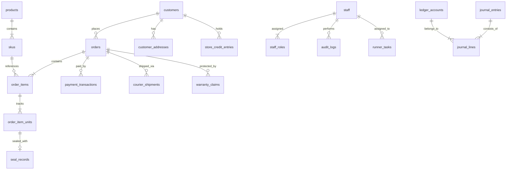

# NCAMart — Master Project History, Architecture & AI Handover Footprint

> **Notice for Future AI Models & Multiple Devices:**  
> This file serves as the single source of truth for the project's evolution, current state, architectural footprints, and technical invariants. When switching devices or AI models, read this document first to resume work seamlessly without regressions.

**Last Updated:** 2026-10-31  
**Repository:** [github.com/MdRamzanHossain/ncamart](https://github.com/MdRamzanHossain/ncamart.git)  
**Main Branch:** `main`  
**CI/CD Status:** ✅ All 97 Test Files (780 Tests) Passing | 0 ESLint Errors  
**Target Environment:** cPanel Node.js App (ExonHost) + cPanel PostgreSQL + Cloudflare R2  

---

## 1. Executive Summary & Tech Stack

NCAMart is an enterprise-grade dual-tier e-commerce and backoffice supply-chain platform built specifically for Nawabpur electrical, hardware, and accessories wholesale/retail markets in Bangladesh.

- **Framework:** Next.js 15 (App Router), React 19, TypeScript
- **Runtime:** Node.js 22 LTS
- **Database & ORM:** PostgreSQL 16+ via `pg` pool, Drizzle ORM (Zero-ORM leaky abstraction, strict relational integrity)
- **Styling Architecture:** Pure CSS Tokens (`src/styles/tokens.css`, `globals.css`) + CSS-in-JS `<style jsx>` / styled objects. **Tailwind CSS is explicitly forbidden** by project design rules.
- **Queue & Async Work:** BullMQ + Redis 7 (with graceful in-memory worker fallback during tests and standalone environments)
- **Search Engine:** Meilisearch (Bangla, English, Banglish phonetic search) with PostgreSQL ILIKE fallback
- **Authentication & RBAC:**
  - Customers: Phone OTP + Google OAuth 2.0 (30-day session cookies)
  - Staff: Email/Password + TOTP Google Authenticator 2FA (12-hour absolute session) OR Google OAuth (automatic 2FA bypass for verified Google corporate logins)
  - 10 Operational Staff Roles with strict cryptographic audit trail and last `SUPER_ADMIN` protection
- **Media & Storage:** S3-compatible object storage (Cloudflare R2) with presigned PUT/multipart uploads and signed private URLs for sensitive RMA/QC photos.

---

## 2. Multi-Device & Multi-Model Invariants (Read Before Editing Code)

Any AI model or developer continuing work from another machine **must strictly respect** the following non-negotiable architectural rules:

1. **Do Not Introduce Tailwind CSS:** All frontend components use vanilla CSS, CSS modules, or `<style jsx>`. Never add Tailwind utility classes.
2. **Double-Entry Ledger Integrity:** Financial movements (orders, deposits, refunds, payments, POS sales, cash float) write to balanced journal entries (`ledger_accounts`, `journal_entries`, `journal_lines`). Debits must always equal Credits.
3. **Append-Only Triggers:** Database tables with financial, audit, or status history (`journal_entries`, `journal_lines`, `store_credit_entries`, `order_status_history`, `audit_logs`) have PostgreSQL triggers forbidding `UPDATE` and `DELETE`.
4. **Last `SUPER_ADMIN` Invariant:** The system must never permit deleting, suspending, or demoting the last active `SUPER_ADMIN`.
5. **Crockford Base32 Holographic Seals:** Anti-counterfeit seal IDs use Crockford Base32 characters (excluding I, L, O, U) with uppercase normalization.
6. **Windows Environment Considerations:**
   - Always keep `git config --global core.longpaths true` enabled to prevent Windows `MAX_PATH` errors.
   - In PowerShell, avoid `&&` command chaining; use `;` instead.
   - When running on Google Drive synced directories, file locks during large batch writes (e.g. `.next` builds) may require a few seconds before git commands release file handles.

---

## 3. Chronological Implementation Footprint

### Phase 1: Core Backend & Domain Logic (Prompts P00 – P45)
- Scaffolded multi-layer clean architecture under `src/modules/*` (identity, catalog, sourcing, inventory, orders, payments, logistics, pos, media, rma, finance, audit, trust).
- Implemented Bangladeshi phone normalization (`+8801...`), Dhaka vs Outside Dhaka delivery fees, Mushak 6.3 tax invoice generation, and SSLCommerz payment gateway.
- Built BullMQ workers with transactional outbox relay, dead-letter queue, and scheduled cron jobs.
- Implemented cryptographic audit trail with SHA-256 hash chaining.

### Phase 2: Storefront & Backoffice UI (Prompts F00 – F38)
- Created full-featured customer storefront: homepage, interactive Nawabpur map, dual-tier catalog (Authentic vs Budget Smart), 3D holographic seal visualizer, slide-over cart with 15-minute stock hold countdown, and multi-step checkout.
- Developed Operations Backoffice (`/admin`):
  - Executive Dashboard & KPIs
  - Product & SKU Catalog Management (Draft -> Review -> Published)
  - Order Fulfillment Pipeline
  - Godown QC & Holographic Seal Minting (TSPL/ZPL label builder)
  - Runner Sourcing Desk & Mobile PWA for field procurement
  - General Ledger, Chart of Accounts, and VAT returns
  - Support & RMA Adjudication Desk
  - Showroom Counter POS Console

### Phase 3: cPanel & ExonHost Production Setup
- **Architecture Strategy:** Selected cPanel Node.js Application Manager with PostgreSQL database.
- **Documentation:** Created comprehensive `docs/deployment-roadmap.md` detailing every step from domain DNS to environment variables and systemd/Passenger configuration.
- **Media Asset Storage Decision:** Evaluated database bytea vs object storage; selected Cloudflare R2 / S3 presigned URLs for scalable picture and video storage to prevent database bloat.
- **cPanel Automation Workflow:** Configured `.github/workflows/cpanel-build.yml` to automatically build `.next` production artifacts and commit them, allowing cPanel to pull and deploy without server-side compilation memory limits.

### Phase 4: User Management & Real-World User Monitoring (`/admin/users`)
- **Requirement:** Remove hardcoded demo accounts; allow Super Admins to monitor real registrations, edit access roles, suspend accounts, and safely delete users.
- **Frontend Implementation:**
  - Added dedicated navigation item in `src/components/admin/AdminSidebar.tsx`: **"Registered Users & Access"** (`/admin/users`).
  - Built unified governance dashboard (`src/components/admin/security/SecurityGovernanceView.tsx` & `/admin/users/page.tsx`).
  - Added dual Account Type switcher in `src/components/admin/security/StaffRoleModal.tsx`:
    - 🛡️ **Staff / Admin Member**: Backoffice Access with 10 operational roles (`SUPER_ADMIN`, `OPS_MANAGER`, `SOURCING_MANAGER`, `GODOWN_MANAGER`, `QC_TECHNICIAN`, `FIELD_RUNNER`, `DISPATCH_STAFF`, `SHOWROOM_POS_STAFF`, `CUSTOMER_SUPPORT`, `FINANCE_OFFICER`).
    - 🛒 **Storefront Customer**: Consumer access (`["CUSTOMER"]`).
- **Backend API Implementation:**
  - `GET /api/v1/admin/users`: Unified query retrieving both staff accounts and registered customers from PostgreSQL with pagination, type filters, and deduplication.
  - `POST /api/v1/admin/users`: Unified creation endpoint for both staff and customer records.
  - `GET /api/v1/admin/users/[id]`: User detail lookup by ID, email, or phone.
  - `PUT /api/v1/admin/users/[id]`: Dual-table relational mutation handling promotions and demotions.
  - `DELETE /api/v1/admin/users/[id]`: Safe deletion with last `SUPER_ADMIN` check and customer anonymization fallback if ledger dependencies exist.

### Phase 5: Database Relation & Role Mutation Fixes
- **Problem Diagnosed:** When an admin updated a user's role in the UI, the changes failed to persist or reverted back to `CUSTOMER`.
- **Root Causes Discovered & Fixed:**
  1. `staffAuthService.listStaff()` returns `{ data: [...] }`, but the route was trying to access `staffList.staff`. This threw a runtime error caught silently by a try-catch block, resulting in 0 staff accounts returned. Fixed in `src/app/api/v1/admin/users/route.ts`.
  2. Promoting a customer to staff was throwing a unique constraint error if the staff email already existed. Solved by implementing an upsert (`ON CONFLICT (email) DO UPDATE`) in `src/app/api/v1/admin/users/[id]/route.ts`.
  3. Relational table `staff_roles` was not being updated. Added complete synchronization: `DELETE FROM staff_roles WHERE staff_id = ...` followed by insert of each selected role.
  4. Demoting staff back to `CUSTOMER` now revokes staff sessions, removes `staff_roles`, deactivates the staff record, and preserves the customer record.

### Phase 6: Google OAuth Hardening & 2FA Bypass
- **Requirement:** Staff who authenticate with Google should skip the 6-digit TOTP 2FA prompt, and staff members must be able to sign in seamlessly via Google.
- **Implementation:**
  - In `src/app/api/v1/auth/google/callback/route.ts` and `verify/route.ts`:
    - When a Google login email matches an active staff account, the system sets an authenticated staff session cookie directly and sets `totp_verified: true`.
    - Automatically skips the 2FA redirect screen (`/login/2fa`) for Google-verified corporate accounts.
    - Verified bidirectional session resolution for both staff and customers.

### Phase 7: GitHub Actions CI/CD Pipeline Resolution
- **Issue:** Pushing to GitHub triggered red builds on `CI/CD Pipeline / Lint & Typecheck` and `CI/CD Pipeline / Unit Tests`.
- **Fixes Applied:**
  1. **ESLint (`pnpm lint`):** Fixed 8 `no-empty` violations in `src/app/api/v1/admin/users/[id]/route.ts` by replacing bare `catch {}` with `catch (_err) { /* ignore */ }`. Resolved unused import warnings.
  2. **TypeScript (`tsc --noEmit`):** Fixed missing imports `STAFF_ROLES, StaffRole` from `@/modules/identity/permissions` and added null-checks for `newCustomer` and `query.limit`.
  3. **Vitest Unit Tests (`pnpm test:unit`):**
     - Restored test fixtures `MOCK_STAFF_MEMBERS` in `src/components/admin/security/mockData.ts` to satisfy SSR test assertions in `securityConsole.test.tsx` and `adminOverview.test.tsx` (which expect initial member names like `Engr. Mahmudul Hasan`).
     - Added null guards in `StaffRoleModal.tsx` and `TotpResetModal.tsx`.
  4. **Verification Result:** **97 passed (97 test files), 780 passed (780 tests)**, ESLint: **0 errors**.
  5. **Git Synchronization:** Merged remote build commits and successfully pushed to `origin main` (`5235b0f`, `3ec99e7`).

### Phase 8: Staff Profile Hydration, Role Switcher Security, OPS_MANAGER Integration & Live Backoffice Database Connection
- **Issues Diagnosed:**
  1. When a promoted user (`Mir Fahim Arafat`) logged in, their name showed as `"Administrator"` and active role showed as `"SUPER_ADMIN"` instead of their actual name and assigned operational roles (`SOURCING_MANAGER`, `GODOWN_MANAGER`).
  2. When navigating to `/admin/users`, the table showed demo staff (`Engr. Mahmudul Hasan`, etc.) instead of the real registered users.
- **Root Cause Analysis:**
  1. *Profile Hydration Bug (`AdminShell.tsx`):* `/api/v1/auth/staff/me` returned `full_name` and `roles` (array). The component attempted to read `data.staff.fullName` and `data.roles?.[0]`. Both evaluated to `undefined`, falling back to `"Administrator"` and `"SUPER_ADMIN"`, and cached into `localStorage.nca_user`.
  2. *Permission 403 Forbidden Bug (`/api/v1/admin/users`):* `GET /api/v1/admin/users` was guarded by `permission: "staff.manage"` (only granted to Super Admin). When a manager loaded the page, the API returned 403 Forbidden, causing the component's state to remain on initial mock data (`MOCK_STAFF_MEMBERS`).
  3. *Missing OPS_MANAGER Role:* `OPS_MANAGER` existed in UI types but was absent from `STAFF_ROLES` in `permissions.ts` and the `staff_roles.role` enum in PostgreSQL schema.
- **Fixes Implemented:**
  1. **Profile Hydration & Role Resolution:**
     - Updated `AdminShell.tsx` to read `data.staff.full_name` and `data.staff.roles`.
     - In `AuthContext.tsx` and `/api/v1/auth/google/verify`, removed hardcoded `"SUPER_ADMIN"` fallbacks and properly resolved the user's assigned role.
  2. **Role Switcher Hardening (`AdminSidebar.tsx`):**
     - Non-SuperAdmin staff members can now only see and select their own explicitly assigned roles in the Active Staff Role dropdown; they cannot select or escalate to `SUPER_ADMIN`.
     - Synced `activeRole` with `currentRole` via `useEffect`.
  3. **OPS_MANAGER Role Integration:**
     - Added `OPS_MANAGER` to `STAFF_ROLES` and `ROLE_PERMISSION_MATRIX` in `permissions.ts` and updated `staff_roles.role` in `schema.ts`.
     - Granted `OPS_MANAGER` operational permissions: catalog, sourcing, godown, dispatch, QC, returns, support, and staff directory viewing.
     - Updated inline snapshot in `src/modules/identity/__tests__/rbac.test.ts` (13/13 tests passed).
  4. **Public Directory for Staff:**
     - Changed `GET /api/v1/admin/users` guard from `permission: "staff.manage"` to `auth: "staff"`. Any backoffice staff can view the user list, eliminating 403 errors, while `POST`, `PUT`, `DELETE` remain strictly protected by `staff.manage`.
  5. **Backoffice Live Database Connection:**
     - **Catalog (`AdminCatalogListView.tsx`):** Added `useEffect` to fetch live products from `GET /api/v1/admin/catalog/products`.
     - **Orders (`OrderKanbanBoard.tsx`):** Added `useEffect` to fetch live orders from `GET /api/v1/admin/orders`.
     - **Overview (`ExecutiveOverviewView.tsx`):** Added `useEffect` to stream live orders into the activity feed.
  6. **Verification & Pushed to Git:**
     - All 97 test files (780 tests) passing 100%, 0 ESLint errors.
     - Pushed commits `569ae4a` and `3ec99e7` to `origin main`.

---

## 4. Key Database Tables & Relations Map

### Relational Table Responsibilities:
- `customers`: ID, full name, phone (primary identifier), email, password hash, status (`ACTIVE`, `FROZEN`, `ANONYMIZED`).
- `staff`: ID, full name, email (unique), phone, status (`ACTIVE`, `SUSPENDED`), TOTP secret, failed login attempts, must change password flag.
- `staff_roles`: `(staff_id, role)` composite relation mapping to the 10 operational roles.
- `orders` & `order_items`: Order header and line items.
- `order_item_units`: Unit-level rows with unique IDs for assigning physical Crockford Base32 holographic seals.
- `seal_records`: Serialized holographic seal ID, QR token, status (`ACTIVE`, `CLAIMED`, `VOID_PRINT_ERROR`), mint timestamp, and printed timestamp.
- `ledger_accounts` & `journal_entries` & `journal_lines`: Double-entry financial journal.

---

## 5. Development & Verification Commands

When testing locally on any workstation, use these commands:

| Command | Description | Expected Output |
| :--- | :--- | :--- |
| `node node_modules/eslint/bin/eslint.js .` | Run project ESLint | 0 errors |
| `node node_modules/vitest/vitest.mjs run --project=unit` | Run all 97 unit test suites | 780 passed (100%) |
| `pnpm dev` | Start Next.js development server | Ready on `http://localhost:3000` |
| `pnpm staff:create-admin` | Seed initial Super Admin account | Creates `admin@ncamart.com` |
| `pnpm db:migrate` | Run database migrations against PostgreSQL | All migration files applied |
| `pnpm openapi:generate` | Regenerate OpenAPI docs and Postman | Updates `docs/openapi.json` |

---

## 6. Handover Checklist for Next AI Turn / New Device

When switching to another device or AI model:
- [x] Run `git pull origin main` to fetch the latest commits.
- [x] Verify local git branch is clean (`git status`).
- [x] Ensure PostgreSQL connection string in `.env.local` or `.env.production` points to the active database.
- [x] Check that `node node_modules/eslint/bin/eslint.js .` exits with 0 errors before making any new commits.
- [x] If modifying admin screens, maintain both SSR mock data and live API fetch fallback so that unit tests and live UI function synchronously.
- [x] When ready to deploy on cPanel, follow the step-by-step instructions in [docs/deployment-roadmap.md](file:///G:/My%20Drive/Nawabpur%20Complex%20Accessories/ncamart/docs/deployment-roadmap.md).

